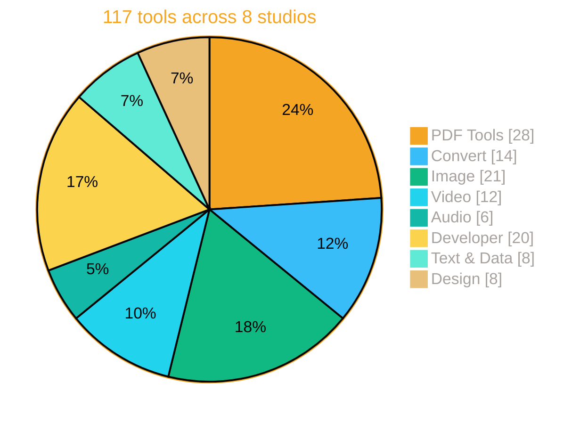
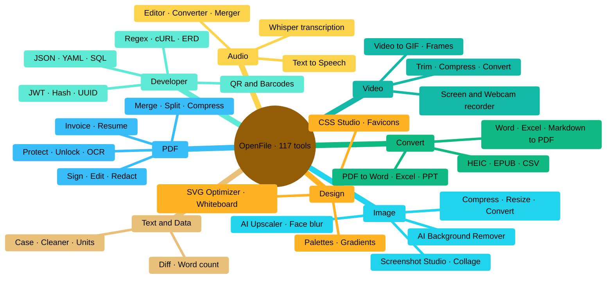
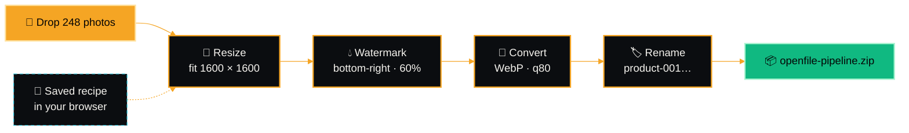
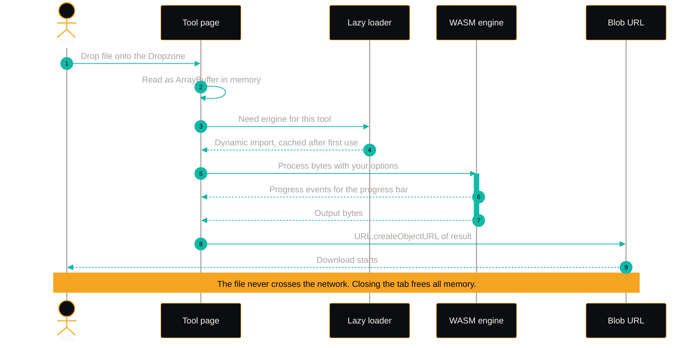
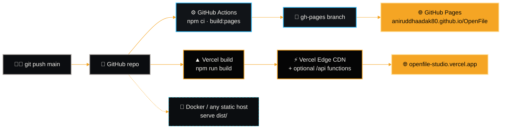
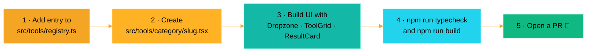
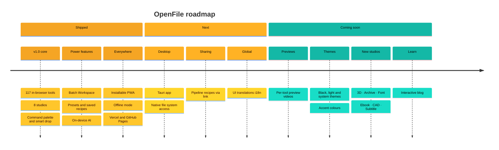

<!-- OpenFile README: animated artwork lives in docs/assets/*.svg -->
<p align="center">
  <a href="https://openfile-studio.vercel.app">
    
  </a>
</p>

<p align="center">
  <a href="https://openfile-studio.vercel.app"></a>
  <a href="https://aniruddhaadak80.github.io/OpenFile/"></a>
  <a href="https://vercel.com/new/clone?repository-url=https%3A%2F%2Fgithub.com%2Faniruddhaadak80%2FOpenFile"></a>
</p>

<p align="center">
  
  
  
  
  
  
  
  
  
  <a href="LICENSE"></a>
  <br/>
  <a href="https://github.com/aniruddhaadak80/OpenFile/stargazers"></a>
  <a href="https://github.com/aniruddhaadak80/OpenFile/network/members"></a>
  <a href="https://github.com/aniruddhaadak80/OpenFile/issues"></a>
  <a href="https://github.com/aniruddhaadak80/OpenFile/commits/main"></a>
  <a href="https://github.com/aniruddhaadak80/OpenFile/actions"></a>
  
</p>

<p align="center">
  <b>117 free, open-source tools</b> for PDFs, images, video, audio, data and code , <br/>
  processed <b>entirely inside your browser tab</b>. No uploads. No sign-up. No watermarks. No limits.
</p>

<p align="center">
  <a href="#-launch-film">Launch film</a> ·
  <a href="#-why-openfile">Why</a> ·
  <a href="#-the-toolbox">Toolbox</a> ·
  <a href="#-workspace--batch-pipelines">Workspace</a> ·
  <a href="#%EF%B8%8F-architecture">Architecture</a> ·
  <a href="#-quick-start">Quick start</a> ·
  <a href="#%EF%B8%8F-self-hosting">Self-hosting</a> ·
  <a href="#%EF%B8%8F-roadmap">Roadmap</a> ·
  <a href="#-faq">FAQ</a> ·
  <a href="#-built-by">Author</a>
</p>

<p align="center"></p>

<p align="center"></p>

## 🎬 Launch film

<p align="center">
  <a href="public/media/launch.mp4" title="Play the OpenFile launch film">
    
  </a>
  <br/>
  <sub>▶ <a href="public/media/launch.mp4"><b>Play the launch film</b></a> (<code>public/media/launch.mp4</code>) · or watch it on the <a href="https://openfile-studio.vercel.app">homepage</a></sub>
</p>

<p align="center"></p>

## ✨ Why OpenFile

<p align="center"></p>

<table>
<tr>
<td width="33%" valign="top">

### 🔒 Private by design
Everything runs on **WebAssembly, Canvas, Web Audio and Web Workers inside your tab**. There is no upload endpoint, your files never touch a server.

</td>
<td width="33%" valign="top">

### ⚡ Instant
No upload queue, no download wait. Most jobs finish in **milliseconds** on your own CPU/GPU, and the PWA keeps working **offline** after the first visit.

</td>
<td width="33%" valign="top">

### 🤖 On-device AI
[OCR PDF](https://openfile-studio.vercel.app/ocr-pdf) · [Background Remover](https://openfile-studio.vercel.app/background-remover) · [Image Upscaler](https://openfile-studio.vercel.app/image-upscaler) · [Blur & Redact Image](https://openfile-studio.vercel.app/blur-faces) · [Audio Transcriber](https://openfile-studio.vercel.app/audio-transcriber), all run locally via WASM / WebGPU.

</td>
</tr>
<tr>
<td valign="top">

### ♾️ No limits
No file-size caps, no daily quotas, no watermarks, no account. Free forever under MIT.

</td>
<td valign="top">

### 🔁 Batch pipelines
Chain steps into **reusable recipes** in the [Workspace](https://openfile-studio.vercel.app/workspace) and process hundreds of files in one go, then grab a single ZIP.

</td>
<td valign="top">

### 💎 Crafted UI
Command palette (<kbd>Ctrl</kbd>/<kbd>⌘</kbd> + <kbd>K</kbd>), smart file drop, dark &amp; light themes, favorites, recents and a fully responsive layout.

</td>
</tr>
</table>

### 🆚 OpenFile vs. typical upload-based tools

| | **OpenFile** | Typical upload-based tools |
|---|:-:|:-:|
| Where your file is processed | 🟢 **Your device** (browser tab) | 🔴 A remote server |
| Upload / download wait | 🟢 None | 🔴 Every file, both ways |
| Works offline | 🟢 Yes (PWA) | 🔴 No |
| File-size or daily limits | 🟢 None, only your RAM | 🟠 Usually capped on free tiers |
| Account required | 🟢 Never | 🟠 Often, for full features |
| Watermarks on output | 🟢 Never | 🟠 Common on free tiers |
| On-device AI (OCR, background removal, Whisper) | 🟢 Yes | 🔴 Server-side, if available |
| Batch pipelines with saved recipes | 🟢 Built in | 🟠 Paid add-on, if any |
| Source code you can audit | 🟢 100% open source (MIT) | 🔴 Closed |
| Self-hostable | 🟢 Any static host | 🔴 No |
| Price | 🟢 Free | 🟠 Freemium / subscription |

### 🌟 Highlights

- 🧲 **Smart drop**, drop *any* file on the homepage; OpenFile detects the type, suggests the right tools and opens them with your file already loaded.
- 🖊️ **[Sign](https://openfile-studio.vercel.app/sign-pdf) & [edit](https://openfile-studio.vercel.app/edit-pdf) PDFs**, draw/type/upload signatures, add text, shapes, highlights, images and freehand ink, then burn them in.
- 🗂️ **[Organize visually](https://openfile-studio.vercel.app/organize-pdf)**, drag page thumbnails to reorder, rotate, duplicate, delete and insert pages.
- 🕵️ **[True redaction](https://openfile-studio.vercel.app/redact-pdf)**, auto-detect emails, phones and card numbers or paint areas, then flatten so the text is really gone.
- 🎞️ **Full media suite**, [trim](https://openfile-studio.vercel.app/video-trimmer), [compress](https://openfile-studio.vercel.app/video-compressor), [convert](https://openfile-studio.vercel.app/video-converter) and [GIF-ify](https://openfile-studio.vercel.app/video-to-gif) video with ffmpeg.wasm; [record your screen](https://openfile-studio.vercel.app/screen-recorder) with a webcam bubble.
- ✏️ **[Sketch Whiteboard](https://openfile-studio.vercel.app/sketch-board)**, an infinite hand-drawn canvas with shapes, arrows, sticky notes, frames and presentation mode.
- 🧾 **Business docs**, [GST/VAT invoices](https://openfile-studio.vercel.app/invoice-generator) and an [ATS-friendly resume builder](https://openfile-studio.vercel.app/resume-builder) with live preview.
- 🧑‍💻 **Developer kit**, [JSON](https://openfile-studio.vercel.app/json-formatter), [JWT](https://openfile-studio.vercel.app/jwt-decoder), [regex](https://openfile-studio.vercel.app/regex-tester), [cURL → code](https://openfile-studio.vercel.app/curl-to-code) and an [ERD studio](https://openfile-studio.vercel.app/erd-diagram) exporting SQL / Prisma / Drizzle.

<p align="center"></p>

## 🧰 The toolbox

<p align="center"></p>

<table>
<tr>
<td width="25%" valign="top" align="center">
<h3>📄<br/>PDF Tools</h3>
<br/>
<sub>Merge, split, sign, protect and edit PDFs</sub><br/><br/>
<a href="https://openfile-studio.vercel.app/merge-pdf">Merge PDF</a><br/><a href="https://openfile-studio.vercel.app/split-pdf">Split PDF</a><br/><a href="https://openfile-studio.vercel.app/compress-pdf">Compress PDF</a><br/>
<a href="https://openfile-studio.vercel.app/category/pdf"><b>Browse all →</b></a>
</td>
<td width="25%" valign="top" align="center">
<h3>🔄<br/>Convert</h3>
<br/>
<sub>Move between PDF, Office, Markdown, HTML and images</sub><br/><br/>
<a href="https://openfile-studio.vercel.app/pdf-to-image">PDF to Image</a><br/><a href="https://openfile-studio.vercel.app/image-to-pdf">Image to PDF</a><br/><a href="https://openfile-studio.vercel.app/pdf-to-word">PDF to Word</a><br/>
<a href="https://openfile-studio.vercel.app/category/convert"><b>Browse all →</b></a>
</td>
<td width="25%" valign="top" align="center">
<h3>🖼️<br/>Image</h3>
<br/>
<sub>Compress, resize, crop, remove backgrounds, upscale</sub><br/><br/>
<a href="https://openfile-studio.vercel.app/image-compressor">Image Compressor</a><br/><a href="https://openfile-studio.vercel.app/image-converter">Image Converter</a><br/><a href="https://openfile-studio.vercel.app/image-resizer">Image Resizer</a><br/>
<a href="https://openfile-studio.vercel.app/category/image"><b>Browse all →</b></a>
</td>
<td width="25%" valign="top" align="center">
<h3>🎬<br/>Video</h3>
<br/>
<sub>Trim, compress, convert, GIF and record</sub><br/><br/>
<a href="https://openfile-studio.vercel.app/video-trimmer">Video Trimmer</a><br/><a href="https://openfile-studio.vercel.app/video-compressor">Video Compressor</a><br/><a href="https://openfile-studio.vercel.app/screen-recorder">Screen Recorder</a><br/>
<a href="https://openfile-studio.vercel.app/category/video"><b>Browse all →</b></a>
</td>
</tr>
<tr>
<td width="25%" valign="top" align="center">
<h3>🎧<br/>Audio</h3>
<br/>
<sub>Edit, convert, record and transcribe</sub><br/><br/>
<a href="https://openfile-studio.vercel.app/audio-editor">Audio Editor &amp; Trimmer</a><br/><a href="https://openfile-studio.vercel.app/audio-transcriber">Audio Transcriber</a><br/>
<a href="https://openfile-studio.vercel.app/category/audio"><b>Browse all →</b></a>
</td>
<td width="25%" valign="top" align="center">
<h3>🧑‍💻<br/>Developer</h3>
<br/>
<sub>JSON, JWT, regex, hashes, cURL and more</sub><br/><br/>
<a href="https://openfile-studio.vercel.app/json-formatter">JSON Formatter</a><br/><a href="https://openfile-studio.vercel.app/qr-generator">QR Code Generator</a><br/>
<a href="https://openfile-studio.vercel.app/category/dev"><b>Browse all →</b></a>
</td>
<td width="25%" valign="top" align="center">
<h3>📝<br/>Text &amp; Data</h3>
<br/>
<sub>Diff, count, convert tables, format text</sub><br/><br/>
<a href="https://openfile-studio.vercel.app/diff-checker">Diff Checker</a><br/>
<a href="https://openfile-studio.vercel.app/category/text"><b>Browse all →</b></a>
</td>
<td width="25%" valign="top" align="center">
<h3>🖌️<br/>Design</h3>
<br/>
<sub>Colors, CSS, favicons, SVG, whiteboards</sub><br/><br/>
<a href="https://openfile-studio.vercel.app/color-palette">Color Palette Extractor</a><br/><a href="https://openfile-studio.vercel.app/sketch-board">Sketch Whiteboard</a><br/>
<a href="https://openfile-studio.vercel.app/category/design"><b>Browse all →</b></a>
</td>
</tr>
</table>

### 📚 Every tool, one click away

> **117 tools across 8 studios.** Each name is a deep link, `https://openfile-studio.vercel.app/<slug>`, that opens the tool directly.
> Legend: 🔥 Hot · ✨ New · 🤖 AI · ⭐ Popular · 🔁 Usable as a Workspace pipeline step

<details open>
<summary><b>📄 PDF Tools</b>, 28 tools · <i>Merge, split, sign, protect and edit PDFs</i></summary>
<br/>
<table>
<tr><th align="left">Tool</th><th align="left">What it does</th><th align="left">Tags</th></tr>
<tr><td><a href="https://openfile-studio.vercel.app/merge-pdf"><b>Merge PDF</b></a></td><td>Combine multiple PDFs into one ordered document with drag-and-drop sorting.</td><td><sub>⭐ Popular</sub></td></tr>
<tr><td><a href="https://openfile-studio.vercel.app/split-pdf"><b>Split PDF</b></a></td><td>Split by ranges, every N pages, or extract each page into a ZIP.</td><td><sub>⭐ Popular</sub></td></tr>
<tr><td><a href="https://openfile-studio.vercel.app/compress-pdf"><b>Compress PDF</b></a></td><td>Shrink PDF size with smart image downsampling and stream compression.</td><td><sub>⭐ Popular · 🔁 Pipeline</sub></td></tr>
<tr><td><a href="https://openfile-studio.vercel.app/organize-pdf"><b>Organize PDF</b></a></td><td>Visually reorder, rotate, duplicate and delete pages with thumbnails.</td><td><sub>🔥 Hot</sub></td></tr>
<tr><td><a href="https://openfile-studio.vercel.app/delete-pdf-pages"><b>Delete Pages</b></a></td><td>Remove selected pages and download the trimmed document.</td><td><sub></sub></td></tr>
<tr><td><a href="https://openfile-studio.vercel.app/extract-pdf-pages"><b>Extract Pages</b></a></td><td>Pull selected pages into a brand-new PDF.</td><td><sub></sub></td></tr>
<tr><td><a href="https://openfile-studio.vercel.app/rotate-pdf"><b>Rotate PDF</b></a></td><td>Rotate selected pages or the whole document.</td><td><sub>🔁 Pipeline</sub></td></tr>
<tr><td><a href="https://openfile-studio.vercel.app/pdf-page-numbers"><b>Add Page Numbers</b></a></td><td>Stamp page numbers with position, format and font controls.</td><td><sub>🔁 Pipeline</sub></td></tr>
<tr><td><a href="https://openfile-studio.vercel.app/pdf-watermark"><b>Watermark PDF</b></a></td><td>Stamp text or logo watermarks with opacity, rotation and tiling.</td><td><sub>🔁 Pipeline</sub></td></tr>
<tr><td><a href="https://openfile-studio.vercel.app/pdf-header-footer"><b>Header &amp; Footer</b></a></td><td>Add running headers and footers with dates, titles and page tokens.</td><td><sub></sub></td></tr>
<tr><td><a href="https://openfile-studio.vercel.app/sign-pdf"><b>Sign PDF</b></a></td><td>Draw, type or upload a signature and place it anywhere, plus dates and initials.</td><td><sub>⭐ Popular</sub></td></tr>
<tr><td><a href="https://openfile-studio.vercel.app/edit-pdf"><b>Edit PDF</b></a></td><td>Add text, shapes, highlights, images and freehand drawing to any page.</td><td><sub>🔥 Hot</sub></td></tr>
<tr><td><a href="https://openfile-studio.vercel.app/protect-pdf"><b>Protect PDF</b></a></td><td>Encrypt a PDF with a password and set print/copy permissions.</td><td><sub></sub></td></tr>
<tr><td><a href="https://openfile-studio.vercel.app/unlock-pdf"><b>Unlock PDF</b></a></td><td>Remove the password from a PDF you have access to.</td><td><sub></sub></td></tr>
<tr><td><a href="https://openfile-studio.vercel.app/redact-pdf"><b>Redact PDF</b></a></td><td>Black out areas or auto-find emails, phones and card numbers, then flatten.</td><td><sub></sub></td></tr>
<tr><td><a href="https://openfile-studio.vercel.app/pdf-grayscale"><b>PDF to Grayscale</b></a></td><td>Convert color PDFs to grayscale or high-contrast black &amp; white.</td><td><sub>🔁 Pipeline</sub></td></tr>
<tr><td><a href="https://openfile-studio.vercel.app/crop-pdf"><b>Crop PDF</b></a></td><td>Trim page margins visually or by exact measurements.</td><td><sub></sub></td></tr>
<tr><td><a href="https://openfile-studio.vercel.app/flatten-pdf"><b>Flatten PDF</b></a></td><td>Flatten form fields and annotations into static page content.</td><td><sub></sub></td></tr>
<tr><td><a href="https://openfile-studio.vercel.app/pdf-metadata"><b>PDF Metadata</b></a></td><td>View and edit title, author, subject, keywords and dates.</td><td><sub></sub></td></tr>
<tr><td><a href="https://openfile-studio.vercel.app/fill-pdf-form"><b>Fill PDF Form</b></a></td><td>Detect form fields and fill text boxes, checkboxes and dropdowns.</td><td><sub></sub></td></tr>
<tr><td><a href="https://openfile-studio.vercel.app/compare-pdf"><b>Compare PDF</b></a></td><td>Side-by-side text diff of two PDF versions.</td><td><sub>✨ New</sub></td></tr>
<tr><td><a href="https://openfile-studio.vercel.app/nup-pdf"><b>N-up / Booklet</b></a></td><td>Print 2, 4 or 9 pages per sheet, or impose a booklet.</td><td><sub></sub></td></tr>
<tr><td><a href="https://openfile-studio.vercel.app/ocr-pdf"><b>OCR PDF</b></a></td><td>Recognise text in scanned PDFs and images in 10+ languages.</td><td><sub>🤖 AI</sub></td></tr>
<tr><td><a href="https://openfile-studio.vercel.app/pdf-reader"><b>PDF Reader</b></a></td><td>Fast viewer with search, zoom, thumbnails and outline.</td><td><sub></sub></td></tr>
<tr><td><a href="https://openfile-studio.vercel.app/add-blank-pages"><b>Insert Pages</b></a></td><td>Insert blank pages or pages from another PDF at any position.</td><td><sub></sub></td></tr>
<tr><td><a href="https://openfile-studio.vercel.app/repair-pdf"><b>Repair PDF</b></a></td><td>Rebuild broken or malformed PDFs by re-writing the document structure.</td><td><sub></sub></td></tr>
<tr><td><a href="https://openfile-studio.vercel.app/invoice-generator"><b>Invoice Generator</b></a></td><td>Create GST/VAT invoices with automatic totals and a polished PDF.</td><td><sub>⭐ Popular</sub></td></tr>
<tr><td><a href="https://openfile-studio.vercel.app/resume-builder"><b>Resume Builder</b></a></td><td>Fill a form, pick a template, download an ATS-friendly PDF resume.</td><td><sub>✨ New</sub></td></tr>
</table>
<p align="right"><a href="https://openfile-studio.vercel.app/category/pdf">Open the PDF Tools studio ↗</a></p>
</details>

<details>
<summary><b>🔄 Convert</b>, 14 tools · <i>Move between PDF, Office, Markdown, HTML and images</i></summary>
<br/>
<table>
<tr><th align="left">Tool</th><th align="left">What it does</th><th align="left">Tags</th></tr>
<tr><td><a href="https://openfile-studio.vercel.app/pdf-to-image"><b>PDF to Image</b></a></td><td>Export PDF pages as crisp PNG, JPG or WEBP at any DPI.</td><td><sub>⭐ Popular</sub></td></tr>
<tr><td><a href="https://openfile-studio.vercel.app/image-to-pdf"><b>Image to PDF</b></a></td><td>Combine JPG, PNG and WEBP into one PDF with page-size controls.</td><td><sub>⭐ Popular</sub></td></tr>
<tr><td><a href="https://openfile-studio.vercel.app/pdf-to-text"><b>PDF to Text</b></a></td><td>Extract text from every page, with layout-aware ordering.</td><td><sub></sub></td></tr>
<tr><td><a href="https://openfile-studio.vercel.app/pdf-to-word"><b>PDF to Word</b></a></td><td>Convert PDF text into an editable DOCX document.</td><td><sub>⭐ Popular</sub></td></tr>
<tr><td><a href="https://openfile-studio.vercel.app/word-to-pdf"><b>Word to PDF</b></a></td><td>Turn DOCX files into well-formatted PDFs.</td><td><sub>⭐ Popular</sub></td></tr>
<tr><td><a href="https://openfile-studio.vercel.app/pdf-to-ppt"><b>PDF to PowerPoint</b></a></td><td>Turn each PDF page into a slide in a PPTX deck.</td><td><sub></sub></td></tr>
<tr><td><a href="https://openfile-studio.vercel.app/excel-to-pdf"><b>Excel to PDF</b></a></td><td>Render XLSX/CSV sheets as clean paginated PDF tables.</td><td><sub></sub></td></tr>
<tr><td><a href="https://openfile-studio.vercel.app/pdf-to-excel"><b>PDF to Excel</b></a></td><td>Pull tabular text from PDFs into an XLSX spreadsheet.</td><td><sub></sub></td></tr>
<tr><td><a href="https://openfile-studio.vercel.app/markdown-to-pdf"><b>Markdown to PDF</b></a></td><td>Write Markdown with a live preview and export a beautiful PDF.</td><td><sub></sub></td></tr>
<tr><td><a href="https://openfile-studio.vercel.app/html-to-pdf"><b>HTML to PDF</b></a></td><td>Paste HTML or a URL and convert it into a PDF.</td><td><sub></sub></td></tr>
<tr><td><a href="https://openfile-studio.vercel.app/text-to-pdf"><b>Text to PDF</b></a></td><td>Turn plain text into a paginated PDF with fonts and margins.</td><td><sub></sub></td></tr>
<tr><td><a href="https://openfile-studio.vercel.app/heic-converter"><b>HEIC Converter</b></a></td><td>Convert Apple HEIC/HEIF photos to JPG, PNG or WEBP.</td><td><sub></sub></td></tr>
<tr><td><a href="https://openfile-studio.vercel.app/table-converter"><b>CSV &amp; Excel Converter</b></a></td><td>Convert CSV, XLSX, JSON, Markdown, TSV, HTML and SQL both ways.</td><td><sub></sub></td></tr>
<tr><td><a href="https://openfile-studio.vercel.app/epub-to-pdf"><b>EPUB to PDF</b></a></td><td>Convert e-books into printable PDFs.</td><td><sub></sub></td></tr>
</table>
<p align="right"><a href="https://openfile-studio.vercel.app/category/convert">Open the Convert studio ↗</a></p>
</details>

<details>
<summary><b>🖼️ Image</b>, 21 tools · <i>Compress, resize, crop, remove backgrounds, upscale</i></summary>
<br/>
<table>
<tr><th align="left">Tool</th><th align="left">What it does</th><th align="left">Tags</th></tr>
<tr><td><a href="https://openfile-studio.vercel.app/image-compressor"><b>Image Compressor</b></a></td><td>Shrink images in bulk with quality and width controls and live savings.</td><td><sub>⭐ Popular · 🔁 Pipeline</sub></td></tr>
<tr><td><a href="https://openfile-studio.vercel.app/image-converter"><b>Image Converter</b></a></td><td>Convert JPG, PNG, WEBP, AVIF, BMP, GIF and ICO in bulk.</td><td><sub>⭐ Popular · 🔁 Pipeline</sub></td></tr>
<tr><td><a href="https://openfile-studio.vercel.app/image-resizer"><b>Image Resizer</b></a></td><td>Resize to exact pixels, percentages or social presets.</td><td><sub>⭐ Popular · 🔁 Pipeline</sub></td></tr>
<tr><td><a href="https://openfile-studio.vercel.app/image-cropper"><b>Image Cropper</b></a></td><td>Crop with aspect ratios, social presets and circle avatars.</td><td><sub></sub></td></tr>
<tr><td><a href="https://openfile-studio.vercel.app/background-remover"><b>Background Remover</b></a></td><td>Remove image backgrounds with on-device AI. Replace with color or blur.</td><td><sub>🤖 AI · ⭐ Popular</sub></td></tr>
<tr><td><a href="https://openfile-studio.vercel.app/image-upscaler"><b>Image Upscaler</b></a></td><td>Upscale images 2× to 4× with AI super-resolution.</td><td><sub>🤖 AI</sub></td></tr>
<tr><td><a href="https://openfile-studio.vercel.app/image-rotate-flip"><b>Rotate &amp; Flip</b></a></td><td>Rotate by any angle or flip images horizontally/vertically.</td><td><sub>🔁 Pipeline</sub></td></tr>
<tr><td><a href="https://openfile-studio.vercel.app/image-watermark"><b>Image Watermark</b></a></td><td>Add text or logo watermarks to images in bulk.</td><td><sub>🔁 Pipeline</sub></td></tr>
<tr><td><a href="https://openfile-studio.vercel.app/add-text-to-image"><b>Add Text to Image</b></a></td><td>Place styled text anywhere with fonts, shadows and outlines.</td><td><sub></sub></td></tr>
<tr><td><a href="https://openfile-studio.vercel.app/rounded-corners"><b>Rounded Corners</b></a></td><td>Round image corners or make a perfect circle with transparency.</td><td><sub>🔁 Pipeline</sub></td></tr>
<tr><td><a href="https://openfile-studio.vercel.app/image-filters"><b>Photo Editor &amp; Filters</b></a></td><td>Brightness, contrast, saturation, blur, presets and more.</td><td><sub>🔁 Pipeline</sub></td></tr>
<tr><td><a href="https://openfile-studio.vercel.app/blur-faces"><b>Blur &amp; Redact Image</b></a></td><td>Auto-detect faces or paint areas to blur or pixelate.</td><td><sub>🤖 AI</sub></td></tr>
<tr><td><a href="https://openfile-studio.vercel.app/image-metadata-remover"><b>EXIF Viewer &amp; Remover</b></a></td><td>Inspect camera/GPS metadata and strip it for privacy.</td><td><sub>🔁 Pipeline</sub></td></tr>
<tr><td><a href="https://openfile-studio.vercel.app/image-to-svg"><b>Image to SVG</b></a></td><td>Vectorize PNG/JPG into scalable SVG paths.</td><td><sub></sub></td></tr>
<tr><td><a href="https://openfile-studio.vercel.app/screenshot-studio"><b>Screenshot Studio</b></a></td><td>Beautify screenshots with backgrounds, padding, shadows and frames.</td><td><sub>🔥 Hot</sub></td></tr>
<tr><td><a href="https://openfile-studio.vercel.app/collage-maker"><b>Collage Maker</b></a></td><td>Arrange photos into grid layouts with spacing and borders.</td><td><sub></sub></td></tr>
<tr><td><a href="https://openfile-studio.vercel.app/meme-generator"><b>Meme Generator</b></a></td><td>Classic top/bottom caption memes from any image.</td><td><sub></sub></td></tr>
<tr><td><a href="https://openfile-studio.vercel.app/gif-maker"><b>GIF Maker</b></a></td><td>Turn a set of images into an animated GIF.</td><td><sub></sub></td></tr>
<tr><td><a href="https://openfile-studio.vercel.app/image-to-base64"><b>Image to Base64</b></a></td><td>Encode images as data URIs, or decode Base64 back to images.</td><td><sub></sub></td></tr>
<tr><td><a href="https://openfile-studio.vercel.app/image-splitter"><b>Image Splitter</b></a></td><td>Slice an image into a grid of tiles (Instagram carousels).</td><td><sub></sub></td></tr>
<tr><td><a href="https://openfile-studio.vercel.app/color-picker-image"><b>Image Color Picker</b></a></td><td>Pick exact pixel colors from any image with a loupe.</td><td><sub></sub></td></tr>
</table>
<p align="right"><a href="https://openfile-studio.vercel.app/category/image">Open the Image studio ↗</a></p>
</details>

<details>
<summary><b>🎬 Video</b>, 12 tools · <i>Trim, compress, convert, GIF and record</i></summary>
<br/>
<table>
<tr><th align="left">Tool</th><th align="left">What it does</th><th align="left">Tags</th></tr>
<tr><td><a href="https://openfile-studio.vercel.app/video-trimmer"><b>Video Trimmer</b></a></td><td>Trim and cut clips with a visual timeline, no re-upload.</td><td><sub>⭐ Popular</sub></td></tr>
<tr><td><a href="https://openfile-studio.vercel.app/video-compressor"><b>Video Compressor</b></a></td><td>Compress videos with quality presets and target resolution.</td><td><sub>⭐ Popular</sub></td></tr>
<tr><td><a href="https://openfile-studio.vercel.app/video-converter"><b>Video Converter</b></a></td><td>Convert between MP4, WEBM, MOV, MKV and AVI.</td><td><sub></sub></td></tr>
<tr><td><a href="https://openfile-studio.vercel.app/video-to-gif"><b>Video to GIF</b></a></td><td>Turn a clip into an optimized animated GIF.</td><td><sub></sub></td></tr>
<tr><td><a href="https://openfile-studio.vercel.app/extract-audio"><b>Extract Audio</b></a></td><td>Pull the soundtrack from a video as MP3, WAV or AAC.</td><td><sub></sub></td></tr>
<tr><td><a href="https://openfile-studio.vercel.app/mute-video"><b>Mute Video</b></a></td><td>Remove the audio track from any video.</td><td><sub></sub></td></tr>
<tr><td><a href="https://openfile-studio.vercel.app/video-speed"><b>Video Speed</b></a></td><td>Speed up or slow down a video from 0.25× to 4×.</td><td><sub></sub></td></tr>
<tr><td><a href="https://openfile-studio.vercel.app/merge-videos"><b>Merge Videos</b></a></td><td>Join multiple clips into one video.</td><td><sub></sub></td></tr>
<tr><td><a href="https://openfile-studio.vercel.app/video-upscaler"><b>Video Upscaler</b></a></td><td>Upscale video to 1080p, 1440p or 4K with Lanczos + sharpening.</td><td><sub></sub></td></tr>
<tr><td><a href="https://openfile-studio.vercel.app/video-frames"><b>Video to Frames</b></a></td><td>Grab frames as images at any interval.</td><td><sub></sub></td></tr>
<tr><td><a href="https://openfile-studio.vercel.app/screen-recorder"><b>Screen Recorder</b></a></td><td>Record screen + webcam bubble with mic and system audio.</td><td><sub>⭐ Popular</sub></td></tr>
<tr><td><a href="https://openfile-studio.vercel.app/webcam-recorder"><b>Webcam Recorder</b></a></td><td>Record webcam video with mirror and countdown.</td><td><sub></sub></td></tr>
</table>
<p align="right"><a href="https://openfile-studio.vercel.app/category/video">Open the Video studio ↗</a></p>
</details>

<details>
<summary><b>🎧 Audio</b>, 6 tools · <i>Edit, convert, record and transcribe</i></summary>
<br/>
<table>
<tr><th align="left">Tool</th><th align="left">What it does</th><th align="left">Tags</th></tr>
<tr><td><a href="https://openfile-studio.vercel.app/audio-editor"><b>Audio Editor &amp; Trimmer</b></a></td><td>Trim, fade in/out, change volume and export with a waveform.</td><td><sub>⭐ Popular</sub></td></tr>
<tr><td><a href="https://openfile-studio.vercel.app/audio-converter"><b>Audio Converter</b></a></td><td>Convert MP3, WAV, OGG, AAC, FLAC and M4A.</td><td><sub></sub></td></tr>
<tr><td><a href="https://openfile-studio.vercel.app/voice-recorder"><b>Voice Recorder</b></a></td><td>Record your voice with live waveform and export.</td><td><sub></sub></td></tr>
<tr><td><a href="https://openfile-studio.vercel.app/audio-transcriber"><b>Audio Transcriber</b></a></td><td>Transcribe speech with on-device Whisper AI and export SRT.</td><td><sub>🤖 AI</sub></td></tr>
<tr><td><a href="https://openfile-studio.vercel.app/text-to-speech"><b>Text to Speech</b></a></td><td>Read text aloud with your system voices, adjust rate and pitch.</td><td><sub></sub></td></tr>
<tr><td><a href="https://openfile-studio.vercel.app/audio-merger"><b>Audio Merger</b></a></td><td>Join multiple audio files into one track.</td><td><sub></sub></td></tr>
</table>
<p align="right"><a href="https://openfile-studio.vercel.app/category/audio">Open the Audio studio ↗</a></p>
</details>

<details>
<summary><b>🧑‍💻 Developer</b>, 20 tools · <i>JSON, JWT, regex, hashes, cURL and more</i></summary>
<br/>
<table>
<tr><th align="left">Tool</th><th align="left">What it does</th><th align="left">Tags</th></tr>
<tr><td><a href="https://openfile-studio.vercel.app/json-formatter"><b>JSON Formatter</b></a></td><td>Prettify, validate, minify and explore JSON as a tree.</td><td><sub>⭐ Popular</sub></td></tr>
<tr><td><a href="https://openfile-studio.vercel.app/jwt-decoder"><b>JWT Decoder</b></a></td><td>Decode JWT headers/payloads and check expiry locally.</td><td><sub></sub></td></tr>
<tr><td><a href="https://openfile-studio.vercel.app/hash-generator"><b>Hash Generator</b></a></td><td>MD5, SHA-1, SHA-256, SHA-512 for text and files.</td><td><sub></sub></td></tr>
<tr><td><a href="https://openfile-studio.vercel.app/uuid-generator"><b>UUID Generator</b></a></td><td>Generate v4 and v7 UUIDs in bulk.</td><td><sub></sub></td></tr>
<tr><td><a href="https://openfile-studio.vercel.app/password-generator"><b>Password Generator</b></a></td><td>Strong random passwords and passphrases with strength meter.</td><td><sub></sub></td></tr>
<tr><td><a href="https://openfile-studio.vercel.app/qr-generator"><b>QR Code Generator</b></a></td><td>QR codes for links, Wi-Fi, vCards and text with colors and logo.</td><td><sub>⭐ Popular</sub></td></tr>
<tr><td><a href="https://openfile-studio.vercel.app/qr-scanner"><b>QR Code Scanner</b></a></td><td>Scan QR codes from your camera or an image.</td><td><sub></sub></td></tr>
<tr><td><a href="https://openfile-studio.vercel.app/barcode-generator"><b>Barcode Generator</b></a></td><td>CODE128, EAN-13, UPC, CODE39 and more as PNG/SVG.</td><td><sub></sub></td></tr>
<tr><td><a href="https://openfile-studio.vercel.app/regex-tester"><b>Regex Tester</b></a></td><td>Test regular expressions with live highlighting and groups.</td><td><sub></sub></td></tr>
<tr><td><a href="https://openfile-studio.vercel.app/regex-builder"><b>Regex Builder</b></a></td><td>Build regular expressions from plain-language blocks.</td><td><sub></sub></td></tr>
<tr><td><a href="https://openfile-studio.vercel.app/base64"><b>Base64 Encode/Decode</b></a></td><td>Encode or decode Base64 text and files.</td><td><sub></sub></td></tr>
<tr><td><a href="https://openfile-studio.vercel.app/url-encoder"><b>URL Encode/Decode</b></a></td><td>Encode/decode URLs and parse query strings.</td><td><sub></sub></td></tr>
<tr><td><a href="https://openfile-studio.vercel.app/curl-to-code"><b>cURL to Code</b></a></td><td>Convert cURL to JavaScript, Python, Go, Rust, PHP, Java and more.</td><td><sub></sub></td></tr>
<tr><td><a href="https://openfile-studio.vercel.app/timestamp-converter"><b>Timestamp Converter</b></a></td><td>Unix epoch ⇄ human dates across time zones.</td><td><sub></sub></td></tr>
<tr><td><a href="https://openfile-studio.vercel.app/cron-parser"><b>Cron Explainer</b></a></td><td>Explain cron expressions and preview next run times.</td><td><sub></sub></td></tr>
<tr><td><a href="https://openfile-studio.vercel.app/yaml-json"><b>YAML ⇄ JSON</b></a></td><td>Convert between YAML and JSON with validation.</td><td><sub></sub></td></tr>
<tr><td><a href="https://openfile-studio.vercel.app/sql-formatter"><b>SQL Formatter</b></a></td><td>Beautify SQL for many dialects.</td><td><sub></sub></td></tr>
<tr><td><a href="https://openfile-studio.vercel.app/erd-diagram"><b>ERD Studio</b></a></td><td>Design database schemas and export SQL, Prisma and Drizzle.</td><td><sub></sub></td></tr>
<tr><td><a href="https://openfile-studio.vercel.app/html-entities"><b>HTML Entities</b></a></td><td>Escape and unescape HTML entities.</td><td><sub></sub></td></tr>
<tr><td><a href="https://openfile-studio.vercel.app/number-base"><b>Number Base Converter</b></a></td><td>Binary, octal, decimal and hex conversion.</td><td><sub></sub></td></tr>
</table>
<p align="right"><a href="https://openfile-studio.vercel.app/category/dev">Open the Developer studio ↗</a></p>
</details>

<details>
<summary><b>📝 Text &amp; Data</b>, 8 tools · <i>Diff, count, convert tables, format text</i></summary>
<br/>
<table>
<tr><th align="left">Tool</th><th align="left">What it does</th><th align="left">Tags</th></tr>
<tr><td><a href="https://openfile-studio.vercel.app/diff-checker"><b>Diff Checker</b></a></td><td>Compare text and code side-by-side or inline.</td><td><sub>⭐ Popular</sub></td></tr>
<tr><td><a href="https://openfile-studio.vercel.app/word-counter"><b>Word Counter</b></a></td><td>Words, characters, sentences, reading time and keyword density.</td><td><sub></sub></td></tr>
<tr><td><a href="https://openfile-studio.vercel.app/case-converter"><b>Case Converter</b></a></td><td>UPPER, lower, Title, camelCase, snake_case, kebab-case and more.</td><td><sub></sub></td></tr>
<tr><td><a href="https://openfile-studio.vercel.app/lorem-ipsum"><b>Lorem Ipsum</b></a></td><td>Generate placeholder paragraphs, sentences or words.</td><td><sub></sub></td></tr>
<tr><td><a href="https://openfile-studio.vercel.app/markdown-editor"><b>Markdown Editor</b></a></td><td>Live split-pane Markdown editor with HTML export.</td><td><sub></sub></td></tr>
<tr><td><a href="https://openfile-studio.vercel.app/date-calculator"><b>Date Calculator</b></a></td><td>Difference between dates, add/subtract days, business days.</td><td><sub></sub></td></tr>
<tr><td><a href="https://openfile-studio.vercel.app/unit-converter"><b>Unit Converter</b></a></td><td>Length, weight, temperature, data, speed and more.</td><td><sub></sub></td></tr>
<tr><td><a href="https://openfile-studio.vercel.app/text-cleaner"><b>Text Cleaner</b></a></td><td>Remove duplicates, sort lines, trim spaces and strip line breaks.</td><td><sub></sub></td></tr>
</table>
<p align="right"><a href="https://openfile-studio.vercel.app/category/text">Open the Text &amp; Data studio ↗</a></p>
</details>

<details>
<summary><b>🖌️ Design</b>, 8 tools · <i>Colors, CSS, favicons, SVG, whiteboards</i></summary>
<br/>
<table>
<tr><th align="left">Tool</th><th align="left">What it does</th><th align="left">Tags</th></tr>
<tr><td><a href="https://openfile-studio.vercel.app/color-palette"><b>Color Palette Extractor</b></a></td><td>Extract dominant colors and export CSS/Tailwind palettes.</td><td><sub>⭐ Popular</sub></td></tr>
<tr><td><a href="https://openfile-studio.vercel.app/color-converter"><b>Color Converter &amp; Contrast</b></a></td><td>HEX, RGB, HSL, OKLCH conversion and WCAG contrast checks.</td><td><sub></sub></td></tr>
<tr><td><a href="https://openfile-studio.vercel.app/gradient-generator"><b>Gradient Generator</b></a></td><td>Design linear, radial and conic gradients and copy CSS.</td><td><sub></sub></td></tr>
<tr><td><a href="https://openfile-studio.vercel.app/css-studio"><b>CSS Studio</b></a></td><td>Box shadows, glassmorphism and neumorphism generators.</td><td><sub></sub></td></tr>
<tr><td><a href="https://openfile-studio.vercel.app/favicon-generator"><b>Favicon Generator</b></a></td><td>Full icon packs: ICO, Apple Touch, Android, manifest and HTML.</td><td><sub></sub></td></tr>
<tr><td><a href="https://openfile-studio.vercel.app/svg-optimizer"><b>SVG Optimizer</b></a></td><td>Minify SVGs, export JSX or PNG.</td><td><sub></sub></td></tr>
<tr><td><a href="https://openfile-studio.vercel.app/sketch-board"><b>Sketch Whiteboard</b></a></td><td>Infinite whiteboard with shapes, arrows, text and sticky notes.</td><td><sub>🔥 Hot</sub></td></tr>
<tr><td><a href="https://openfile-studio.vercel.app/placeholder-image"><b>Placeholder Image</b></a></td><td>Generate placeholder images in any size, color and text.</td><td><sub></sub></td></tr>
</table>
<p align="right"><a href="https://openfile-studio.vercel.app/category/design">Open the Design studio ↗</a></p>
</details>


### 📊 Tools per category



### 🧭 Category map



<p align="center"></p>

## 🔁 Workspace, batch pipelines

The **[Workspace](https://openfile-studio.vercel.app/workspace)** turns single tools into automations: pick a mode, stack steps, drop a folder of files, download one ZIP.



<table>
<tr>
<td width="50%" valign="top">

**🖼️ Image steps**
Resize · Convert format (JPG / PNG / WEBP / AVIF) · Compress · Rotate / flip · Filter · Watermark · Rounded corners · Rename (`{name}` `{n}` `{date}`)

</td>
<td width="50%" valign="top">

**📄 PDF steps**
Merge all · Rotate pages · Page numbers · Watermark · Clean metadata · Compress (rasterize) · Grayscale

</td>
</tr>
<tr>
<td colspan="2">

**Built-in presets:** *Web-ready photos* · *Product catalog* · *Social avatars* · *Share-safe PDF pack* · *Confidential drafts* · *Shrink scans*, plus your own **saved recipes**, stored locally.

</td>
</tr>
</table>

<p align="center"></p>

## 🏗️ Architecture


### 🔄 Lifecycle of a file



- **One component per tool** at `src/tools/<category>/<slug>.tsx`, discovered with `import.meta.glob` and code-split automatically, the homepage stays light even with 117 tools.
- **Heavy engines load on demand** (ffmpeg core, OCR language data, AI weights) and are cached by the browser and the service worker.
- **Zero-upload guarantee:** the optional Vercel functions (`/api/health`, `/api/fetch-page`, `/api/meta`) only ever receive a **URL you type**, never a file.

➡️ Deeper dive: **[docs/ARCHITECTURE.md](docs/ARCHITECTURE.md)** · Writing a tool: **[docs/TOOL_GUIDE.md](docs/TOOL_GUIDE.md)**

### 🛠️ Tech stack

| Layer | Built with |
|---|---|
| **UI** |       |
| **PDF** |     |
| **Media** |     |
| **AI** |     |
| **Office & data** |       |
| **Tooling** |      |

<p align="center"></p>

## 🚀 Quick start

<p align="center"></p>

```bash
git clone https://github.com/aniruddhaadak80/OpenFile.git
cd OpenFile
npm install
npm run dev          # → http://localhost:5173
```

| Script | What it does |
|---|---|
| `npm run dev` | Start the Vite dev server |
| `npm run build` | Production build for root hosting (Vercel, Netlify, Cloudflare Pages…) |
| `npm run build:pages` | Build with base `/OpenFile/` for GitHub Pages |
| `npm run typecheck` | Strict TypeScript check |
| `npm run preview` | Preview the production build locally |

> Requires **Node.js 20+** (CI uses Node 22).

### ⌨️ Keyboard shortcuts

| Where | Shortcut | Action |
|---|---|---|
| Everywhere | <kbd>Ctrl</kbd>/<kbd>⌘</kbd> + <kbd>K</kbd> | Open / close the command palette |
| Command palette | <kbd>↑</kbd> <kbd>↓</kbd> · <kbd>Enter</kbd> · <kbd>Esc</kbd> | Move · open tool · close |
| Homepage search | <kbd>Enter</kbd> | Jump to the best-matching tool |
| [PDF Reader](https://openfile-studio.vercel.app/pdf-reader) | <kbd>←</kbd> <kbd>→</kbd> (or <kbd>P</kbd> <kbd>N</kbd>) · <kbd>Home</kbd> <kbd>End</kbd> | Previous / next page · first / last page |
| [PDF Reader](https://openfile-studio.vercel.app/pdf-reader) | <kbd>Ctrl</kbd> + <kbd>F</kbd> · <kbd>Ctrl</kbd> + <kbd>+</kbd> / <kbd>-</kbd> / <kbd>0</kbd> | Search · zoom in / out / fit width |
| [Video Trimmer](https://openfile-studio.vercel.app/video-trimmer) | <kbd>I</kbd> · <kbd>O</kbd> · <kbd>Space</kbd> | Set in-point · set out-point · play selection |
| [Audio Editor](https://openfile-studio.vercel.app/audio-editor) | <kbd>Space</kbd> · <kbd>Ctrl</kbd> + <kbd>Z</kbd> / <kbd>Y</kbd> · <kbd>Del</kbd> | Play / pause · undo / redo · delete selection |
| [Sketch Whiteboard](https://openfile-studio.vercel.app/sketch-board) | <kbd>Ctrl</kbd> + <kbd>Z</kbd> / <kbd>D</kbd> / <kbd>G</kbd> / <kbd>S</kbd> | Undo · duplicate · group · save |
| [Sketch Whiteboard](https://openfile-studio.vercel.app/sketch-board) | <kbd>Alt</kbd> + <kbd>P</kbd> · <kbd>Shift</kbd> + <kbd>1</kbd> · <kbd>?</kbd> | Present · zoom to fit · all shortcuts |

<p align="center"></p>

## ☁️ Self-hosting

OpenFile is a **static site**. Host it anywhere that serves files and rewrites unknown routes to `index.html`.



<details open>
<summary><b>▲ Vercel</b> (recommended, includes the optional API routes)</summary>
<br/>

[](https://vercel.com/new/clone?repository-url=https%3A%2F%2Fgithub.com%2Faniruddhaadak80%2FOpenFile)

1. Import the repo on Vercel, framework (**Vite**), build command and output dir are read from `vercel.json`.
2. Deploy. SPA rewrites, `/api/*` functions, immutable asset caching and security headers work out of the box.

</details>

<details>
<summary><b>🐙 GitHub Pages</b> (static mirror)</summary>
<br/>

1. Fork the repo and push to `main`, `.github/workflows/deploy-pages.yml` runs `npm run build:pages` and publishes `dist/` to the `gh-pages` branch.
2. **Settings → Pages → Deploy from a branch → `gh-pages` / root** (one-time).
3. Live at `https://<you>.github.io/OpenFile/`. Every tool works; only the URL mode of HTML → PDF needs the Vercel API.

> Renamed the repo? Change `VITE_BASE=/OpenFile/` in the `build:pages` script to match.

</details>

<details>
<summary><b>🐳 Docker</b> (nginx, any server)</summary>
<br/>

Save this as `Dockerfile` in the repo root:

```dockerfile
# ---- build ----
FROM node:22-alpine AS build
WORKDIR /app
COPY package*.json ./
RUN npm ci
COPY . .
RUN npm run build

# ---- serve ----
FROM nginx:alpine
COPY --from=build /app/dist /usr/share/nginx/html
RUN printf 'server {\n  listen 80;\n  root /usr/share/nginx/html;\n  location / { try_files $uri $uri/ /index.html; }\n}\n' > /etc/nginx/conf.d/default.conf
EXPOSE 80
```

```bash
docker build -t openfile .
docker run -p 8080:80 openfile   # → http://localhost:8080
```

</details>

<details>
<summary><b>📦 Any static host</b> (Netlify, Cloudflare Pages, S3, your own server)</summary>
<br/>

```bash
npm run build      # outputs dist/
npx serve -s dist  # quick local check with SPA fallback
```

Upload `dist/` and make unknown routes serve `index.html`. For a sub-path, build with `VITE_BASE=/your-path/ npx vite build`.

</details>

<p align="center"></p>

## 🗂️ Project structure

```text
OpenFile/
├─ api/                      # optional Vercel functions (receive URLs, never files)
│  ├─ health.ts              #   GET /api/health
│  ├─ fetch-page.ts          #   GET /api/fetch-page?url=   (HTML → PDF)
│  └─ meta.ts                #   GET /api/meta?url=         (link previews)
├─ docs/
│  ├─ assets/                # animated SVG artwork for this README
│  ├─ ARCHITECTURE.md        # deep dive: engines, routing, pipelines
│  └─ TOOL_GUIDE.md          # how to write a new tool
├─ public/
│  ├─ media/                 # launch.mp4 + poster.jpg
│  ├─ og.png · icons         # social card, favicons, PWA icons
│  ├─ manifest.webmanifest   # installable PWA
│  └─ sw.js                  # offline service worker
├─ scripts/                  # postbuild + launch-film tooling
├─ src/
│  ├─ components/            # UI kit, layout, command palette, PDF thumbnails
│  ├─ lib/                   # files · pdf · ffmpeg · handoff · store (IndexedDB) · prefs
│  ├─ pages/                 # Home, Tools, ToolPage, Workspace, About, Privacy, Status
│  │  └─ workspace/steps.ts  # pipeline steps + presets
│  └─ tools/
│     ├─ registry.ts         # the catalog, 117 tools, 8 categories
│     └─ pdf/ convert/ image/ video/ audio/ dev/ text/ design/
├─ .github/workflows/        # GitHub Pages deploy
└─ vercel.json               # SPA rewrites + security headers
```

<p align="center"></p>

## 🤝 Contributing

New tools, fixes and ideas are very welcome. Every tool is **one React component**:



- The one hard rule: **keep everything client-side**, PRs that upload user files will not be merged.
- Heavy libraries must be **dynamically imported** inside handlers so each tool chunk stays small.
- Add a screenshot or GIF for UI changes. Full conventions: **[docs/TOOL_GUIDE.md](docs/TOOL_GUIDE.md)** · **[CONTRIBUTING.md](CONTRIBUTING.md)**.
- Found a bug or want a tool? **[Open an issue](https://github.com/aniruddhaadak80/OpenFile/issues/new)**.

<p align="center"></p>

## 🗺️ Roadmap



- [x] 117 in-browser tools across 8 studios
- [x] Batch Workspace with presets and saved recipes
- [x] On-device AI, background removal, OCR, upscaling, transcription
- [x] Installable PWA + offline mode
- [ ] Desktop app (Tauri) with native file-system access
- [ ] Shareable pipeline recipes via link
- [ ] UI translations (i18n)

### 🔭 Coming soon

- 🎞️ **Per-tool preview videos**, a short preview video for every tool.
- 🌗 **Black, light and system themes** with selectable **accent colours**.
- 🧩 **New studios**, 3D models, archives, fonts, ebooks, CAD and subtitles.
- 📰 **Interactive blog**, guides and project updates with live, interactive examples.

<p align="center"></p>

## ❓ FAQ

<details>
<summary><b>Are my files really never uploaded?</b></summary>
<br/>
Yes. Files are read into memory by your browser and processed with WebAssembly, Canvas and Web Audio inside the tab. There is no upload endpoint in the code. Open DevTools → Network while using any tool to see for yourself. The only server routes are optional and accept a URL you type (for HTML → PDF and link previews), never a file.
</details>

<details>
<summary><b>Is it actually free? What's the catch?</b></summary>
<br/>
No catch. Because your device does the work, there are no server costs to recover, so no paywall, no watermark, no quota and no account. The code is MIT-licensed.
</details>

<details>
<summary><b>Does it work offline?</b></summary>
<br/>
Yes. OpenFile is an installable PWA. After the first visit the app shell is cached; engines such as ffmpeg, OCR language packs and AI models are cached the first time you use the tool that needs them.
</details>

<details>
<summary><b>How big can my files be?</b></summary>
<br/>
There is no artificial cap, the limit is your device's memory. Very large videos or PDFs with hundreds of pages work best on a desktop browser.
</details>

<details>
<summary><b>Why is the first run of an AI or video tool slower?</b></summary>
<br/>
The engine (for example ffmpeg core or model weights) is downloaded once and then cached. Later runs start instantly. WebGPU-capable browsers run the AI tools faster.
</details>

<details>
<summary><b>Which browsers are supported?</b></summary>
<br/>

| Capability | Chrome / Edge | Firefox | Safari |
|---|:-:|:-:|:-:|
| PDF, image, dev &amp; text tools | ✅ | ✅ | ✅ |
| Video / audio (ffmpeg.wasm) | ✅ | ✅ | ✅ |
| AI tools (WebGPU fast path) | ✅ | ⚠️ WASM | ⚠️ WASM |
| Screen recorder | ✅ | ✅ | ✅ 16+ |
| QR scanning (BarcodeDetector) | ✅ | ⚠️ | ⚠️ |

Check your own browser on the in-app **[/status](https://openfile-studio.vercel.app/status)** page.
</details>

<details>
<summary><b>Can I link straight to a tool?</b></summary>
<br/>
Yes, every tool has its own URL: <code>https://openfile-studio.vercel.app/&lt;slug&gt;</code>, for example <a href="https://openfile-studio.vercel.app/merge-pdf">/merge-pdf</a> or <a href="https://openfile-studio.vercel.app/background-remover">/background-remover</a>. Categories live at <code>/category/&lt;id&gt;</code>.
</details>

<details>
<summary><b>Can I self-host it for my team?</b></summary>
<br/>
Absolutely, see <a href="#%EF%B8%8F-self-hosting">Self-hosting</a>. It is a static build, so any static host, an internal nginx, or the Docker recipe above works.
</details>

<p align="center"></p>

## 👤 Built by

<p align="center">
  <a href="public/author/aniruddha-adak.webp"></a>
</p>

<p align="center"></p>

<p align="center">
  <a href="https://github.com/aniruddhaadak80"></a>
  <a href="https://dev.to/aniruddhaadak"></a>
  <a href="https://www.linkedin.com/in/aniruddha-adak"></a>
  <br/>
  <a href="https://x.com/asi369_"></a>
  <a href="https://www.youtube.com/channel/UCPG2FWjVxnz9pKSzK2Bzxlw"></a>
  <a href="https://devpost.com/aniruddhaadak"></a>
</p>

<table>
<tr>
<td width="50%" valign="top">

### 🌏 About
**Aniruddha Adak** is an open-source developer from West Bengal, India (Kolkata area), with a **B.Tech in Computer Science &amp; Engineering (2026)**, who builds **agentic harnesses** and **production-grade agent skills**, and OpenFile, a fully in-browser file toolkit.

</td>
<td width="50%" valign="top">

### ⚡ Highlights
- 🛠️ Active **open-source contributor**
- 🏆 Frequent **hackathon builder**, MLH Global Hack Week, Hacktoberfest, DEV challenges
- ✍️ Writes **daily AI news on [DEV](https://dev.to/aniruddhaadak)**

</td>
</tr>
</table>

<p align="center"><sub>Like OpenFile? <a href="https://github.com/aniruddhaadak80">Follow on GitHub</a> for more open-source tools.</sub></p>

<p align="center"></p>

## ⭐ Star history

<p align="center">
  <a href="https://star-history.com/#aniruddhaadak80/OpenFile&Date">
    <picture>
      <source media="(prefers-color-scheme: dark)" srcset="https://api.star-history.com/svg?repos=aniruddhaadak80/OpenFile&type=Date&theme=dark"/>
      <source media="(prefers-color-scheme: light)" srcset="https://api.star-history.com/svg?repos=aniruddhaadak80/OpenFile&type=Date"/>
      
    </picture>
  </a>
</p>

## 🙏 Credits

Built on the shoulders of giants: [pdf-lib](https://pdf-lib.js.org) · [PDF.js](https://mozilla.github.io/pdf.js/) · [ffmpeg.wasm](https://ffmpegwasm.netlify.app) · [Tesseract.js](https://tesseract.projectnaptha.com) · [Transformers.js](https://huggingface.co/docs/transformers.js) · [IMG.LY background-removal](https://github.com/imgly/background-removal-js) · [SheetJS](https://sheetjs.com) · [docx](https://docx.js.org) · [mammoth](https://github.com/mwilliamson/mammoth.js) · [pptxgenjs](https://gitbrent.github.io/PptxGenJS/) · [svgo](https://svgo.dev) · [Lucide](https://lucide.dev).

## 📄 License

[MIT](LICENSE) © 2026 [Aniruddha Adak](https://github.com/aniruddhaadak80)

<p align="center"></p>

<p align="center">
  <b>If OpenFile saved you an upload, please <a href="https://github.com/aniruddhaadak80/OpenFile">⭐ star the repo</a>.</b><br/>
  <sub>Made with ♥ by <a href="https://github.com/aniruddhaadak80">@aniruddhaadak80</a> · <a href="https://openfile-studio.vercel.app">openfile-studio.vercel.app</a> · <a href="https://aniruddhaadak80.github.io/OpenFile/">GitHub Pages mirror</a></sub>
</p>
