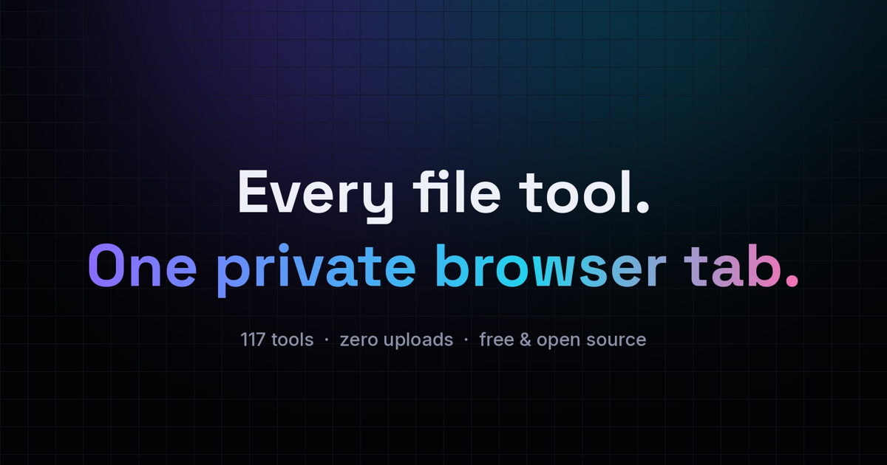
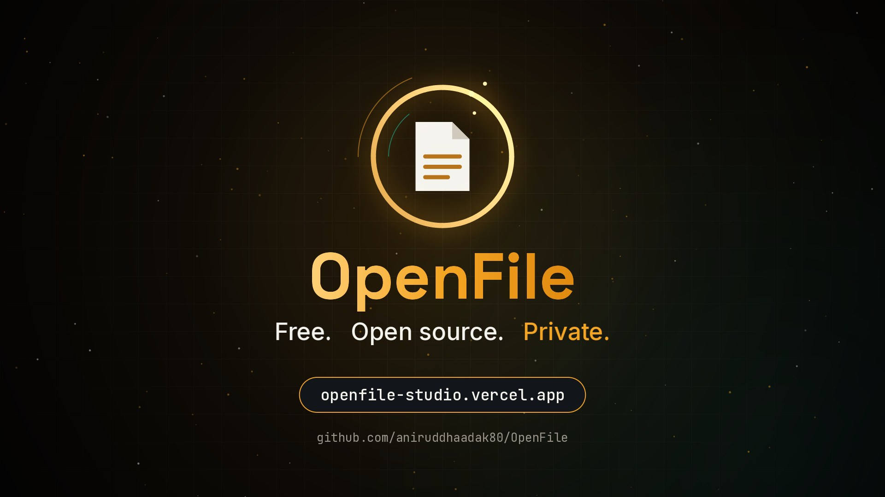
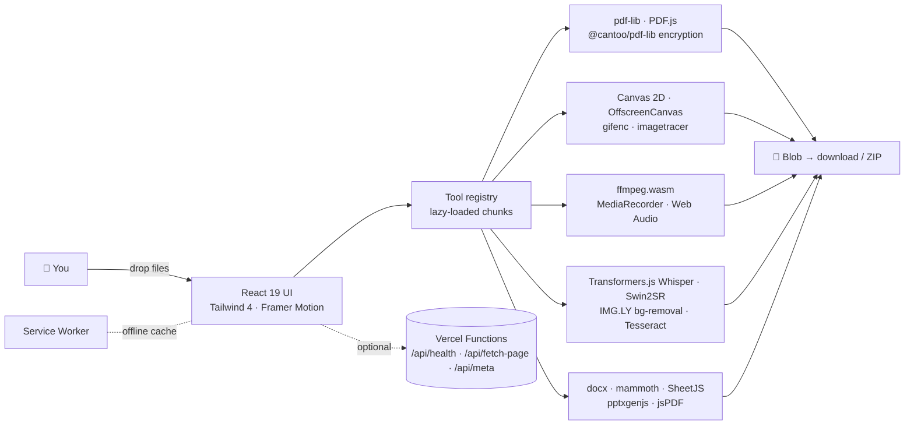

<div align="center">



<br/>


# OpenFile

### Every file tool. One private browser tab.

**117 free, open-source tools** for PDFs, images, video, audio, data and code —
running **100% in your browser**. No uploads. No sign-up. No watermarks. No limits.

<br/>

[](https://openfile-studio.vercel.app/)
[](https://openfile-studio.vercel.app/)
[](https://vercel.com/new/clone?repository-url=https%3A%2F%2Fgithub.com%2Faniruddhaadak80%2FOpenFile)


<br/>

[**Launch film**](#-launch-film) · [**Features**](#-why-openfile) · [**All tools**](#-the-toolbox) · [**Workspace**](#-workspace--batch-pipelines) · [**Architecture**](#-architecture) · [**Deploy**](#-deploy-your-own) · [**Contribute**](#-contributing)

</div>

---

## 🎬 Launch film

<div align="center">

[](public/media/launch.mp4)

<sub>50-second tour — click to play <code>public/media/launch.mp4</code>, or watch it on the homepage.</sub>

</div>

---

## ✨ Why OpenFile

<table>
<tr>
<td width="33%" valign="top">

### 🔒 Private by design
Files are processed with **WebAssembly, Canvas and Web Workers inside your tab**. There is no upload endpoint — your documents never touch a server.

</td>
<td width="33%" valign="top">

### ⚡ Instant
No upload queues and no download waits. Most jobs finish in **milliseconds** on your own CPU/GPU, and the app works **offline** after the first visit.

</td>
<td width="33%" valign="top">

### 🧠 On-device AI
**Background removal, OCR (12 languages), AI upscaling and Whisper transcription** run locally with WASM/WebGPU.

</td>
</tr>
<tr>
<td valign="top">

### ♾️ No limits
No file-size caps, no daily quotas, no watermarks, no account. Forever free under MIT.

</td>
<td valign="top">

### 🔁 Batch pipelines
Chain steps into **reusable recipes** in the Workspace and process hundreds of files at once, then grab one ZIP.

</td>
<td valign="top">

### 🎨 Crafted UI
Command palette (<kbd>Ctrl</kbd> + <kbd>K</kbd>), smart file drop, dark & light themes, favorites, recents, motion everywhere and a fully responsive layout.

</td>
</tr>
</table>

### Highlights

- 🧲 **Smart drop** — drop *any* file on the homepage; OpenFile detects the type, suggests the right tools and opens them with your file already loaded.
- 🖊️ **Sign & edit PDFs** — draw/type/upload signatures, add text, shapes, highlights, images and freehand ink, then burn them into the PDF.
- 🗂️ **Organize visually** — drag-and-drop page thumbnails to reorder, rotate, duplicate, delete and insert pages.
- 🕵️ **True redaction** — auto-detect emails, phones, cards, Aadhaar/PAN or custom regex and flatten pages so text is really gone.
- 🎞️ **Full media suite** — trim, compress, convert, speed-change, merge and GIF-ify video with ffmpeg.wasm; record your screen with a webcam bubble.
- ✏️ **Sketch Whiteboard** — an infinite canvas with hand-drawn style, 30+ tech & cloud stencils, ER tables, frames, presentation mode and shareable links.
- 🧾 **Business docs** — GST/VAT invoice generator and an ATS-friendly resume builder with live preview.
- 🧑‍💻 **Developer kit** — JSON/YAML/SQL formatters, JWT signer, regex tester & builder, cURL → 11 languages, ERD studio exporting SQL/Prisma/Drizzle.
- 📲 **Installable PWA** with offline cache, plus optional Vercel serverless API routes.

---

## 🧰 The toolbox

> **117 tools across 8 studios.** Every link opens the tool directly.

<details open>
<summary><b>📄 PDF Tools</b> — 28 tools · <i>Merge, split, sign, protect and edit PDFs</i></summary>

| Tool | What it does | |
|---|---|---|
| **[Merge PDF](https://openfile-studio.vercel.app/merge-pdf)** | Combine multiple PDFs into one ordered document with drag-and-drop sorting. |  |
| **[Split PDF](https://openfile-studio.vercel.app/split-pdf)** | Split by ranges, every N pages, or extract each page into a ZIP. |  |
| **[Compress PDF](https://openfile-studio.vercel.app/compress-pdf)** | Shrink PDF size with smart image downsampling and stream compression. |  |
| **[Organize PDF](https://openfile-studio.vercel.app/organize-pdf)** | Visually reorder, rotate, duplicate and delete pages with thumbnails. | `HOT` |
| **[Delete Pages](https://openfile-studio.vercel.app/delete-pdf-pages)** | Remove selected pages and download the trimmed document. |  |
| **[Extract Pages](https://openfile-studio.vercel.app/extract-pdf-pages)** | Pull selected pages into a brand-new PDF. |  |
| **[Rotate PDF](https://openfile-studio.vercel.app/rotate-pdf)** | Rotate selected pages or the whole document. |  |
| **[Add Page Numbers](https://openfile-studio.vercel.app/pdf-page-numbers)** | Stamp page numbers with position, format and font controls. |  |
| **[Watermark PDF](https://openfile-studio.vercel.app/pdf-watermark)** | Stamp text or logo watermarks with opacity, rotation and tiling. |  |
| **[Header & Footer](https://openfile-studio.vercel.app/pdf-header-footer)** | Add running headers and footers with dates, titles and page tokens. |  |
| **[Sign PDF](https://openfile-studio.vercel.app/sign-pdf)** | Draw, type or upload a signature and place it anywhere, plus dates and initials. |  |
| **[Edit PDF](https://openfile-studio.vercel.app/edit-pdf)** | Add text, shapes, highlights, images and freehand drawing to any page. | `HOT` |
| **[Protect PDF](https://openfile-studio.vercel.app/protect-pdf)** | Encrypt a PDF with a password and set print/copy permissions. |  |
| **[Unlock PDF](https://openfile-studio.vercel.app/unlock-pdf)** | Remove the password from a PDF you have access to. |  |
| **[Redact PDF](https://openfile-studio.vercel.app/redact-pdf)** | Black out areas or auto-find emails, phones and card numbers, then flatten. |  |
| **[PDF to Grayscale](https://openfile-studio.vercel.app/pdf-grayscale)** | Convert color PDFs to grayscale or high-contrast black & white. |  |
| **[Crop PDF](https://openfile-studio.vercel.app/crop-pdf)** | Trim page margins visually or by exact measurements. |  |
| **[Flatten PDF](https://openfile-studio.vercel.app/flatten-pdf)** | Flatten form fields and annotations into static page content. |  |
| **[PDF Metadata](https://openfile-studio.vercel.app/pdf-metadata)** | View and edit title, author, subject, keywords and dates. |  |
| **[Fill PDF Form](https://openfile-studio.vercel.app/fill-pdf-form)** | Detect form fields and fill text boxes, checkboxes and dropdowns. |  |
| **[Compare PDF](https://openfile-studio.vercel.app/compare-pdf)** | Side-by-side text diff of two PDF versions. | `NEW` |
| **[N-up / Booklet](https://openfile-studio.vercel.app/nup-pdf)** | Print 2, 4 or 9 pages per sheet, or impose a booklet. |  |
| **[OCR PDF](https://openfile-studio.vercel.app/ocr-pdf)** | Recognise text in scanned PDFs and images in 10+ languages. | `AI` |
| **[PDF Reader](https://openfile-studio.vercel.app/pdf-reader)** | Fast viewer with search, zoom, thumbnails and outline. |  |
| **[Insert Pages](https://openfile-studio.vercel.app/add-blank-pages)** | Insert blank pages or pages from another PDF at any position. |  |
| **[Repair PDF](https://openfile-studio.vercel.app/repair-pdf)** | Rebuild broken or malformed PDFs by re-writing the document structure. |  |
| **[Invoice Generator](https://openfile-studio.vercel.app/invoice-generator)** | Create GST/VAT invoices with automatic totals and a polished PDF. |  |
| **[Resume Builder](https://openfile-studio.vercel.app/resume-builder)** | Fill a form, pick a template, download an ATS-friendly PDF resume. | `NEW` |

</details>

<details>
<summary><b>🔄 Convert</b> — 14 tools · <i>Move between PDF, Office, Markdown, HTML and images</i></summary>

| Tool | What it does | |
|---|---|---|
| **[PDF to Image](https://openfile-studio.vercel.app/pdf-to-image)** | Export PDF pages as crisp PNG, JPG or WEBP at any DPI. |  |
| **[Image to PDF](https://openfile-studio.vercel.app/image-to-pdf)** | Combine JPG, PNG and WEBP into one PDF with page-size controls. |  |
| **[PDF to Text](https://openfile-studio.vercel.app/pdf-to-text)** | Extract text from every page, with layout-aware ordering. |  |
| **[PDF to Word](https://openfile-studio.vercel.app/pdf-to-word)** | Convert PDF text into an editable DOCX document. |  |
| **[Word to PDF](https://openfile-studio.vercel.app/word-to-pdf)** | Turn DOCX files into well-formatted PDFs. |  |
| **[PDF to PowerPoint](https://openfile-studio.vercel.app/pdf-to-ppt)** | Turn each PDF page into a slide in a PPTX deck. |  |
| **[Excel to PDF](https://openfile-studio.vercel.app/excel-to-pdf)** | Render XLSX/CSV sheets as clean paginated PDF tables. |  |
| **[PDF to Excel](https://openfile-studio.vercel.app/pdf-to-excel)** | Pull tabular text from PDFs into an XLSX spreadsheet. |  |
| **[Markdown to PDF](https://openfile-studio.vercel.app/markdown-to-pdf)** | Write Markdown with a live preview and export a beautiful PDF. |  |
| **[HTML to PDF](https://openfile-studio.vercel.app/html-to-pdf)** | Paste HTML or a URL and convert it into a PDF. |  |
| **[Text to PDF](https://openfile-studio.vercel.app/text-to-pdf)** | Turn plain text into a paginated PDF with fonts and margins. |  |
| **[HEIC Converter](https://openfile-studio.vercel.app/heic-converter)** | Convert Apple HEIC/HEIF photos to JPG, PNG or WEBP. |  |
| **[CSV & Excel Converter](https://openfile-studio.vercel.app/table-converter)** | Convert CSV, XLSX, JSON, Markdown, TSV, HTML and SQL both ways. |  |
| **[EPUB to PDF](https://openfile-studio.vercel.app/epub-to-pdf)** | Convert e-books into printable PDFs. |  |

</details>

<details open>
<summary><b>🖼️ Image</b> — 21 tools · <i>Compress, resize, crop, remove backgrounds, upscale</i></summary>

| Tool | What it does | |
|---|---|---|
| **[Image Compressor](https://openfile-studio.vercel.app/image-compressor)** | Shrink images in bulk with quality and width controls and live savings. |  |
| **[Image Converter](https://openfile-studio.vercel.app/image-converter)** | Convert JPG, PNG, WEBP, AVIF, BMP, GIF and ICO in bulk. |  |
| **[Image Resizer](https://openfile-studio.vercel.app/image-resizer)** | Resize to exact pixels, percentages or social presets. |  |
| **[Image Cropper](https://openfile-studio.vercel.app/image-cropper)** | Crop with aspect ratios, social presets and circle avatars. |  |
| **[Background Remover](https://openfile-studio.vercel.app/background-remover)** | Remove image backgrounds with on-device AI. Replace with color or blur. | `AI` |
| **[Image Upscaler](https://openfile-studio.vercel.app/image-upscaler)** | Upscale images 2× to 4× with AI super-resolution. | `AI` |
| **[Rotate & Flip](https://openfile-studio.vercel.app/image-rotate-flip)** | Rotate by any angle or flip images horizontally/vertically. |  |
| **[Image Watermark](https://openfile-studio.vercel.app/image-watermark)** | Add text or logo watermarks to images in bulk. |  |
| **[Add Text to Image](https://openfile-studio.vercel.app/add-text-to-image)** | Place styled text anywhere with fonts, shadows and outlines. |  |
| **[Rounded Corners](https://openfile-studio.vercel.app/rounded-corners)** | Round image corners or make a perfect circle with transparency. |  |
| **[Photo Editor & Filters](https://openfile-studio.vercel.app/image-filters)** | Brightness, contrast, saturation, blur, presets and more. |  |
| **[Blur & Redact Image](https://openfile-studio.vercel.app/blur-faces)** | Auto-detect faces or paint areas to blur or pixelate. | `AI` |
| **[EXIF Viewer & Remover](https://openfile-studio.vercel.app/image-metadata-remover)** | Inspect camera/GPS metadata and strip it for privacy. |  |
| **[Image to SVG](https://openfile-studio.vercel.app/image-to-svg)** | Vectorize PNG/JPG into scalable SVG paths. |  |
| **[Screenshot Studio](https://openfile-studio.vercel.app/screenshot-studio)** | Beautify screenshots with backgrounds, padding, shadows and frames. | `HOT` |
| **[Collage Maker](https://openfile-studio.vercel.app/collage-maker)** | Arrange photos into grid layouts with spacing and borders. |  |
| **[Meme Generator](https://openfile-studio.vercel.app/meme-generator)** | Classic top/bottom caption memes from any image. |  |
| **[GIF Maker](https://openfile-studio.vercel.app/gif-maker)** | Turn a set of images into an animated GIF. |  |
| **[Image to Base64](https://openfile-studio.vercel.app/image-to-base64)** | Encode images as data URIs, or decode Base64 back to images. |  |
| **[Image Splitter](https://openfile-studio.vercel.app/image-splitter)** | Slice an image into a grid of tiles (Instagram carousels). |  |
| **[Image Color Picker](https://openfile-studio.vercel.app/color-picker-image)** | Pick exact pixel colors from any image with a loupe. |  |

</details>

<details>
<summary><b>🎬 Video</b> — 12 tools · <i>Trim, compress, convert, GIF and record</i></summary>

| Tool | What it does | |
|---|---|---|
| **[Video Trimmer](https://openfile-studio.vercel.app/video-trimmer)** | Trim and cut clips with a visual timeline, no re-upload. |  |
| **[Video Compressor](https://openfile-studio.vercel.app/video-compressor)** | Compress videos with quality presets and target resolution. |  |
| **[Video Converter](https://openfile-studio.vercel.app/video-converter)** | Convert between MP4, WEBM, MOV, MKV and AVI. |  |
| **[Video to GIF](https://openfile-studio.vercel.app/video-to-gif)** | Turn a clip into an optimized animated GIF. |  |
| **[Extract Audio](https://openfile-studio.vercel.app/extract-audio)** | Pull the soundtrack from a video as MP3, WAV or AAC. |  |
| **[Mute Video](https://openfile-studio.vercel.app/mute-video)** | Remove the audio track from any video. |  |
| **[Video Speed](https://openfile-studio.vercel.app/video-speed)** | Speed up or slow down a video from 0.25× to 4×. |  |
| **[Merge Videos](https://openfile-studio.vercel.app/merge-videos)** | Join multiple clips into one video. |  |
| **[Video Upscaler](https://openfile-studio.vercel.app/video-upscaler)** | Upscale video to 1080p, 1440p or 4K with Lanczos + sharpening. |  |
| **[Video to Frames](https://openfile-studio.vercel.app/video-frames)** | Grab frames as images at any interval. |  |
| **[Screen Recorder](https://openfile-studio.vercel.app/screen-recorder)** | Record screen + webcam bubble with mic and system audio. |  |
| **[Webcam Recorder](https://openfile-studio.vercel.app/webcam-recorder)** | Record webcam video with mirror and countdown. |  |

</details>

<details>
<summary><b>🎧 Audio</b> — 6 tools · <i>Edit, convert, record and transcribe</i></summary>

| Tool | What it does | |
|---|---|---|
| **[Audio Editor & Trimmer](https://openfile-studio.vercel.app/audio-editor)** | Trim, fade in/out, change volume and export with a waveform. |  |
| **[Audio Converter](https://openfile-studio.vercel.app/audio-converter)** | Convert MP3, WAV, OGG, AAC, FLAC and M4A. |  |
| **[Voice Recorder](https://openfile-studio.vercel.app/voice-recorder)** | Record your voice with live waveform and export. |  |
| **[Audio Transcriber](https://openfile-studio.vercel.app/audio-transcriber)** | Transcribe speech with on-device Whisper AI and export SRT. | `AI` |
| **[Text to Speech](https://openfile-studio.vercel.app/text-to-speech)** | Read text aloud with your system voices, adjust rate and pitch. |  |
| **[Audio Merger](https://openfile-studio.vercel.app/audio-merger)** | Join multiple audio files into one track. |  |

</details>

<details>
<summary><b>🧑‍💻 Developer</b> — 20 tools · <i>JSON, JWT, regex, hashes, cURL and more</i></summary>

| Tool | What it does | |
|---|---|---|
| **[JSON Formatter](https://openfile-studio.vercel.app/json-formatter)** | Prettify, validate, minify and explore JSON as a tree. |  |
| **[JWT Decoder](https://openfile-studio.vercel.app/jwt-decoder)** | Decode JWT headers/payloads and check expiry locally. |  |
| **[Hash Generator](https://openfile-studio.vercel.app/hash-generator)** | MD5, SHA-1, SHA-256, SHA-512 for text and files. |  |
| **[UUID Generator](https://openfile-studio.vercel.app/uuid-generator)** | Generate v4 and v7 UUIDs in bulk. |  |
| **[Password Generator](https://openfile-studio.vercel.app/password-generator)** | Strong random passwords and passphrases with strength meter. |  |
| **[QR Code Generator](https://openfile-studio.vercel.app/qr-generator)** | QR codes for links, Wi-Fi, vCards and text with colors and logo. |  |
| **[QR Code Scanner](https://openfile-studio.vercel.app/qr-scanner)** | Scan QR codes from your camera or an image. |  |
| **[Barcode Generator](https://openfile-studio.vercel.app/barcode-generator)** | CODE128, EAN-13, UPC, CODE39 and more as PNG/SVG. |  |
| **[Regex Tester](https://openfile-studio.vercel.app/regex-tester)** | Test regular expressions with live highlighting and groups. |  |
| **[Regex Builder](https://openfile-studio.vercel.app/regex-builder)** | Build regular expressions from plain-language blocks. |  |
| **[Base64 Encode/Decode](https://openfile-studio.vercel.app/base64)** | Encode or decode Base64 text and files. |  |
| **[URL Encode/Decode](https://openfile-studio.vercel.app/url-encoder)** | Encode/decode URLs and parse query strings. |  |
| **[cURL to Code](https://openfile-studio.vercel.app/curl-to-code)** | Convert cURL to JavaScript, Python, Go, Rust, PHP, Java and more. |  |
| **[Timestamp Converter](https://openfile-studio.vercel.app/timestamp-converter)** | Unix epoch ⇄ human dates across time zones. |  |
| **[Cron Explainer](https://openfile-studio.vercel.app/cron-parser)** | Explain cron expressions and preview next run times. |  |
| **[YAML ⇄ JSON](https://openfile-studio.vercel.app/yaml-json)** | Convert between YAML and JSON with validation. |  |
| **[SQL Formatter](https://openfile-studio.vercel.app/sql-formatter)** | Beautify SQL for many dialects. |  |
| **[ERD Studio](https://openfile-studio.vercel.app/erd-diagram)** | Design database schemas and export SQL, Prisma and Drizzle. |  |
| **[HTML Entities](https://openfile-studio.vercel.app/html-entities)** | Escape and unescape HTML entities. |  |
| **[Number Base Converter](https://openfile-studio.vercel.app/number-base)** | Binary, octal, decimal and hex conversion. |  |

</details>

<details>
<summary><b>📝 Text & Data</b> — 8 tools · <i>Diff, count, convert tables, format text</i></summary>

| Tool | What it does | |
|---|---|---|
| **[Diff Checker](https://openfile-studio.vercel.app/diff-checker)** | Compare text and code side-by-side or inline. |  |
| **[Word Counter](https://openfile-studio.vercel.app/word-counter)** | Words, characters, sentences, reading time and keyword density. |  |
| **[Case Converter](https://openfile-studio.vercel.app/case-converter)** | UPPER, lower, Title, camelCase, snake_case, kebab-case and more. |  |
| **[Lorem Ipsum](https://openfile-studio.vercel.app/lorem-ipsum)** | Generate placeholder paragraphs, sentences or words. |  |
| **[Markdown Editor](https://openfile-studio.vercel.app/markdown-editor)** | Live split-pane Markdown editor with HTML export. |  |
| **[Date Calculator](https://openfile-studio.vercel.app/date-calculator)** | Difference between dates, add/subtract days, business days. |  |
| **[Unit Converter](https://openfile-studio.vercel.app/unit-converter)** | Length, weight, temperature, data, speed and more. |  |
| **[Text Cleaner](https://openfile-studio.vercel.app/text-cleaner)** | Remove duplicates, sort lines, trim spaces and strip line breaks. |  |

</details>

<details>
<summary><b>🎨 Design</b> — 8 tools · <i>Colors, CSS, favicons, SVG, whiteboards</i></summary>

| Tool | What it does | |
|---|---|---|
| **[Color Palette Extractor](https://openfile-studio.vercel.app/color-palette)** | Extract dominant colors and export CSS/Tailwind palettes. |  |
| **[Color Converter & Contrast](https://openfile-studio.vercel.app/color-converter)** | HEX, RGB, HSL, OKLCH conversion and WCAG contrast checks. |  |
| **[Gradient Generator](https://openfile-studio.vercel.app/gradient-generator)** | Design linear, radial and conic gradients and copy CSS. |  |
| **[CSS Studio](https://openfile-studio.vercel.app/css-studio)** | Box shadows, glassmorphism and neumorphism generators. |  |
| **[Favicon Generator](https://openfile-studio.vercel.app/favicon-generator)** | Full icon packs: ICO, Apple Touch, Android, manifest and HTML. |  |
| **[SVG Optimizer](https://openfile-studio.vercel.app/svg-optimizer)** | Minify SVGs, export JSX or PNG. |  |
| **[Sketch Whiteboard](https://openfile-studio.vercel.app/sketch-board)** | Infinite whiteboard with shapes, arrows, text and sticky notes. | `HOT` |
| **[Placeholder Image](https://openfile-studio.vercel.app/placeholder-image)** | Generate placeholder images in any size, color and text. |  |

</details>


---

## 🔁 Workspace — batch pipelines

The Workspace (`/workspace`) turns single tools into **automations**:

```text
 📁 248 product photos
   │
   ├─▶ Resize (fit 1600×1600)
   ├─▶ Watermark (“© My Store”, bottom-right, 60%)
   ├─▶ Convert (WebP, quality 80)  ← also strips EXIF
   ├─▶ Rename  (product-{n})
   ▼
 📦 openfile-pipeline.zip
```

- **Image steps:** resize, convert, compress, rotate/flip, filters, watermark, rounded corners, rename.
- **PDF steps:** merge, rotate, page numbers, watermark, clean metadata, compress, grayscale.
- Built-in presets (*Web-ready photos*, *Product catalog*, *Share-safe PDF pack*, *Shrink scans*…) and **saved recipes** stored in your browser.

---

## 🏗️ Architecture



- **One component per tool** at `src/tools/<category>/<slug>.tsx`, discovered with `import.meta.glob` and code-split automatically — the homepage stays light even with 117 tools.
- **Heavy engines load on demand** (ffmpeg core, OCR language data, AI weights) from public CDNs and are cached by the browser / service worker.
- **Zero-upload guarantee:** the only server routes receive a URL you type (HTML→PDF) — never a file.

### Project structure

```text
OpenFile/
├─ api/                    # Vercel serverless functions (optional)
│  ├─ health.ts            # GET /api/health
│  ├─ fetch-page.ts        # GET /api/fetch-page?url=  (HTML → PDF)
│  └─ meta.ts              # GET /api/meta?url=        (link previews)
├─ public/                 # icons, manifest, service worker, launch film
├─ src/
│  ├─ components/          # UI kit, layout, command palette, PDF thumbnails
│  ├─ lib/                 # files, pdf, ffmpeg, store, handoff helpers
│  ├─ pages/               # Home, ToolPage, Tools, Workspace, About, Privacy, Status
│  └─ tools/
│     ├─ registry.ts       # the catalog (117 tools)
│     ├─ pdf/ convert/ image/ video/ audio/ dev/ text/ design/
├─ docs/TOOL_GUIDE.md      # how to write a new tool
├─ .github/workflows/      # GitHub Pages deploy
└─ vercel.json             # SPA rewrites + security headers
```

---

## 🚀 Getting started

```bash
git clone https://github.com/aniruddhaadak80/OpenFile.git
cd OpenFile
npm install
npm run dev          # http://localhost:5173
```

| Script | What it does |
|---|---|
| `npm run dev` | Start the Vite dev server |
| `npm run build` | Production build for root hosting (Vercel, Netlify, Cloudflare) |
| `npm run build:pages` | Build with base `/OpenFile/` for GitHub Pages |
| `npm run typecheck` | Strict TypeScript check |
| `npm run preview` | Preview the production build |

---

## ☁️ Deploy your own

### Vercel (recommended — includes API routes)

[](https://vercel.com/new/clone?repository-url=https%3A%2F%2Fgithub.com%2Faniruddhaadak80%2FOpenFile)

1. Import the repo on Vercel — the framework (**Vite**) and settings are read from `vercel.json`.
2. Deploy. SPA routes, `/api/*` functions and cache headers work out of the box.

### GitHub Pages (static mirror)

1. Push to `main` — the workflow builds and publishes `dist/` to the `gh-pages` branch.
2. Repo **Settings → Pages → Deploy from a branch → `gh-pages` / root** (one-time).
3. Live at `https://<user>.github.io/OpenFile/`. Every tool works; the optional URL mode of HTML→PDF needs the Vercel API.

### Anywhere else
It is a static site: `npm run build` and upload `dist/` to Netlify, Cloudflare Pages, S3, or any web server (serve `index.html` for unknown routes).

---

## 🌐 Browser support

| Capability | Chrome / Edge | Firefox | Safari |
|---|:-:|:-:|:-:|
| PDF, image, dev & text tools | ✅ | ✅ | ✅ |
| Video/audio (ffmpeg.wasm) | ✅ | ✅ | ✅ |
| AI tools (WebGPU fast path) | ✅ | ⚠️ WASM | ⚠️ WASM |
| Screen recorder | ✅ | ✅ | ✅ 16+ |
| QR scanning (BarcodeDetector) | ✅ | ⚠️ | ⚠️ |

Check your browser’s capabilities on the in-app **/status** page.

---

## 🤝 Contributing

New tools are welcome! Each tool is a single React component:

1. Add an entry to `src/tools/registry.ts`.
2. Create `src/tools/<category>/<slug>.tsx` with a default export.
3. Use the UI kit (`Dropzone`, `ToolGrid`, `ResultCard`, `useJob`…) — see **[docs/TOOL_GUIDE.md](docs/TOOL_GUIDE.md)**.
4. `npm run typecheck && npm run build`, then open a PR.

See [CONTRIBUTING.md](CONTRIBUTING.md) for details.

## 🗺️ Roadmap

- [x] 117 in-browser tools across 8 studios
- [x] Batch Workspace with presets and saved recipes
- [x] On-device AI (background removal, OCR, upscaling, transcription)
- [x] Installable PWA + offline mode
- [ ] Desktop app (Tauri) with native file system access
- [ ] Shareable pipeline recipes via link
- [ ] More languages for the UI (i18n)

## 🙏 Credits

Built on the shoulders of giants: [pdf-lib](https://pdf-lib.js.org), [PDF.js](https://mozilla.github.io/pdf.js/), [ffmpeg.wasm](https://ffmpegwasm.netlify.app), [Tesseract.js](https://tesseract.projectnaptha.com), [Transformers.js](https://huggingface.co/docs/transformers.js), [IMG.LY background-removal](https://github.com/imgly/background-removal-js), [SheetJS](https://sheetjs.com), [docx](https://docx.js.org), [mammoth](https://github.com/mwilliamson/mammoth.js), [pptxgenjs](https://gitbrent.github.io/PptxGenJS/), [svgo](https://svgo.dev), [Lucide](https://lucide.dev).

## 📄 License

[MIT](LICENSE) © 2026 Aniruddha Adak

<div align="center"><br/>

**If OpenFile saved you an upload, please ⭐ the repo!**

<sub>Made with ♥ by <a href="https://github.com/aniruddhaadak80">@aniruddhaadak80</a></sub>
</div>
