<!-- OpenFile README: animated artwork lives in docs/assets/*.svg -->
<p align="center">
  <a href="https://openfile-studio.vercel.app">
    
  </a>
</p>

<p align="center">
  <a href="https://openfile-studio.vercel.app"></a>
  <a href="https://aniruddhaadak80.github.io/OpenFile/"></a>
  <a href="https://aniruddhaadak80.github.io/OpenFile/install"></a>
  <a href="https://vercel.com/new/clone?repository-url=https%3A%2F%2Fgithub.com%2Faniruddhaadak80%2FOpenFile"></a>
</p>

<p align="center">
  
  
  
  
  
  
  
  
  
  <a href="LICENSE"></a>
  <br/>
  <a href="https://github.com/aniruddhaadak80/OpenFile/stargazers"></a>
  <a href="https://github.com/aniruddhaadak80/OpenFile/network/members"></a>
  <a href="https://github.com/aniruddhaadak80/OpenFile/issues"></a>
  <a href="https://github.com/aniruddhaadak80/OpenFile/commits/main"></a>
  <a href="https://github.com/aniruddhaadak80/OpenFile/actions"></a>
  
</p>

<p align="center">
  <b>411 free, open-source tools</b> for PDFs, images, video, audio, 3D, fonts, archives, eBooks, data and code, <br/>
  processed <b>entirely inside your browser tab</b>. No uploads. No sign-up. No watermarks. No limits.
</p>

<p align="center">
  <a href="#-whats-new">What's new</a> ·
  <a href="#-launch-film">Launch film</a> ·
  <a href="#-install">Install</a> ·
  <a href="#-why-openfile">Why</a> ·
  <a href="#-the-toolbox">Toolbox</a> ·
  <a href="#-workspace--batch-pipelines">Workspace</a> ·
  <a href="#%EF%B8%8F-architecture">Architecture</a> ·
  <a href="#-quick-start">Quick start</a> ·
  <a href="#%EF%B8%8F-self-hosting">Self-hosting</a> ·
  <a href="#%EF%B8%8F-roadmap">Roadmap</a> ·
  <a href="#-faq">FAQ</a> ·
  <a href="#-built-by">Author</a>
</p>

<p align="center">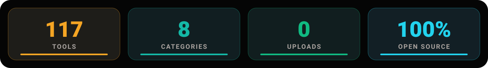</p>

<p align="center"></p>

## 🆕 What's new

<!-- whatsnew:start -->
OpenFile now has **411 tools in 21 studios**. This release adds whole new studios, more on-device AI and a smoother way to get files in.

- 🧊 **3D viewer and converter**: [3D Model Viewer](https://openfile-studio.vercel.app/3d-viewer) opens GLB, glTF, OBJ, STL, PLY, FBX and more with orbit controls. [3D Model Converter](https://openfile-studio.vercel.app/3d-converter) moves models between formats and [GLB / glTF Optimizer](https://openfile-studio.vercel.app/gltf-optimizer) shrinks them.
- 🔤 **Fonts**: [Font Converter](https://openfile-studio.vercel.app/font-converter) (TTF, OTF, WOFF, WOFF2), [Font Viewer & Inspector](https://openfile-studio.vercel.app/font-viewer) and [Font Subsetter](https://openfile-studio.vercel.app/font-subsetter) for tiny web fonts.
- 🗜️ **Archives**: [Open Any Archive](https://openfile-studio.vercel.app/archive-extractor) reads ZIP, 7Z, RAR, TAR and more. [Create Archive](https://openfile-studio.vercel.app/archive-creator) packs files, with optional AES-256 ZIP passwords, and [Archive Converter](https://openfile-studio.vercel.app/archive-converter) turns RAR or 7Z into ZIP.
- 📚 **eBooks**: [E-book Reader](https://openfile-studio.vercel.app/ebook-reader), [E-book Converter](https://openfile-studio.vercel.app/ebook-converter) (EPUB, MOBI, AZW3, FB2 and more), [EPUB Editor](https://openfile-studio.vercel.app/epub-editor) and [Comic Converter](https://openfile-studio.vercel.app/comic-converter) for CBZ and CBR.
- 💬 **Subtitles**: [Subtitle Converter](https://openfile-studio.vercel.app/subtitle-converter), [Subtitle Editor](https://openfile-studio.vercel.app/subtitle-editor), [Subtitle Shift and Sync](https://openfile-studio.vercel.app/subtitle-sync) and [Extract Subtitles](https://openfile-studio.vercel.app/extract-subtitles) from MKV and MP4.
- 📐 **CAD and DXF**: [DXF Viewer](https://openfile-studio.vercel.app/dxf-viewer) with layers and measuring, and [CAD to PDF, SVG and PNG](https://openfile-studio.vercel.app/cad-converter) for clean vector output you can print.
- 📊 **Data**: [SQLite Browser](https://openfile-studio.vercel.app/sqlite-viewer), [Parquet / Arrow / Avro Viewer](https://openfile-studio.vercel.app/parquet-viewer), [CSV & Spreadsheet Editor](https://openfile-studio.vercel.app/csv-editor) and [GPS / GIS Converter](https://openfile-studio.vercel.app/geo-converter) for GPX, KML, GeoJSON and Shapefile.
- 🤖 **On-device AI**: [Chat with PDF](https://openfile-studio.vercel.app/chat-pdf), [Colorize Black and White Photo](https://openfile-studio.vercel.app/colorize-photo), [Magic Eraser (Remove Objects)](https://openfile-studio.vercel.app/object-remover), [Photo Enhancer](https://openfile-studio.vercel.app/photo-enhancer) and [AI Summarizer](https://openfile-studio.vercel.app/pdf-summarizer). Models download once and then run on your device.
- 🧲 **Drop anything**: drag a file onto any page. OpenFile reads its bytes to work out the type and suggests the right tools.
- ⚖️ **Compare tools**: on the [tools page](https://openfile-studio.vercel.app/tools), pick up to three tools and see formats, engines, offline support and batch support side by side.
- 📲 **Share target**: install the app, then share files from other apps straight into OpenFile.
- 🎞️ **Per-tool preview videos**: short previews on tool pages and cards (329 so far).
- ✨ **New hero**: a gold ring in motion, with file chips that turn into their converted format. It pauses off screen and respects reduced motion.

Full list of changes: **[CHANGELOG.md](CHANGELOG.md)**
<!-- whatsnew:end -->

<p align="center"></p>

## 🎬 Launch film

<p align="center">
  <a href="public/media/launch.mp4" title="Play the OpenFile launch film">
    
  </a>
  <br/>
  <sub>▶ <a href="public/media/launch.mp4"><b>Play the launch film</b></a> (<code>public/media/launch.mp4</code>) · or watch it on the <a href="https://openfile-studio.vercel.app">homepage</a></sub>
</p>

<p align="center"></p>

<!-- install:start -->
## 📲 Install

OpenFile is a website and an app. Install it on any device: it works offline, opens files from your system, and your files still never leave your device. **[Open the interactive install guide](https://aniruddhaadak80.github.io/OpenFile/install)** (it detects your device) or read **[docs/INSTALL.md](docs/INSTALL.md)**.

<p align="center">
  <a href="https://aniruddhaadak80.github.io/OpenFile/install"></a>
  <a href="https://github.com/aniruddhaadak80/OpenFile/releases/latest"></a>
  <a href="https://github.com/aniruddhaadak80/OpenFile/actions/workflows/release-apps.yml"></a>
</p>

<p align="center">
  <a href="https://github.com/aniruddhaadak80/OpenFile/releases/latest/download/OpenFile-windows-x64-setup.exe"></a>
  <a href="https://github.com/aniruddhaadak80/OpenFile/releases/latest/download/OpenFile-macos-universal.dmg"></a>
  <a href="https://github.com/aniruddhaadak80/OpenFile/releases/latest/download/OpenFile-linux-x86_64.AppImage"></a>
  <a href="https://github.com/aniruddhaadak80/OpenFile/releases/latest/download/OpenFile-android.apk"></a>
  <a href="https://aniruddhaadak80.github.io/OpenFile/install#guide-ios"></a>
  <a href="https://aniruddhaadak80.github.io/OpenFile/install#guide-chromeos"></a>
</p>

<p align="center">
  <a href="public/media/apps.mp4" title="Play: OpenFile on every device">
    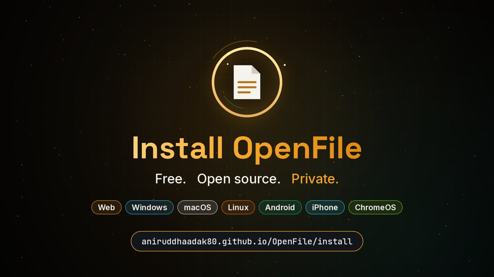
  </a>
  <br/>
  <sub>▶ <a href="public/media/apps.mp4"><b>Watch: OpenFile on every device</b></a> (44 s, 1920x1080) · <a href="public/media/apps-vertical.mp4">vertical cut for phones</a></sub>
</p>

| Platform | Get it | First run |
| --- | --- | --- |
| 🌐 **Web app** (Chrome, Edge, Brave, Opera, Safari on macOS) | Click **Install** in the OpenFile header or the install icon in the address bar | Opens in its own window, offline ready |
| 🪟 **Windows 10 and 11** | [OpenFile-windows-x64-setup.exe](https://github.com/aniruddhaadak80/OpenFile/releases/latest/download/OpenFile-windows-x64-setup.exe) · [.msi](https://github.com/aniruddhaadak80/OpenFile/releases/latest/download/OpenFile-windows-x64.msi) | SmartScreen: **More info**, **Run anyway** |
| 🍎 **macOS 11+** (Apple silicon and Intel) | [OpenFile-macos-universal.dmg](https://github.com/aniruddhaadak80/OpenFile/releases/latest/download/OpenFile-macos-universal.dmg) | Right-click OpenFile in Applications, **Open**, **Open** |
| 🐧 **Linux x86_64** | [AppImage](https://github.com/aniruddhaadak80/OpenFile/releases/latest/download/OpenFile-linux-x86_64.AppImage) · [.deb](https://github.com/aniruddhaadak80/OpenFile/releases/latest/download/OpenFile-linux-amd64.deb) · [.rpm](https://github.com/aniruddhaadak80/OpenFile/releases/latest/download/OpenFile-linux-x86_64.rpm) | `chmod +x OpenFile-linux-x86_64.AppImage` |
| 🤖 **Android 7+** | Chrome menu, **Install app**, or [OpenFile-android.apk](https://github.com/aniruddhaadak80/OpenFile/releases/latest/download/OpenFile-android.apk) | Allow installs from this source once |
| 📱 **iPhone and iPad** | Safari, **Share**, **Add to Home Screen** | Full screen and offline |
| 💻 **ChromeOS** | Install icon in Chrome's address bar | Pin it to the shelf |

<details>
<summary><b>Web app steps per browser and phone</b></summary>

- **Chrome** (Windows, macOS, Linux, ChromeOS): install icon at the right of the address bar, or menu, *Cast, save and share*, *Install page as app*.
- **Edge**: menu, *Apps*, *Install OpenFile*.
- **Safari on macOS Sonoma+**: *File*, *Add to Dock*.
- **Firefox desktop**: does not install web apps. Use the desktop app, or Chrome or Edge.
- **Android Chrome**: menu (three dots), *Install app*. **Samsung Internet**: menu, *Add page to*, *Home screen*. **Firefox Android**: menu, *Install*.
- **iPhone and iPad** (Safari, or Chrome and Edge on iOS 16.4+): *Share*, *Add to Home Screen*, *Add*.
- **Updates**: a bar says *New version ready, reload*. Click *Reload*.
- **Open with OpenFile**: once installed in Chrome or Edge on desktop, right-click a PDF, image, video, audio, ZIP, CSV or JSON file, *Open with*, *OpenFile*. Turn on *Open straight in the best tool* on [/open](https://aniruddhaadak80.github.io/OpenFile/open) to skip the picker.
</details>

<details>
<summary><b>Build the apps yourself (contributors)</b></summary>

The desktop app is [Tauri v2](https://tauri.app) in [`desktop/`](desktop), the mobile apps are [Capacitor 8](https://capacitorjs.com) in [`mobile/`](mobile). Both wrap the same `dist/` web build.

```bash
npm run app:desktop       # Windows, macOS or Linux installer for your OS (needs Rust)
npm run app:desktop:dev   # desktop dev window
npm run app:android       # debug APK (needs JDK 21 and the Android SDK)
npm run app:ios           # syncs and opens the Xcode project (macOS)
npm run app:assets        # regenerate icons, maskable icons, screenshots and splash screens
```

Push a tag like `v1.2.0` and [`.github/workflows/release-apps.yml`](.github/workflows/release-apps.yml) builds Windows, macOS (universal), Linux, Android and the iOS Simulator app, then attaches them to the GitHub Release. Code signing for Windows, macOS, Google Play and the App Store needs the owner's certificates; see [docs/INSTALL.md](docs/INSTALL.md#signing-owner).
</details>
<!-- install:end -->

<p align="center"></p>

## ✨ Why OpenFile

<p align="center"></p>

<table>
<tr>
<td width="33%" valign="top">

### 🔒 Private by design
Everything runs on **WebAssembly, Canvas, Web Audio and Web Workers inside your tab**. There is no upload endpoint, your files never touch a server.

</td>
<td width="33%" valign="top">

### ⚡ Instant
No upload queue, no download wait. Most jobs finish in **milliseconds** on your own CPU/GPU, and the PWA keeps working **offline** after the first visit.

</td>
<td width="33%" valign="top">

### 🤖 On-device AI
[OCR PDF](https://openfile-studio.vercel.app/ocr-pdf) · [Background Remover](https://openfile-studio.vercel.app/background-remover) · [Image Upscaler](https://openfile-studio.vercel.app/image-upscaler) · [Blur & Redact Image](https://openfile-studio.vercel.app/blur-faces) · [Audio Transcriber](https://openfile-studio.vercel.app/audio-transcriber), all run locally via WASM / WebGPU.

</td>
</tr>
<tr>
<td valign="top">

### ♾️ No limits
No file-size caps, no daily quotas, no watermarks, no account. Free forever under MIT.

</td>
<td valign="top">

### 🔁 Batch pipelines
Chain steps into **reusable recipes** in the [Workspace](https://openfile-studio.vercel.app/workspace) and process hundreds of files in one go, then grab a single ZIP.

</td>
<td valign="top">

### 💎 Crafted UI
Command palette (<kbd>Ctrl</kbd>/<kbd>⌘</kbd> + <kbd>K</kbd>), smart file drop, dark &amp; light themes, favorites, recents and a fully responsive layout.

</td>
</tr>
</table>

### 🆚 OpenFile vs. typical upload-based tools

| | **OpenFile** | Typical upload-based tools |
|---|:-:|:-:|
| Where your file is processed | 🟢 **Your device** (browser tab) | 🔴 A remote server |
| Upload / download wait | 🟢 None | 🔴 Every file, both ways |
| Works offline | 🟢 Yes (PWA) | 🔴 No |
| File-size or daily limits | 🟢 None, only your RAM | 🟠 Usually capped on free tiers |
| Account required | 🟢 Never | 🟠 Often, for full features |
| Watermarks on output | 🟢 Never | 🟠 Common on free tiers |
| On-device AI (OCR, background removal, Whisper) | 🟢 Yes | 🔴 Server-side, if available |
| Batch pipelines with saved recipes | 🟢 Built in | 🟠 Paid add-on, if any |
| Source code you can audit | 🟢 100% open source (MIT) | 🔴 Closed |
| Self-hostable | 🟢 Any static host | 🔴 No |
| Price | 🟢 Free | 🟠 Freemium / subscription |

### 🌟 Highlights

- 🧲 **Smart drop**, drop *any* file on the homepage; OpenFile detects the type, suggests the right tools and opens them with your file already loaded.
- 🖊️ **[Sign](https://openfile-studio.vercel.app/sign-pdf) & [edit](https://openfile-studio.vercel.app/edit-pdf) PDFs**, draw/type/upload signatures, add text, shapes, highlights, images and freehand ink, then burn them in.
- 🗂️ **[Organize visually](https://openfile-studio.vercel.app/organize-pdf)**, drag page thumbnails to reorder, rotate, duplicate, delete and insert pages.
- 🕵️ **[True redaction](https://openfile-studio.vercel.app/redact-pdf)**, auto-detect emails, phones and card numbers or paint areas, then flatten so the text is really gone.
- 🎞️ **Full media suite**, [trim](https://openfile-studio.vercel.app/video-trimmer), [compress](https://openfile-studio.vercel.app/video-compressor), [convert](https://openfile-studio.vercel.app/video-converter) and [GIF-ify](https://openfile-studio.vercel.app/video-to-gif) video with ffmpeg.wasm; [record your screen](https://openfile-studio.vercel.app/screen-recorder) with a webcam bubble.
- ✏️ **[Sketch Whiteboard](https://openfile-studio.vercel.app/sketch-board)**, an infinite hand-drawn canvas with shapes, arrows, sticky notes, frames and presentation mode.
- 🧾 **Business docs**, [GST/VAT invoices](https://openfile-studio.vercel.app/invoice-generator) and an [ATS-friendly resume builder](https://openfile-studio.vercel.app/resume-builder) with live preview.
- 🧑‍💻 **Developer kit**, [JSON](https://openfile-studio.vercel.app/json-formatter), [JWT](https://openfile-studio.vercel.app/jwt-decoder), [regex](https://openfile-studio.vercel.app/regex-tester), [cURL → code](https://openfile-studio.vercel.app/curl-to-code) and an [ERD studio](https://openfile-studio.vercel.app/erd-diagram) exporting SQL / Prisma / Drizzle.

<p align="center"></p>

## 🧰 The toolbox

<p align="center"></p>

<!-- toolbox:start -->
<table>
<tr>
<td width="25%" valign="top" align="center">
<h3>📄<br/>PDF Tools</h3>
<br/>
<sub>Merge, split, sign, protect and edit PDFs</sub><br/><br/>
<a href="https://openfile-studio.vercel.app/merge-pdf">Merge PDF</a><br/><a href="https://openfile-studio.vercel.app/split-pdf">Split PDF</a><br/><a href="https://openfile-studio.vercel.app/compress-pdf">Compress PDF</a><br/>
<a href="https://openfile-studio.vercel.app/category/pdf"><b>Browse all →</b></a>
</td>
<td width="25%" valign="top" align="center">
<h3>🔄<br/>Convert</h3>
<br/>
<sub>Move between PDF, Office, Markdown, HTML and images</sub><br/><br/>
<a href="https://openfile-studio.vercel.app/pdf-to-image">PDF to Image</a><br/><a href="https://openfile-studio.vercel.app/image-to-pdf">Image to PDF</a><br/><a href="https://openfile-studio.vercel.app/pdf-to-word">PDF to Word</a><br/>
<a href="https://openfile-studio.vercel.app/category/convert"><b>Browse all →</b></a>
</td>
<td width="25%" valign="top" align="center">
<h3>🖼️<br/>Image</h3>
<br/>
<sub>Compress, resize, crop, remove backgrounds, upscale</sub><br/><br/>
<a href="https://openfile-studio.vercel.app/image-compressor">Image Compressor</a><br/><a href="https://openfile-studio.vercel.app/image-converter">Image Converter</a><br/><a href="https://openfile-studio.vercel.app/image-resizer">Image Resizer</a><br/>
<a href="https://openfile-studio.vercel.app/category/image"><b>Browse all →</b></a>
</td>
<td width="25%" valign="top" align="center">
<h3>🎬<br/>Video</h3>
<br/>
<sub>Trim, compress, convert, GIF and record</sub><br/><br/>
<a href="https://openfile-studio.vercel.app/video-trimmer">Video Trimmer</a><br/><a href="https://openfile-studio.vercel.app/video-compressor">Video Compressor</a><br/><a href="https://openfile-studio.vercel.app/screen-recorder">Screen Recorder</a><br/>
<a href="https://openfile-studio.vercel.app/category/video"><b>Browse all →</b></a>
</td>
</tr>
<tr>
<td width="25%" valign="top" align="center">
<h3>🎧<br/>Audio</h3>
<br/>
<sub>Edit, convert, record and transcribe</sub><br/><br/>
<a href="https://openfile-studio.vercel.app/audio-editor">Audio Editor &amp; Trimmer</a><br/><a href="https://openfile-studio.vercel.app/volume-booster">Volume Booster and Normalizer</a><br/><a href="https://openfile-studio.vercel.app/audio-converter">Audio Converter</a><br/>
<a href="https://openfile-studio.vercel.app/category/audio"><b>Browse all →</b></a>
</td>
<td width="25%" valign="top" align="center">
<h3>🧑‍💻<br/>Developer</h3>
<br/>
<sub>JSON, JWT, regex, hashes, cURL and more</sub><br/><br/>
<a href="https://openfile-studio.vercel.app/json-formatter">JSON Formatter</a><br/><a href="https://openfile-studio.vercel.app/qr-generator">QR Code Generator</a><br/><a href="https://openfile-studio.vercel.app/encoding-recipes">Encoding Toolbox (Recipe Chains)</a><br/>
<a href="https://openfile-studio.vercel.app/category/dev"><b>Browse all →</b></a>
</td>
<td width="25%" valign="top" align="center">
<h3>📝<br/>Text &amp; Data</h3>
<br/>
<sub>Diff, count, convert tables, format text</sub><br/><br/>
<a href="https://openfile-studio.vercel.app/diff-checker">Diff Checker</a><br/><a href="https://openfile-studio.vercel.app/time-zone-converter">Time Zone Converter</a><br/><a href="https://openfile-studio.vercel.app/word-counter">Word Counter</a><br/>
<a href="https://openfile-studio.vercel.app/category/text"><b>Browse all →</b></a>
</td>
<td width="25%" valign="top" align="center">
<h3>🖌️<br/>Design</h3>
<br/>
<sub>Colors, CSS, favicons, SVG, whiteboards</sub><br/><br/>
<a href="https://openfile-studio.vercel.app/color-palette">Color Palette Extractor</a><br/><a href="https://openfile-studio.vercel.app/color-converter">Color Converter &amp; Contrast</a><br/><a href="https://openfile-studio.vercel.app/gradient-generator">Gradient Generator</a><br/>
<a href="https://openfile-studio.vercel.app/category/design"><b>Browse all →</b></a>
</td>
</tr>
<tr>
<td width="25%" valign="top" align="center">
<h3>📊<br/>Data</h3>
<br/>
<sub>CSV, Excel, JSON, SQLite, Parquet, maps and GPS</sub><br/><br/>
<a href="https://openfile-studio.vercel.app/data-converter">Data Format Converter</a><br/><a href="https://openfile-studio.vercel.app/csv-editor">CSV &amp; Spreadsheet Editor</a><br/><a href="https://openfile-studio.vercel.app/mock-data-generator">Mock Data Generator</a><br/>
<a href="https://openfile-studio.vercel.app/category/data"><b>Browse all →</b></a>
</td>
<td width="25%" valign="top" align="center">
<h3>🤖<br/>AI</h3>
<br/>
<sub>On-device AI for images, text and documents</sub><br/><br/>
<a href="https://openfile-studio.vercel.app/pdf-summarizer">AI Summarizer</a><br/><a href="https://openfile-studio.vercel.app/chat-pdf">Chat with PDF</a><br/><a href="https://openfile-studio.vercel.app/object-remover">Magic Eraser (Remove Objects)</a><br/>
<a href="https://openfile-studio.vercel.app/category/ai"><b>Browse all →</b></a>
</td>
<td width="25%" valign="top" align="center">
<h3>🧊<br/>3D</h3>
<br/>
<sub>View and convert GLB, GLTF, OBJ, STL, PLY and more</sub><br/><br/>
<a href="https://openfile-studio.vercel.app/3d-viewer">3D Model Viewer</a><br/><a href="https://openfile-studio.vercel.app/3d-converter">3D Model Converter</a><br/><a href="https://openfile-studio.vercel.app/lithophane-maker">Image to Lithophane (STL)</a><br/>
<a href="https://openfile-studio.vercel.app/category/3d"><b>Browse all →</b></a>
</td>
<td width="25%" valign="top" align="center">
<h3>🗜️<br/>Archives</h3>
<br/>
<sub>Open and create ZIP, 7Z, TAR, GZ and RAR</sub><br/><br/>
<a href="https://openfile-studio.vercel.app/archive-extractor">Open Any Archive</a><br/><a href="https://openfile-studio.vercel.app/archive-creator">Create Archive</a><br/><a href="https://openfile-studio.vercel.app/archive-converter">Archive Converter</a><br/>
<a href="https://openfile-studio.vercel.app/category/archive"><b>Browse all →</b></a>
</td>
</tr>
<tr>
<td width="25%" valign="top" align="center">
<h3>📚<br/>eBooks</h3>
<br/>
<sub>Read and convert EPUB, MOBI, FB2 and comics</sub><br/><br/>
<a href="https://openfile-studio.vercel.app/ebook-converter">E-book Converter</a><br/><a href="https://openfile-studio.vercel.app/ebook-reader">E-book Reader</a><br/><a href="https://openfile-studio.vercel.app/epub-editor">EPUB Editor</a><br/>
<a href="https://openfile-studio.vercel.app/category/ebook"><b>Browse all →</b></a>
</td>
<td width="25%" valign="top" align="center">
<h3>🔤<br/>Fonts</h3>
<br/>
<sub>Convert, inspect and subset TTF, OTF, WOFF</sub><br/><br/>
<a href="https://openfile-studio.vercel.app/font-converter">Font Converter</a><br/><a href="https://openfile-studio.vercel.app/font-viewer">Font Viewer &amp; Inspector</a><br/><a href="https://openfile-studio.vercel.app/font-subsetter">Font Subsetter</a><br/>
<a href="https://openfile-studio.vercel.app/category/font"><b>Browse all →</b></a>
</td>
<td width="25%" valign="top" align="center">
<h3>📐<br/>CAD</h3>
<br/>
<sub>View and convert DXF and other drawings</sub><br/><br/>
<a href="https://openfile-studio.vercel.app/dxf-viewer">DXF Viewer</a><br/><a href="https://openfile-studio.vercel.app/cad-converter">CAD to PDF, SVG and PNG</a><br/>
<a href="https://openfile-studio.vercel.app/category/cad"><b>Browse all →</b></a>
</td>
<td width="25%" valign="top" align="center">
<h3>💬<br/>Subtitles</h3>
<br/>
<sub>Convert, sync and edit SRT, VTT, ASS</sub><br/><br/>
<a href="https://openfile-studio.vercel.app/subtitle-converter">Subtitle Converter</a><br/><a href="https://openfile-studio.vercel.app/subtitle-editor">Subtitle Editor</a><br/><a href="https://openfile-studio.vercel.app/subtitle-sync">Subtitle Shift and Sync</a><br/>
<a href="https://openfile-studio.vercel.app/category/subtitle"><b>Browse all →</b></a>
</td>
</tr>
<tr>
<td width="25%" valign="top" align="center">
<h3>🔐<br/>Security &amp; Privacy</h3>
<br/>
<sub>Scrub metadata, lock files, hide messages, redact personal data</sub><br/><br/>
<a href="https://openfile-studio.vercel.app/metadata-scrubber">Metadata Scrubber</a><br/><a href="https://openfile-studio.vercel.app/zip-encrypt">Password ZIP</a><br/><a href="https://openfile-studio.vercel.app/steganography">Steganography</a><br/>
<a href="https://openfile-studio.vercel.app/category/privacy"><b>Browse all →</b></a>
</td>
<td width="25%" valign="top" align="center">
<h3>🗺️<br/>Maps &amp; GPS</h3>
<br/>
<sub>GPX elevation, splits, heatmaps, privacy zones and location codes</sub><br/><br/>
<a href="https://openfile-studio.vercel.app/gpx-elevation-profile">GPX Elevation Profile</a><br/><a href="https://openfile-studio.vercel.app/gpx-splits">GPX Pace &amp; Splits</a><br/><a href="https://openfile-studio.vercel.app/gpx-merge-split">GPX Merge &amp; Split</a><br/>
<a href="https://openfile-studio.vercel.app/category/geo"><b>Browse all →</b></a>
</td>
<td width="25%" valign="top" align="center">
<h3>🗂️<br/>Office &amp; Sheets</h3>
<br/>
<sub>Merge, split, compare and pivot spreadsheets, clean Word files</sub><br/><br/>
<a href="https://openfile-studio.vercel.app/xlsx-merger">Merge Excel Files</a><br/><a href="https://openfile-studio.vercel.app/xlsx-splitter">Split Excel Workbook</a><br/><a href="https://openfile-studio.vercel.app/spreadsheet-compare">Compare Spreadsheets</a><br/>
<a href="https://openfile-studio.vercel.app/category/office"><b>Browse all →</b></a>
</td>
<td width="25%" valign="top" align="center">
<h3>🧪<br/>Science &amp; Education</h3>
<br/>
<sub>Equations, graphs, chemistry, matrices, logic and primes</sub><br/><br/>
<a href="https://openfile-studio.vercel.app/latex-equation">LaTeX Equation Renderer</a><br/><a href="https://openfile-studio.vercel.app/function-plotter">Function Plotter</a><br/><a href="https://openfile-studio.vercel.app/periodic-table">Periodic Table</a><br/>
<a href="https://openfile-studio.vercel.app/category/science"><b>Browse all →</b></a>
</td>
</tr>
<tr>
<td width="25%" valign="top" align="center">
<h3>🎙️<br/>Creator Studio</h3>
<br/>
<sub>Audiograms, vertical video, carousels, word clouds and chapters</sub><br/><br/>
<a href="https://openfile-studio.vercel.app/audiogram-maker">Audiogram Maker</a><br/><a href="https://openfile-studio.vercel.app/video-reframe">Video Reframe (9:16, 1:1, 4:5)</a><br/><a href="https://openfile-studio.vercel.app/carousel-maker">Carousel Maker</a><br/>
<a href="https://openfile-studio.vercel.app/category/creator"><b>Browse all →</b></a>
</td>
</tr>
</table>
<!-- toolbox:end -->

### 📚 Every tool, one click away

<!-- catalog:start -->
> **411 tools across 21 studios.** Each name is a deep link, `https://openfile-studio.vercel.app/<slug>`, that opens the tool directly.
> Legend: 🔥 Hot · ✨ New · 🤖 AI · ⭐ Popular · 🔁 Usable as a Workspace pipeline step

<details open>
<summary><b>📄 PDF Tools</b>, 58 tools · <i>Merge, split, sign, protect and edit PDFs</i></summary>
<br/>
<table>
<tr><th align="left">Tool</th><th align="left">What it does</th><th align="left">Tags</th></tr>
<tr><td><a href="https://openfile-studio.vercel.app/merge-pdf"><b>Merge PDF</b></a></td><td>Combine multiple PDFs into one ordered document with drag-and-drop sorting.</td><td><sub>⭐ Popular</sub></td></tr>
<tr><td><a href="https://openfile-studio.vercel.app/split-pdf"><b>Split PDF</b></a></td><td>Split by ranges, every N pages, or extract each page into a ZIP.</td><td><sub>⭐ Popular</sub></td></tr>
<tr><td><a href="https://openfile-studio.vercel.app/compress-pdf"><b>Compress PDF</b></a></td><td>Shrink PDF size with smart image downsampling and stream compression.</td><td><sub>⭐ Popular · 🔁 Pipeline</sub></td></tr>
<tr><td><a href="https://openfile-studio.vercel.app/organize-pdf"><b>Organize PDF</b></a></td><td>Visually reorder, rotate, duplicate and delete pages with thumbnails.</td><td><sub>🔥 Hot</sub></td></tr>
<tr><td><a href="https://openfile-studio.vercel.app/delete-pdf-pages"><b>Delete Pages</b></a></td><td>Remove selected pages and download the trimmed document.</td><td><sub></sub></td></tr>
<tr><td><a href="https://openfile-studio.vercel.app/extract-pdf-pages"><b>Extract Pages</b></a></td><td>Pull selected pages into a brand-new PDF.</td><td><sub></sub></td></tr>
<tr><td><a href="https://openfile-studio.vercel.app/rotate-pdf"><b>Rotate PDF</b></a></td><td>Rotate selected pages or the whole document.</td><td><sub>🔁 Pipeline</sub></td></tr>
<tr><td><a href="https://openfile-studio.vercel.app/pdf-page-numbers"><b>Add Page Numbers</b></a></td><td>Stamp page numbers with position, format and font controls.</td><td><sub>🔁 Pipeline</sub></td></tr>
<tr><td><a href="https://openfile-studio.vercel.app/pdf-watermark"><b>Watermark PDF</b></a></td><td>Stamp text or logo watermarks with opacity, rotation and tiling.</td><td><sub>🔁 Pipeline</sub></td></tr>
<tr><td><a href="https://openfile-studio.vercel.app/pdf-header-footer"><b>Header &amp; Footer</b></a></td><td>Add running headers and footers with dates, titles and page tokens.</td><td><sub></sub></td></tr>
<tr><td><a href="https://openfile-studio.vercel.app/sign-pdf"><b>Sign PDF</b></a></td><td>Draw, type or upload a signature and place it anywhere, plus dates and initials.</td><td><sub>⭐ Popular</sub></td></tr>
<tr><td><a href="https://openfile-studio.vercel.app/edit-pdf"><b>Edit PDF</b></a></td><td>Add text, shapes, highlights, images and freehand drawing to any page.</td><td><sub>🔥 Hot</sub></td></tr>
<tr><td><a href="https://openfile-studio.vercel.app/protect-pdf"><b>Protect PDF</b></a></td><td>Encrypt a PDF with a password and set print/copy permissions.</td><td><sub></sub></td></tr>
<tr><td><a href="https://openfile-studio.vercel.app/unlock-pdf"><b>Unlock PDF</b></a></td><td>Remove the password from a PDF you have access to.</td><td><sub></sub></td></tr>
<tr><td><a href="https://openfile-studio.vercel.app/redact-pdf"><b>Redact PDF</b></a></td><td>Black out areas or auto-find emails, phones and card numbers, then flatten.</td><td><sub></sub></td></tr>
<tr><td><a href="https://openfile-studio.vercel.app/pdf-grayscale"><b>PDF to Grayscale</b></a></td><td>Convert color PDFs to grayscale or high-contrast black &amp; white.</td><td><sub>🔁 Pipeline</sub></td></tr>
<tr><td><a href="https://openfile-studio.vercel.app/crop-pdf"><b>Crop PDF</b></a></td><td>Trim page margins visually or by exact measurements.</td><td><sub></sub></td></tr>
<tr><td><a href="https://openfile-studio.vercel.app/flatten-pdf"><b>Flatten PDF</b></a></td><td>Flatten form fields and annotations into static page content.</td><td><sub></sub></td></tr>
<tr><td><a href="https://openfile-studio.vercel.app/pdf-metadata"><b>PDF Metadata</b></a></td><td>View and edit title, author, subject, keywords and dates.</td><td><sub></sub></td></tr>
<tr><td><a href="https://openfile-studio.vercel.app/fill-pdf-form"><b>Fill PDF Form</b></a></td><td>Detect form fields and fill text boxes, checkboxes and dropdowns.</td><td><sub></sub></td></tr>
<tr><td><a href="https://openfile-studio.vercel.app/compare-pdf"><b>Compare PDF</b></a></td><td>Side-by-side text diff of two PDF versions.</td><td><sub>✨ New</sub></td></tr>
<tr><td><a href="https://openfile-studio.vercel.app/nup-pdf"><b>N-up / Booklet</b></a></td><td>Print 2, 4 or 9 pages per sheet, or impose a booklet.</td><td><sub></sub></td></tr>
<tr><td><a href="https://openfile-studio.vercel.app/ocr-pdf"><b>OCR PDF</b></a></td><td>Recognise text in scanned PDFs and images in 10+ languages.</td><td><sub>🤖 AI</sub></td></tr>
<tr><td><a href="https://openfile-studio.vercel.app/pdf-reader"><b>PDF Reader</b></a></td><td>Fast viewer with search, zoom, thumbnails and outline.</td><td><sub></sub></td></tr>
<tr><td><a href="https://openfile-studio.vercel.app/add-blank-pages"><b>Insert Pages</b></a></td><td>Insert blank pages or pages from another PDF at any position.</td><td><sub></sub></td></tr>
<tr><td><a href="https://openfile-studio.vercel.app/repair-pdf"><b>Repair PDF</b></a></td><td>Rebuild broken or malformed PDFs by re-writing the document structure.</td><td><sub></sub></td></tr>
<tr><td><a href="https://openfile-studio.vercel.app/invoice-generator"><b>Invoice Generator</b></a></td><td>Create GST/VAT invoices with automatic totals and a polished PDF.</td><td><sub>⭐ Popular</sub></td></tr>
<tr><td><a href="https://openfile-studio.vercel.app/resume-builder"><b>Resume Builder</b></a></td><td>Fill a form, pick a template, download an ATS-friendly PDF resume.</td><td><sub>✨ New</sub></td></tr>
<tr><td><a href="https://openfile-studio.vercel.app/resize-pdf-pages"><b>Change PDF Page Size</b></a></td><td>Scale or fit pages to A4, Letter, A5 or a custom size, with margins. Text stays sharp.</td><td><sub>✨ New</sub></td></tr>
<tr><td><a href="https://openfile-studio.vercel.app/split-page-halves"><b>Split Pages in Half</b></a></td><td>Cut two-page spreads and two-up scans into single pages, left and right or top and bottom.</td><td><sub>✨ New</sub></td></tr>
<tr><td><a href="https://openfile-studio.vercel.app/flip-pdf"><b>Flip / Mirror PDF</b></a></td><td>Mirror PDF pages left to right or top to bottom for transfers, back-lit prints and glass scans.</td><td><sub>✨ New</sub></td></tr>
<tr><td><a href="https://openfile-studio.vercel.app/overlay-pdf"><b>Overlay PDF</b></a></td><td>Lay one PDF over or under another: letterheads, stationery, form backgrounds and stamps.</td><td><sub>✨ New</sub></td></tr>
<tr><td><a href="https://openfile-studio.vercel.app/pdf-poster"><b>Print Poster (Tile PDF)</b></a></td><td>Enlarge one page across several sheets with overlap, cut marks and sheet labels.</td><td><sub>✨ New</sub></td></tr>
<tr><td><a href="https://openfile-studio.vercel.app/alternate-mix-pdf"><b>Alternate &amp; Mix PDFs</b></a></td><td>Interleave front and back scans into one double-sided PDF, or mix pages from several files.</td><td><sub>✨ New</sub></td></tr>
<tr><td><a href="https://openfile-studio.vercel.app/pdf-bookmarks"><b>Edit Bookmarks / Outline</b></a></td><td>Add, edit, reorder and nest PDF bookmarks, or build them from the headings in the text.</td><td><sub>✨ New</sub></td></tr>
<tr><td><a href="https://openfile-studio.vercel.app/pdf-link-editor"><b>Edit PDF Links</b></a></td><td>Add, move and remove web and page links, or turn every web address in the text into a link.</td><td><sub>✨ New</sub></td></tr>
<tr><td><a href="https://openfile-studio.vercel.app/create-pdf-form"><b>Create Fillable PDF Form</b></a></td><td>Add text fields, checkboxes, radio buttons, dropdowns, lists and signature fields to any PDF.</td><td><sub>✨ New · ⭐ Popular</sub></td></tr>
<tr><td><a href="https://openfile-studio.vercel.app/pdf-attachments"><b>PDF Attachments</b></a></td><td>List, extract, add and remove files embedded inside a PDF.</td><td><sub>✨ New</sub></td></tr>
<tr><td><a href="https://openfile-studio.vercel.app/pdf-viewer-preferences"><b>PDF Viewer Preferences</b></a></td><td>Set the opening page, zoom, page layout, side panel, full screen and toolbar options.</td><td><sub>✨ New</sub></td></tr>
<tr><td><a href="https://openfile-studio.vercel.app/remove-annotations"><b>Remove Annotations</b></a></td><td>Strip comments, highlights, drawings, stamps, links or form fields, by type and page.</td><td><sub>✨ New</sub></td></tr>
<tr><td><a href="https://openfile-studio.vercel.app/sanitize-pdf"><b>Sanitize PDF</b></a></td><td>Remove JavaScript, embedded files, links, metadata, comments and hidden layers before sharing.</td><td><sub>✨ New</sub></td></tr>
<tr><td><a href="https://openfile-studio.vercel.app/pdf-inspector"><b>PDF Inspector</b></a></td><td>See page sizes, fonts and whether they are embedded, images, scripts, version, encryption and word counts.</td><td><sub>✨ New</sub></td></tr>
<tr><td><a href="https://openfile-studio.vercel.app/rasterize-pdf"><b>Rasterize PDF</b></a></td><td>Turn every page into an image-only PDF at the resolution you choose.</td><td><sub>✨ New</sub></td></tr>
<tr><td><a href="https://openfile-studio.vercel.app/remove-blank-pages"><b>Remove Blank Pages</b></a></td><td>Find and delete blank or nearly blank scanned pages automatically, with a manual override.</td><td><sub>✨ New</sub></td></tr>
<tr><td><a href="https://openfile-studio.vercel.app/pdf-adjust-colors"><b>Adjust PDF Colors</b></a></td><td>Dark mode, invert, grayscale, sepia, black and white, contrast and color replacement for PDFs.</td><td><sub>✨ New</sub></td></tr>
<tr><td><a href="https://openfile-studio.vercel.app/extract-pdf-images"><b>Extract PDF Images</b></a></td><td>Pull embedded images out of a PDF at original quality and download them as a ZIP.</td><td><sub>✨ New · ⭐ Popular</sub></td></tr>
<tr><td><a href="https://openfile-studio.vercel.app/search-pdfs"><b>Search in PDFs</b></a></td><td>Full-text search across many PDFs at once, with context and the match highlighted on the page.</td><td><sub>✨ New</sub></td></tr>
<tr><td><a href="https://openfile-studio.vercel.app/linearize-pdf"><b>Web-Optimize PDF</b></a></td><td>Linearize a PDF for fast web view and pack it with compressed object streams.</td><td><sub>✨ New</sub></td></tr>
<tr><td><a href="https://openfile-studio.vercel.app/pdf-to-pdfa"><b>PDF to PDF/A</b></a></td><td>Convert to archival PDF/A-1b, 2b or 3b: color profile, XMP metadata, no scripts, with a strict image mode.</td><td><sub>✨ New</sub></td></tr>
<tr><td><a href="https://openfile-studio.vercel.app/validate-pdfa"><b>Check PDF/A</b></a></td><td>Quick PDF/A report: identification, fonts, color profile, encryption, scripts, transparency and metadata.</td><td><sub>✨ New</sub></td></tr>
<tr><td><a href="https://openfile-studio.vercel.app/pdf-accessibility-check"><b>PDF Accessibility Checker</b></a></td><td>Check tags, alt text, language, title, headings, table headers, tab order and real text.</td><td><sub>✨ New</sub></td></tr>
<tr><td><a href="https://openfile-studio.vercel.app/sign-pdf-certificate"><b>Digital Signature (Certificate)</b></a></td><td>Sign a PDF with your .p12 or .pfx certificate, visibly or invisibly, without uploading it.</td><td><sub>✨ New</sub></td></tr>
<tr><td><a href="https://openfile-studio.vercel.app/verify-pdf-signature"><b>Verify PDF Signatures</b></a></td><td>Check digital signatures: was the file changed, who signed it, certificate chain and timestamps.</td><td><sub>✨ New</sub></td></tr>
<tr><td><a href="https://openfile-studio.vercel.app/scan-to-pdf"><b>Scan to PDF</b></a></td><td>Turn phone photos or your camera into a clean multi-page PDF: edge detection, straightening, black and white.</td><td><sub>✨ New · ⭐ Popular</sub></td></tr>
<tr><td><a href="https://openfile-studio.vercel.app/cover-letter-builder"><b>Cover Letter Builder</b></a></td><td>Write a cover letter from a template, pick a design, and bundle it with your resume and certificates into one PDF.</td><td><sub>✨ New</sub></td></tr>
<tr><td><a href="https://openfile-studio.vercel.app/e-invoice-generator"><b>E-Invoice Generator</b></a></td><td>Create EN 16931 e-invoices: Factur-X / ZUGFeRD PDF with embedded XML, or XRechnung in CII or UBL.</td><td><sub>✨ New</sub></td></tr>
<tr><td><a href="https://openfile-studio.vercel.app/e-invoice-viewer"><b>E-Invoice Viewer &amp; Validator</b></a></td><td>Read XRechnung, UBL, CII and Factur-X / ZUGFeRD invoices in plain language and check their totals and rules.</td><td><sub>✨ New</sub></td></tr>
<tr><td><a href="https://openfile-studio.vercel.app/pdf-embed-code"><b>PDF Embed Code</b></a></td><td>Generate HTML to embed a PDF on your website: a PDF.js viewer that works on phones, or iframe and object code.</td><td><sub>✨ New</sub></td></tr>
</table>
<p align="right"><a href="https://openfile-studio.vercel.app/category/pdf">Open the PDF Tools studio ↗</a></p>
</details>

<details>
<summary><b>🔄 Convert</b>, 31 tools · <i>Move between PDF, Office, Markdown, HTML and images</i></summary>
<br/>
<table>
<tr><th align="left">Tool</th><th align="left">What it does</th><th align="left">Tags</th></tr>
<tr><td><a href="https://openfile-studio.vercel.app/pdf-to-image"><b>PDF to Image</b></a></td><td>Export PDF pages as crisp PNG, JPG or WEBP at any DPI.</td><td><sub>⭐ Popular</sub></td></tr>
<tr><td><a href="https://openfile-studio.vercel.app/image-to-pdf"><b>Image to PDF</b></a></td><td>Combine JPG, PNG and WEBP into one PDF with page-size controls.</td><td><sub>⭐ Popular</sub></td></tr>
<tr><td><a href="https://openfile-studio.vercel.app/pdf-to-text"><b>PDF to Text</b></a></td><td>Extract text from every page, with layout-aware ordering.</td><td><sub></sub></td></tr>
<tr><td><a href="https://openfile-studio.vercel.app/pdf-to-word"><b>PDF to Word</b></a></td><td>Convert PDF text into an editable DOCX document.</td><td><sub>⭐ Popular</sub></td></tr>
<tr><td><a href="https://openfile-studio.vercel.app/word-to-pdf"><b>Word to PDF</b></a></td><td>Turn DOCX files into well-formatted PDFs.</td><td><sub>⭐ Popular</sub></td></tr>
<tr><td><a href="https://openfile-studio.vercel.app/pdf-to-ppt"><b>PDF to PowerPoint</b></a></td><td>Turn each PDF page into a slide in a PPTX deck.</td><td><sub></sub></td></tr>
<tr><td><a href="https://openfile-studio.vercel.app/excel-to-pdf"><b>Excel to PDF</b></a></td><td>Render XLSX/CSV sheets as clean paginated PDF tables.</td><td><sub></sub></td></tr>
<tr><td><a href="https://openfile-studio.vercel.app/pdf-to-excel"><b>PDF to Excel</b></a></td><td>Pull tabular text from PDFs into an XLSX spreadsheet.</td><td><sub></sub></td></tr>
<tr><td><a href="https://openfile-studio.vercel.app/markdown-to-pdf"><b>Markdown to PDF</b></a></td><td>Write Markdown with a live preview and export a beautiful PDF.</td><td><sub></sub></td></tr>
<tr><td><a href="https://openfile-studio.vercel.app/html-to-pdf"><b>HTML to PDF</b></a></td><td>Paste HTML or a URL and convert it into a PDF.</td><td><sub></sub></td></tr>
<tr><td><a href="https://openfile-studio.vercel.app/text-to-pdf"><b>Text to PDF</b></a></td><td>Turn plain text into a paginated PDF with fonts and margins.</td><td><sub></sub></td></tr>
<tr><td><a href="https://openfile-studio.vercel.app/heic-converter"><b>HEIC Converter</b></a></td><td>Convert Apple HEIC/HEIF photos to JPG, PNG or WEBP.</td><td><sub></sub></td></tr>
<tr><td><a href="https://openfile-studio.vercel.app/table-converter"><b>CSV &amp; Excel Converter</b></a></td><td>Convert CSV, XLSX, JSON, Markdown, TSV, HTML and SQL both ways.</td><td><sub></sub></td></tr>
<tr><td><a href="https://openfile-studio.vercel.app/epub-to-pdf"><b>EPUB to PDF</b></a></td><td>Convert e-books into printable PDFs.</td><td><sub></sub></td></tr>
<tr><td><a href="https://openfile-studio.vercel.app/pdf-to-markdown"><b>PDF to Markdown</b></a></td><td>Turn PDF text into clean Markdown with headings, lists, bold and italic text, and tables.</td><td><sub>✨ New</sub></td></tr>
<tr><td><a href="https://openfile-studio.vercel.app/pdf-to-html"><b>PDF to HTML</b></a></td><td>Convert a PDF into a clean responsive web page, or an exact-looking page with selectable text.</td><td><sub>✨ New</sub></td></tr>
<tr><td><a href="https://openfile-studio.vercel.app/pdf-to-epub"><b>PDF to EPUB</b></a></td><td>Make a reflowable EPUB e-book from a PDF, with chapters, a contents list and a cover.</td><td><sub>✨ New</sub></td></tr>
<tr><td><a href="https://openfile-studio.vercel.app/pdf-to-rtf"><b>PDF to RTF</b></a></td><td>Convert PDF text into an RTF document with paragraphs, headings, lists, tables and images kept.</td><td><sub>✨ New</sub></td></tr>
<tr><td><a href="https://openfile-studio.vercel.app/pdf-to-odf"><b>PDF to ODT / ODS / ODP</b></a></td><td>Convert a PDF to OpenDocument text, spreadsheet or presentation for LibreOffice and friends.</td><td><sub>✨ New</sub></td></tr>
<tr><td><a href="https://openfile-studio.vercel.app/pdf-to-tiff"><b>PDF to TIFF</b></a></td><td>Export PDF pages as a multi-page TIFF in color, grayscale or black and white, with LZW or ZIP compression.</td><td><sub>✨ New</sub></td></tr>
<tr><td><a href="https://openfile-studio.vercel.app/svg-to-pdf"><b>SVG to PDF</b></a></td><td>Convert SVG graphics to a vector PDF, one page per file, at their own size or on A4 or Letter.</td><td><sub>✨ New</sub></td></tr>
<tr><td><a href="https://openfile-studio.vercel.app/zip-to-pdf"><b>ZIP to PDF</b></a></td><td>Turn every image, PDF and text file inside a ZIP into one PDF, in the order you choose.</td><td><sub>✨ New</sub></td></tr>
<tr><td><a href="https://openfile-studio.vercel.app/pdf-to-svg"><b>PDF to SVG</b></a></td><td>Turn PDF pages into SVG files with sharp vector shapes, real text and the original fonts, ready to edit.</td><td><sub>✨ New</sub></td></tr>
<tr><td><a href="https://openfile-studio.vercel.app/powerpoint-to-pdf"><b>PowerPoint to PDF</b></a></td><td>Convert PPTX slides to PDF in your browser, as slides, slides with speaker notes, or handouts.</td><td><sub>✨ New</sub></td></tr>
<tr><td><a href="https://openfile-studio.vercel.app/xps-to-pdf"><b>XPS to PDF</b></a></td><td>Convert XPS and OXPS documents to PDF, PNG or SVG, with searchable text, right in your browser.</td><td><sub>✨ New</sub></td></tr>
<tr><td><a href="https://openfile-studio.vercel.app/document-converter"><b>Document Converter</b></a></td><td>Convert DOCX, ODT, RTF, Markdown, HTML, TXT and EPUB to Word, PDF, Markdown, HTML, TXT, RTF or EPUB.</td><td><sub>✨ New · ⭐ Popular</sub></td></tr>
<tr><td><a href="https://openfile-studio.vercel.app/office-viewer"><b>Office Viewer</b></a></td><td>View Word, Excel and PowerPoint files (DOCX, XLSX, XLS, ODS, CSV, PPTX), plus ODT and RTF, without converting.</td><td><sub>✨ New</sub></td></tr>
<tr><td><a href="https://openfile-studio.vercel.app/markdown-to-docx"><b>Markdown to Word</b></a></td><td>Turn Markdown into a real Word document with headings, lists, tables, links and code.</td><td><sub>✨ New</sub></td></tr>
<tr><td><a href="https://openfile-studio.vercel.app/docx-to-markdown"><b>Word to Markdown</b></a></td><td>Convert DOCX to clean Markdown with headings, lists, links and tables.</td><td><sub>✨ New</sub></td></tr>
<tr><td><a href="https://openfile-studio.vercel.app/rtf-converter"><b>RTF Viewer and Converter</b></a></td><td>Open RTF files (with tables and WMF or EMF pictures) and convert them to PDF, Word, HTML or text.</td><td><sub>✨ New</sub></td></tr>
<tr><td><a href="https://openfile-studio.vercel.app/email-viewer"><b>Email Viewer (EML, MSG, MBOX)</b></a></td><td>Open EML, Outlook MSG and MBOX files, save attachments and export messages as PDF.</td><td><sub>✨ New</sub></td></tr>
</table>
<p align="right"><a href="https://openfile-studio.vercel.app/category/convert">Open the Convert studio ↗</a></p>
</details>

<details>
<summary><b>🖼️ Image</b>, 55 tools · <i>Compress, resize, crop, remove backgrounds, upscale</i></summary>
<br/>
<table>
<tr><th align="left">Tool</th><th align="left">What it does</th><th align="left">Tags</th></tr>
<tr><td><a href="https://openfile-studio.vercel.app/image-compressor"><b>Image Compressor</b></a></td><td>Shrink images in bulk with quality and width controls and live savings.</td><td><sub>⭐ Popular · 🔁 Pipeline</sub></td></tr>
<tr><td><a href="https://openfile-studio.vercel.app/image-converter"><b>Image Converter</b></a></td><td>Convert JPG, PNG, WEBP, AVIF, BMP, GIF and ICO in bulk.</td><td><sub>⭐ Popular · 🔁 Pipeline</sub></td></tr>
<tr><td><a href="https://openfile-studio.vercel.app/image-resizer"><b>Image Resizer</b></a></td><td>Resize to exact pixels, percentages or social presets.</td><td><sub>⭐ Popular · 🔁 Pipeline</sub></td></tr>
<tr><td><a href="https://openfile-studio.vercel.app/image-cropper"><b>Image Cropper</b></a></td><td>Crop with aspect ratios, social presets and circle avatars.</td><td><sub></sub></td></tr>
<tr><td><a href="https://openfile-studio.vercel.app/background-remover"><b>Background Remover</b></a></td><td>Remove image backgrounds with on-device AI. Replace with color or blur.</td><td><sub>🤖 AI · ⭐ Popular</sub></td></tr>
<tr><td><a href="https://openfile-studio.vercel.app/image-upscaler"><b>Image Upscaler</b></a></td><td>Upscale images 2× to 4× with AI super-resolution.</td><td><sub>🤖 AI</sub></td></tr>
<tr><td><a href="https://openfile-studio.vercel.app/image-rotate-flip"><b>Rotate &amp; Flip</b></a></td><td>Rotate by any angle or flip images horizontally/vertically.</td><td><sub>🔁 Pipeline</sub></td></tr>
<tr><td><a href="https://openfile-studio.vercel.app/image-watermark"><b>Image Watermark</b></a></td><td>Add text or logo watermarks to images in bulk.</td><td><sub>🔁 Pipeline</sub></td></tr>
<tr><td><a href="https://openfile-studio.vercel.app/add-text-to-image"><b>Add Text to Image</b></a></td><td>Place styled text anywhere with fonts, shadows and outlines.</td><td><sub></sub></td></tr>
<tr><td><a href="https://openfile-studio.vercel.app/rounded-corners"><b>Rounded Corners</b></a></td><td>Round image corners or make a perfect circle with transparency.</td><td><sub>🔁 Pipeline</sub></td></tr>
<tr><td><a href="https://openfile-studio.vercel.app/image-filters"><b>Photo Editor &amp; Filters</b></a></td><td>Brightness, contrast, saturation, blur, presets and more.</td><td><sub>🔁 Pipeline</sub></td></tr>
<tr><td><a href="https://openfile-studio.vercel.app/blur-faces"><b>Blur &amp; Redact Image</b></a></td><td>Auto-detect faces or paint areas to blur or pixelate.</td><td><sub>🤖 AI</sub></td></tr>
<tr><td><a href="https://openfile-studio.vercel.app/image-metadata-remover"><b>EXIF Viewer &amp; Remover</b></a></td><td>Inspect camera/GPS metadata and strip it for privacy.</td><td><sub>🔁 Pipeline</sub></td></tr>
<tr><td><a href="https://openfile-studio.vercel.app/image-to-svg"><b>Image to SVG</b></a></td><td>Vectorize PNG/JPG into scalable SVG paths.</td><td><sub></sub></td></tr>
<tr><td><a href="https://openfile-studio.vercel.app/screenshot-studio"><b>Screenshot Studio</b></a></td><td>Beautify screenshots with backgrounds, padding, shadows and frames.</td><td><sub>🔥 Hot</sub></td></tr>
<tr><td><a href="https://openfile-studio.vercel.app/collage-maker"><b>Collage Maker</b></a></td><td>Arrange photos into grid layouts with spacing and borders.</td><td><sub></sub></td></tr>
<tr><td><a href="https://openfile-studio.vercel.app/meme-generator"><b>Meme Generator</b></a></td><td>Classic top/bottom caption memes from any image.</td><td><sub></sub></td></tr>
<tr><td><a href="https://openfile-studio.vercel.app/gif-maker"><b>GIF Maker</b></a></td><td>Turn a set of images into an animated GIF.</td><td><sub></sub></td></tr>
<tr><td><a href="https://openfile-studio.vercel.app/image-to-base64"><b>Image to Base64</b></a></td><td>Encode images as data URIs, or decode Base64 back to images.</td><td><sub></sub></td></tr>
<tr><td><a href="https://openfile-studio.vercel.app/image-splitter"><b>Image Splitter</b></a></td><td>Slice an image into a grid of tiles (Instagram carousels).</td><td><sub></sub></td></tr>
<tr><td><a href="https://openfile-studio.vercel.app/color-picker-image"><b>Image Color Picker</b></a></td><td>Pick exact pixel colors from any image with a loupe.</td><td><sub></sub></td></tr>
<tr><td><a href="https://openfile-studio.vercel.app/compress-to-size"><b>Compress Image to Size</b></a></td><td>Shrink a photo to an exact file size like 20 KB, 50 KB or 100 KB by searching quality and dimensions.</td><td><sub>✨ New</sub></td></tr>
<tr><td><a href="https://openfile-studio.vercel.app/raw-converter"><b>RAW Photo Converter</b></a></td><td>Develop camera RAW files (CR2, CR3, NEF, ARW, DNG, RAF, ORF and more) to JPG, PNG or TIFF with exposure and white balance.</td><td><sub>✨ New</sub></td></tr>
<tr><td><a href="https://openfile-studio.vercel.app/pro-image-converter"><b>Pro Image Converter</b></a></td><td>Convert long-tail image formats: TIFF, JPEG XL, QOI, JPEG 2000, PSD, TGA, PCX, DDS, XCF, Netpbm, SGI, PICT, XBM, XPM, HDR and more.</td><td><sub>✨ New</sub></td></tr>
<tr><td><a href="https://openfile-studio.vercel.app/passport-photo"><b>Passport Photo Maker</b></a></td><td>Make passport, visa and ID photos for many countries with face-centred cropping, a clean background and printable sheets.</td><td><sub>✨ New</sub></td></tr>
<tr><td><a href="https://openfile-studio.vercel.app/psd-viewer"><b>PSD Viewer &amp; Layer Export</b></a></td><td>Open Photoshop PSD and PSB files, show or hide layers, and export layers or the full image as PNG.</td><td><sub>✨ New</sub></td></tr>
<tr><td><a href="https://openfile-studio.vercel.app/image-compare"><b>Compare Images</b></a></td><td>Compare two images with a slider, side by side, onion skin or a pixel difference heatmap, with percent changed and PSNR.</td><td><sub>✨ New</sub></td></tr>
<tr><td><a href="https://openfile-studio.vercel.app/photo-effects"><b>Photo Effects &amp; Frames</b></a></td><td>Duotone, glitch, film grain, outline, drop shadow, polaroid, borders, mirror, kaleidoscope, colour splash, vignette and pencil sketch.</td><td><sub>✨ New</sub></td></tr>
<tr><td><a href="https://openfile-studio.vercel.app/hdr-exr-viewer"><b>HDR &amp; EXR Viewer</b></a></td><td>Open OpenEXR and Radiance HDR images, adjust exposure and tone-map them to PNG, JPG, WEBP or AVIF.</td><td><sub>✨ New</sub></td></tr>
<tr><td><a href="https://openfile-studio.vercel.app/halftone-generator"><b>Halftone Generator</b></a></td><td>Turn photos into dot, line, square or CMYK halftone art with screen angle, ink and paper colours.</td><td><sub>✨ New</sub></td></tr>
<tr><td><a href="https://openfile-studio.vercel.app/pixel-art-converter"><b>Pixel Art &amp; Dither</b></a></td><td>Pixelate photos with retro palettes (Game Boy, CGA, PICO-8, NES, C64) and Floyd-Steinberg, Atkinson or Bayer dithering.</td><td><sub>✨ New</sub></td></tr>
<tr><td><a href="https://openfile-studio.vercel.app/dicom-viewer"><b>DICOM Viewer</b></a></td><td>View DICOM series, NIfTI and NRRD medical images with window and level, slice scrubbing and PNG export.</td><td><sub>✨ New</sub></td></tr>
<tr><td><a href="https://openfile-studio.vercel.app/exif-editor"><b>EXIF Metadata Editor</b></a></td><td>Edit photo metadata: date taken, GPS location, author, copyright, camera and description, for JPEG, PNG and WebP.</td><td><sub>✨ New</sub></td></tr>
<tr><td><a href="https://openfile-studio.vercel.app/layer-editor"><b>Layer Image Editor</b></a></td><td>Edit images with layers in your browser: blend modes, opacity, move, scale and rotate, text, shapes, brush, eraser, crop, filters, undo and redo.</td><td><sub>✨ New</sub></td></tr>
<tr><td><a href="https://openfile-studio.vercel.app/gif-optimizer"><b>GIF Compressor</b></a></td><td>Shrink GIFs and animated WebP with lossy compression, fewer colours, frame dropping or a target file size.</td><td><sub>✨ New · ⭐ Popular</sub></td></tr>
<tr><td><a href="https://openfile-studio.vercel.app/gif-editor"><b>GIF Frame Editor</b></a></td><td>Reorder, delete, duplicate and retime frames, set loop count, add frames, then save as GIF, APNG, WebP or video.</td><td><sub>✨ New</sub></td></tr>
<tr><td><a href="https://openfile-studio.vercel.app/animated-converter"><b>Animated Image Converter</b></a></td><td>Convert between GIF, APNG, animated WebP and AVIF, and turn video clips into GIF, APNG or WebP.</td><td><sub>✨ New · ⭐ Popular</sub></td></tr>
<tr><td><a href="https://openfile-studio.vercel.app/gif-transform"><b>Resize, Crop &amp; Rotate GIF</b></a></td><td>Resize, crop, rotate, flip or change the canvas and aspect ratio of GIF, APNG and WebP animations.</td><td><sub>✨ New</sub></td></tr>
<tr><td><a href="https://openfile-studio.vercel.app/gif-speed-reverse"><b>GIF Speed, Reverse &amp; Cut</b></a></td><td>Speed up or slow down an animation, play it backwards or as a boomerang, and cut a frame range.</td><td><sub>✨ New</sub></td></tr>
<tr><td><a href="https://openfile-studio.vercel.app/gif-overlay"><b>Add Text &amp; Images to GIF</b></a></td><td>Animated captions, a white caption bar, logos and stickers on chosen frames, and freehand drawing on GIFs.</td><td><sub>✨ New</sub></td></tr>
<tr><td><a href="https://openfile-studio.vercel.app/gif-effects"><b>GIF Effects &amp; Filters</b></a></td><td>Colour filters, rounded corners, censor areas, pixel art, halftone, transparency and AI background removal for animations.</td><td><sub>✨ New</sub></td></tr>
<tr><td><a href="https://openfile-studio.vercel.app/gif-combine"><b>Combine GIFs</b></a></td><td>Put animations side by side, stacked, in a grid, or one after another, with shared timing.</td><td><sub>✨ New</sub></td></tr>
<tr><td><a href="https://openfile-studio.vercel.app/gif-splitter"><b>GIF to Frames</b></a></td><td>Split a GIF, APNG, WebP or short clip into PNG, JPG or WebP frames and download them as a ZIP.</td><td><sub>✨ New</sub></td></tr>
<tr><td><a href="https://openfile-studio.vercel.app/static-to-gif"><b>Animate a Still Image</b></a></td><td>Make a still image shake, pulse, zoom, spin, glitch or wobble, or fade between several images.</td><td><sub>✨ New</sub></td></tr>
<tr><td><a href="https://openfile-studio.vercel.app/gif-analyzer"><b>GIF Inspector</b></a></td><td>See frames, delays, disposal, palette, loop count and the block structure of GIF, APNG and WebP files.</td><td><sub>✨ New</sub></td></tr>
<tr><td><a href="https://openfile-studio.vercel.app/gif-repair"><b>Repair GIF</b></a></td><td>Recover cut-off or damaged GIFs by keeping every frame that can still be read and writing a clean file.</td><td><sub>✨ New</sub></td></tr>
<tr><td><a href="https://openfile-studio.vercel.app/sprite-sheet"><b>Sprite Sheet Maker &amp; Cutter</b></a></td><td>Turn a GIF, clip or images into a sprite sheet with CSS and JSON, or cut a sheet back into frames or a GIF.</td><td><sub>✨ New</sub></td></tr>
<tr><td><a href="https://openfile-studio.vercel.app/gif-to-bitmap"><b>GIF to C Array (Arduino / OLED)</b></a></td><td>Convert a GIF or image into monochrome byte arrays for SSD1306 OLEDs with Adafruit GFX or U8g2.</td><td><sub>✨ New</sub></td></tr>
<tr><td><a href="https://openfile-studio.vercel.app/webp-maker"><b>Animated WebP Maker</b></a></td><td>Build an animated WebP from images or a video clip, with transparency, timing and loop control.</td><td><sub>✨ New</sub></td></tr>
<tr><td><a href="https://openfile-studio.vercel.app/apng-maker"><b>APNG Maker</b></a></td><td>Build an animated PNG from images or a clip, with full transparency and per-frame timing.</td><td><sub>✨ New</sub></td></tr>
<tr><td><a href="https://openfile-studio.vercel.app/jxl-maker"><b>JPEG XL Converter</b></a></td><td>Convert images to JPEG XL with lossy or lossless encoding, effort and progressive options.</td><td><sub>✨ New</sub></td></tr>
<tr><td><a href="https://openfile-studio.vercel.app/lottie-converter"><b>Lottie &amp; TGS Converter</b></a></td><td>Preview Lottie JSON, .lottie and Telegram .tgs stickers and render them to GIF, APNG, WebP, MP4 or WebM.</td><td><sub>✨ New</sub></td></tr>
<tr><td><a href="https://openfile-studio.vercel.app/aseprite-converter"><b>Aseprite Converter</b></a></td><td>Open .aseprite and .ase files and export GIF, APNG, WebP, MP4 or a sprite sheet, by tag and with crisp scaling.</td><td><sub>✨ New</sub></td></tr>
<tr><td><a href="https://openfile-studio.vercel.app/motion-photo-extractor"><b>Motion Photo &amp; Live Photo Extractor</b></a></td><td>Pull the video out of Google and Samsung motion photos and Apple Live Photo bundles, as MP4, GIF or a still.</td><td><sub>✨ New</sub></td></tr>
<tr><td><a href="https://openfile-studio.vercel.app/legacy-anim-converter"><b>Retro Animation Converter</b></a></td><td>Convert FLI/FLC, Amiga ANIM and IFF, Deluxe Paint ANM, CDXL, MNG and Smush animations to GIF, APNG, WebP or MP4.</td><td><sub>✨ New</sub></td></tr>
</table>
<p align="right"><a href="https://openfile-studio.vercel.app/category/image">Open the Image studio ↗</a></p>
</details>

<details>
<summary><b>🎬 Video</b>, 36 tools · <i>Trim, compress, convert, GIF and record</i></summary>
<br/>
<table>
<tr><th align="left">Tool</th><th align="left">What it does</th><th align="left">Tags</th></tr>
<tr><td><a href="https://openfile-studio.vercel.app/video-trimmer"><b>Video Trimmer</b></a></td><td>Trim and cut clips with a visual timeline, no re-upload.</td><td><sub>⭐ Popular</sub></td></tr>
<tr><td><a href="https://openfile-studio.vercel.app/video-compressor"><b>Video Compressor</b></a></td><td>Compress videos with quality presets and target resolution.</td><td><sub>⭐ Popular</sub></td></tr>
<tr><td><a href="https://openfile-studio.vercel.app/video-converter"><b>Video Converter</b></a></td><td>Convert between MP4, WEBM, MOV, MKV and AVI.</td><td><sub></sub></td></tr>
<tr><td><a href="https://openfile-studio.vercel.app/video-to-gif"><b>Video to GIF</b></a></td><td>Turn a clip into an optimized animated GIF.</td><td><sub></sub></td></tr>
<tr><td><a href="https://openfile-studio.vercel.app/extract-audio"><b>Extract Audio</b></a></td><td>Pull the soundtrack from a video as MP3, WAV or AAC.</td><td><sub></sub></td></tr>
<tr><td><a href="https://openfile-studio.vercel.app/mute-video"><b>Mute Video</b></a></td><td>Remove the audio track from any video.</td><td><sub></sub></td></tr>
<tr><td><a href="https://openfile-studio.vercel.app/video-speed"><b>Video Speed</b></a></td><td>Speed up or slow down a video from 0.25× to 4×.</td><td><sub></sub></td></tr>
<tr><td><a href="https://openfile-studio.vercel.app/merge-videos"><b>Merge Videos</b></a></td><td>Join multiple clips into one video.</td><td><sub></sub></td></tr>
<tr><td><a href="https://openfile-studio.vercel.app/video-upscaler"><b>Video Upscaler</b></a></td><td>Upscale video to 1080p, 1440p or 4K with Lanczos + sharpening.</td><td><sub></sub></td></tr>
<tr><td><a href="https://openfile-studio.vercel.app/video-frames"><b>Video to Frames</b></a></td><td>Grab frames as images at any interval.</td><td><sub></sub></td></tr>
<tr><td><a href="https://openfile-studio.vercel.app/screen-recorder"><b>Screen Recorder</b></a></td><td>Record screen + webcam bubble with mic and system audio.</td><td><sub>⭐ Popular</sub></td></tr>
<tr><td><a href="https://openfile-studio.vercel.app/webcam-recorder"><b>Webcam Recorder</b></a></td><td>Record webcam video with mirror and countdown.</td><td><sub></sub></td></tr>
<tr><td><a href="https://openfile-studio.vercel.app/video-crop"><b>Crop Video</b></a></td><td>Crop a video visually with aspect presets for Reels, Shorts and TikTok (9:16), square (1:1) and portrait (4:5).</td><td><sub>✨ New · ⭐ Popular</sub></td></tr>
<tr><td><a href="https://openfile-studio.vercel.app/video-rotate"><b>Rotate &amp; Flip Video</b></a></td><td>Rotate a video 90, 180 or 270 degrees or mirror it, with an instant no-quality-loss option for MP4 and MOV.</td><td><sub>✨ New</sub></td></tr>
<tr><td><a href="https://openfile-studio.vercel.app/video-reverse"><b>Reverse Video</b></a></td><td>Play a video backwards with reversed sound, or make a forward-and-back boomerang loop.</td><td><sub>✨ New</sub></td></tr>
<tr><td><a href="https://openfile-studio.vercel.app/video-resize"><b>Resize Video</b></a></td><td>Change resolution or aspect ratio with platform presets, filling the space with a blurred copy or a colour.</td><td><sub>✨ New</sub></td></tr>
<tr><td><a href="https://openfile-studio.vercel.app/video-loop"><b>Loop Video</b></a></td><td>Repeat a clip a number of times or up to an exact length. Repeating is lossless and fast.</td><td><sub>✨ New</sub></td></tr>
<tr><td><a href="https://openfile-studio.vercel.app/video-watermark"><b>Watermark Video</b></a></td><td>Add a text or logo watermark to a video with position, size and opacity controls.</td><td><sub>✨ New</sub></td></tr>
<tr><td><a href="https://openfile-studio.vercel.app/add-text-to-video"><b>Add Text &amp; Stickers to Video</b></a></td><td>Timed text, emoji stickers, freehand drawing and a progress bar on any video.</td><td><sub>✨ New</sub></td></tr>
<tr><td><a href="https://openfile-studio.vercel.app/add-audio-to-video"><b>Add Audio to Video</b></a></td><td>Add music, replace the soundtrack, mix it with the original or add a second track, with a sync offset.</td><td><sub>✨ New · ⭐ Popular</sub></td></tr>
<tr><td><a href="https://openfile-studio.vercel.app/video-overlay"><b>Picture in Picture &amp; Background</b></a></td><td>Overlay a second video or image, place a video on a coloured or image background, or add a slow zoom.</td><td><sub>✨ New</sub></td></tr>
<tr><td><a href="https://openfile-studio.vercel.app/split-screen-video"><b>Split Screen Video</b></a></td><td>Show 2 to 4 videos side by side, stacked or in a grid, with gap colour and sound choice.</td><td><sub>✨ New</sub></td></tr>
<tr><td><a href="https://openfile-studio.vercel.app/video-filters"><b>Video Filters &amp; Colour</b></a></td><td>Brightness, contrast, saturation, warmth, sharpen and unblur, blur, vignette, denoise and LUT colour grading.</td><td><sub>✨ New</sub></td></tr>
<tr><td><a href="https://openfile-studio.vercel.app/blur-video"><b>Blur Part of a Video</b></a></td><td>Blur, pixelate or black out faces, plates and screens in fixed areas, for the whole video or a time range.</td><td><sub>✨ New</sub></td></tr>
<tr><td><a href="https://openfile-studio.vercel.app/video-stabilizer"><b>Stabilize Video</b></a></td><td>Reduce camera shake in handheld clips with an optional zoom to hide moving edges.</td><td><sub>✨ New</sub></td></tr>
<tr><td><a href="https://openfile-studio.vercel.app/video-fps"><b>Frame Rate, Slow Motion &amp; Time-lapse</b></a></td><td>Change frame rate, interpolate smooth motion, make slow motion, time-lapse or a stop-motion look.</td><td><sub>✨ New</sub></td></tr>
<tr><td><a href="https://openfile-studio.vercel.app/freeze-frame"><b>Freeze Frame</b></a></td><td>Hold any moment of a video for a few seconds, then let it carry on.</td><td><sub>✨ New</sub></td></tr>
<tr><td><a href="https://openfile-studio.vercel.app/video-delogo"><b>Remove Logo from Video</b></a></td><td>Fill in a fixed logo, watermark or date stamp from the surrounding pixels.</td><td><sub>✨ New</sub></td></tr>
<tr><td><a href="https://openfile-studio.vercel.app/burn-subtitles"><b>Add Subtitles to Video</b></a></td><td>Burn SRT, VTT or ASS subtitles into a video with your style, or add them as a switchable track in MP4 or MKV.</td><td><sub>✨ New</sub></td></tr>
<tr><td><a href="https://openfile-studio.vercel.app/images-to-video"><b>Images to Video</b></a></td><td>Make a slideshow video from photos with music, crossfades, a slow Ken Burns zoom and per-slide timing.</td><td><sub>✨ New · ⭐ Popular</sub></td></tr>
<tr><td><a href="https://openfile-studio.vercel.app/pdf-to-video"><b>PDF to Video</b></a></td><td>Turn the pages of a PDF or exported slide deck into a timed MP4 slideshow with music and transitions.</td><td><sub>✨ New</sub></td></tr>
<tr><td><a href="https://openfile-studio.vercel.app/video-background-remover"><b>Green Screen Video</b></a></td><td>Remove a green or blue screen and replace it with a colour, image, another video or transparency.</td><td><sub>✨ New</sub></td></tr>
<tr><td><a href="https://openfile-studio.vercel.app/video-repair"><b>Repair Video</b></a></td><td>Fix videos that will not play or seek by rebuilding the container and index, or re-encoding readable frames.</td><td><sub>✨ New</sub></td></tr>
<tr><td><a href="https://openfile-studio.vercel.app/media-info"><b>Media Info</b></a></td><td>See codecs, bitrate, resolution, frame rate, HDR, channels, chapters and tags of any video or audio file.</td><td><sub>✨ New</sub></td></tr>
<tr><td><a href="https://openfile-studio.vercel.app/teleprompter"><b>Teleprompter</b></a></td><td>Scroll your script over the camera preview while you record, with speed, size and mirror controls.</td><td><sub>✨ New</sub></td></tr>
<tr><td><a href="https://openfile-studio.vercel.app/device-test"><b>Webcam, Mic &amp; Speaker Test</b></a></td><td>Check your camera, microphone level and left and right speakers before a call or recording.</td><td><sub>✨ New</sub></td></tr>
</table>
<p align="right"><a href="https://openfile-studio.vercel.app/category/video">Open the Video studio ↗</a></p>
</details>

<details>
<summary><b>🎧 Audio</b>, 21 tools · <i>Edit, convert, record and transcribe</i></summary>
<br/>
<table>
<tr><th align="left">Tool</th><th align="left">What it does</th><th align="left">Tags</th></tr>
<tr><td><a href="https://openfile-studio.vercel.app/audio-editor"><b>Audio Editor &amp; Trimmer</b></a></td><td>Trim, fade in/out, change volume and export with a waveform.</td><td><sub>⭐ Popular</sub></td></tr>
<tr><td><a href="https://openfile-studio.vercel.app/audio-converter"><b>Audio Converter</b></a></td><td>Convert MP3, WAV, OGG, AAC, FLAC and M4A.</td><td><sub></sub></td></tr>
<tr><td><a href="https://openfile-studio.vercel.app/voice-recorder"><b>Voice Recorder</b></a></td><td>Record your voice with live waveform and export.</td><td><sub></sub></td></tr>
<tr><td><a href="https://openfile-studio.vercel.app/audio-transcriber"><b>Audio Transcriber</b></a></td><td>Transcribe speech with on-device Whisper AI and export SRT.</td><td><sub>🤖 AI</sub></td></tr>
<tr><td><a href="https://openfile-studio.vercel.app/text-to-speech"><b>Text to Speech</b></a></td><td>Read text aloud with system voices or a private neural voice, then save it as WAV.</td><td><sub></sub></td></tr>
<tr><td><a href="https://openfile-studio.vercel.app/audio-merger"><b>Audio Merger</b></a></td><td>Join multiple audio files into one track.</td><td><sub></sub></td></tr>
<tr><td><a href="https://openfile-studio.vercel.app/audio-speed-pitch"><b>Audio Speed and Pitch</b></a></td><td>Change speed without changing pitch, or shift pitch by semitones without changing speed.</td><td><sub>✨ New</sub></td></tr>
<tr><td><a href="https://openfile-studio.vercel.app/volume-booster"><b>Volume Booster and Normalizer</b></a></td><td>Make quiet audio or video louder, or even out loudness to a standard level (EBU R128).</td><td><sub>✨ New · ⭐ Popular</sub></td></tr>
<tr><td><a href="https://openfile-studio.vercel.app/noise-remover"><b>Noise Reduction</b></a></td><td>Remove hiss, fan noise, hum and rumble from voice recordings and video sound.</td><td><sub>✨ New</sub></td></tr>
<tr><td><a href="https://openfile-studio.vercel.app/audio-tag-editor"><b>Audio Tag Editor</b></a></td><td>Edit title, artist, album, year, genre, lyrics and cover art in MP3, M4A, FLAC and OGG files.</td><td><sub>✨ New</sub></td></tr>
<tr><td><a href="https://openfile-studio.vercel.app/ringtone-maker"><b>Ringtone Maker</b></a></td><td>Cut the best part of a song, add fades and save an iPhone M4R or an Android MP3 ringtone.</td><td><sub>✨ New</sub></td></tr>
<tr><td><a href="https://openfile-studio.vercel.app/audio-reverse"><b>Reverse Audio</b></a></td><td>Play any sound backwards. Videos are reversed too.</td><td><sub>✨ New</sub></td></tr>
<tr><td><a href="https://openfile-studio.vercel.app/audio-equalizer"><b>Equalizer and Bass Boost</b></a></td><td>10-band equalizer with bass boost, vocal and treble presets and a live preview.</td><td><sub>✨ New</sub></td></tr>
<tr><td><a href="https://openfile-studio.vercel.app/silence-remover"><b>Remove Silence</b></a></td><td>Cut silent parts and long pauses from audio or video automatically (jump cuts).</td><td><sub>✨ New</sub></td></tr>
<tr><td><a href="https://openfile-studio.vercel.app/audio-mixer"><b>Audio Mixer</b></a></td><td>Layer tracks with their own volume, start time, pan and fades, then export one mix.</td><td><sub>✨ New</sub></td></tr>
<tr><td><a href="https://openfile-studio.vercel.app/audio-splitter"><b>Split Audio</b></a></td><td>Split audio into equal parts, fixed lengths, at chosen times, or wherever there is silence.</td><td><sub>✨ New</sub></td></tr>
<tr><td><a href="https://openfile-studio.vercel.app/waveform-image"><b>Waveform and Spectrogram Image</b></a></td><td>Turn audio into waveform art or a spectrogram, as PNG or SVG.</td><td><sub>✨ New</sub></td></tr>
<tr><td><a href="https://openfile-studio.vercel.app/midi-player"><b>MIDI Player and Converter</b></a></td><td>Play MIDI files, see the notes, mute tracks and render them to MP3 or WAV.</td><td><sub>✨ New</sub></td></tr>
<tr><td><a href="https://openfile-studio.vercel.app/music-visualizer"><b>Audio to Video Visualizer</b></a></td><td>Turn a song or podcast clip into an MP4 with cover art and a moving waveform or spectrum.</td><td><sub>✨ New</sub></td></tr>
<tr><td><a href="https://openfile-studio.vercel.app/pdf-to-speech"><b>PDF to Speech</b></a></td><td>Read PDFs, Word files and e-books aloud with natural AI voices and save an audiobook file.</td><td><sub>🤖 AI</sub></td></tr>
<tr><td><a href="https://openfile-studio.vercel.app/vocal-remover"><b>Vocal Remover (Karaoke)</b></a></td><td>Make a karaoke version of a stereo song and get a rough vocal track, right in your browser.</td><td><sub>✨ New</sub></td></tr>
</table>
<p align="right"><a href="https://openfile-studio.vercel.app/category/audio">Open the Audio studio ↗</a></p>
</details>

<details>
<summary><b>🧑‍💻 Developer</b>, 60 tools · <i>JSON, JWT, regex, hashes, cURL and more</i></summary>
<br/>
<table>
<tr><th align="left">Tool</th><th align="left">What it does</th><th align="left">Tags</th></tr>
<tr><td><a href="https://openfile-studio.vercel.app/json-formatter"><b>JSON Formatter</b></a></td><td>Prettify, validate, minify and explore JSON as a tree.</td><td><sub>⭐ Popular</sub></td></tr>
<tr><td><a href="https://openfile-studio.vercel.app/jwt-decoder"><b>JWT Decoder</b></a></td><td>Decode JWT headers/payloads and check expiry locally.</td><td><sub></sub></td></tr>
<tr><td><a href="https://openfile-studio.vercel.app/hash-generator"><b>Hash Generator</b></a></td><td>MD5, SHA-1, SHA-256, SHA-512 for text and files.</td><td><sub></sub></td></tr>
<tr><td><a href="https://openfile-studio.vercel.app/uuid-generator"><b>UUID Generator</b></a></td><td>Generate v4 and v7 UUIDs in bulk.</td><td><sub></sub></td></tr>
<tr><td><a href="https://openfile-studio.vercel.app/password-generator"><b>Password Generator</b></a></td><td>Strong random passwords and passphrases with strength meter.</td><td><sub></sub></td></tr>
<tr><td><a href="https://openfile-studio.vercel.app/qr-generator"><b>QR Code Generator</b></a></td><td>QR codes for links, Wi-Fi, vCards and text with colors and logo.</td><td><sub>⭐ Popular</sub></td></tr>
<tr><td><a href="https://openfile-studio.vercel.app/qr-scanner"><b>QR Code Scanner</b></a></td><td>Scan QR codes from your camera or an image.</td><td><sub></sub></td></tr>
<tr><td><a href="https://openfile-studio.vercel.app/barcode-generator"><b>Barcode Generator</b></a></td><td>CODE128, EAN-13, UPC, CODE39 and more as PNG/SVG.</td><td><sub></sub></td></tr>
<tr><td><a href="https://openfile-studio.vercel.app/regex-tester"><b>Regex Tester</b></a></td><td>Test regular expressions with live highlighting and groups.</td><td><sub></sub></td></tr>
<tr><td><a href="https://openfile-studio.vercel.app/regex-builder"><b>Regex Builder</b></a></td><td>Build regular expressions from plain-language blocks.</td><td><sub></sub></td></tr>
<tr><td><a href="https://openfile-studio.vercel.app/base64"><b>Base64 Encode/Decode</b></a></td><td>Encode or decode Base64 text and files.</td><td><sub></sub></td></tr>
<tr><td><a href="https://openfile-studio.vercel.app/url-encoder"><b>URL Encode/Decode</b></a></td><td>Encode/decode URLs and parse query strings.</td><td><sub></sub></td></tr>
<tr><td><a href="https://openfile-studio.vercel.app/curl-to-code"><b>cURL to Code</b></a></td><td>Convert cURL to JavaScript, Python, Go, Rust, PHP, Java and more.</td><td><sub></sub></td></tr>
<tr><td><a href="https://openfile-studio.vercel.app/timestamp-converter"><b>Timestamp Converter</b></a></td><td>Unix epoch ⇄ human dates across time zones.</td><td><sub></sub></td></tr>
<tr><td><a href="https://openfile-studio.vercel.app/cron-parser"><b>Cron Explainer</b></a></td><td>Explain cron expressions and preview next run times.</td><td><sub></sub></td></tr>
<tr><td><a href="https://openfile-studio.vercel.app/yaml-json"><b>YAML ⇄ JSON</b></a></td><td>Convert between YAML and JSON with validation.</td><td><sub></sub></td></tr>
<tr><td><a href="https://openfile-studio.vercel.app/sql-formatter"><b>SQL Formatter</b></a></td><td>Beautify SQL for many dialects.</td><td><sub></sub></td></tr>
<tr><td><a href="https://openfile-studio.vercel.app/erd-diagram"><b>ERD Studio</b></a></td><td>Design database schemas and export SQL, Prisma and Drizzle.</td><td><sub></sub></td></tr>
<tr><td><a href="https://openfile-studio.vercel.app/html-entities"><b>HTML Entities</b></a></td><td>Escape and unescape HTML entities.</td><td><sub></sub></td></tr>
<tr><td><a href="https://openfile-studio.vercel.app/number-base"><b>Number Base Converter</b></a></td><td>Binary, octal, decimal and hex conversion.</td><td><sub></sub></td></tr>
<tr><td><a href="https://openfile-studio.vercel.app/json-to-types"><b>JSON to Types</b></a></td><td>Generate TypeScript, Zod, Go, Rust, Python, Java, C#, Swift, Kotlin, Dart, C++, PHP, Ruby, Elm types or JSON Schema from JSON.</td><td><sub>✨ New</sub></td></tr>
<tr><td><a href="https://openfile-studio.vercel.app/password-hasher"><b>Bcrypt / Argon2 / Scrypt Hasher</b></a></td><td>Hash and verify passwords with Argon2id, bcrypt, scrypt and PBKDF2.</td><td><sub>✨ New</sub></td></tr>
<tr><td><a href="https://openfile-studio.vercel.app/encryption-tool"><b>Encrypt / Decrypt Text &amp; Files</b></a></td><td>Password-protect text or any file with AES-256-GCM, ChaCha20-Poly1305 or OpenSSL-compatible AES.</td><td><sub>✨ New</sub></td></tr>
<tr><td><a href="https://openfile-studio.vercel.app/pgp-tool"><b>PGP Encrypt / Sign / Keys</b></a></td><td>Generate PGP keys, encrypt and decrypt messages or files, sign and verify, and inspect keys.</td><td><sub>✨ New</sub></td></tr>
<tr><td><a href="https://openfile-studio.vercel.app/key-generator"><b>RSA / ECDSA / SSH Key Generator</b></a></td><td>Generate Ed25519, ECDSA and RSA key pairs as OpenSSH, PEM and JWK.</td><td><sub>✨ New</sub></td></tr>
<tr><td><a href="https://openfile-studio.vercel.app/cert-decoder"><b>Certificate / CSR / PEM Decoder</b></a></td><td>Decode X.509 certificates, CSRs, CRLs and any ASN.1 structure from PEM or DER.</td><td><sub>✨ New</sub></td></tr>
<tr><td><a href="https://openfile-studio.vercel.app/otp-generator"><b>TOTP / HOTP Generator</b></a></td><td>Generate and check 2FA codes, and make QR codes for authenticator apps.</td><td><sub>✨ New</sub></td></tr>
<tr><td><a href="https://openfile-studio.vercel.app/bip39-generator"><b>BIP39 Mnemonic Generator</b></a></td><td>Generate and validate BIP39 seed phrases offline, in 10 languages, with the derived seed.</td><td><sub>✨ New</sub></td></tr>
<tr><td><a href="https://openfile-studio.vercel.app/cipher-tools"><b>Classic Ciphers &amp; Codes</b></a></td><td>Caesar, ROT13, ROT47, Vigenère, Atbash, Affine, Morse, Bacon, rail fence, XOR, NATO, Braille and more.</td><td><sub>✨ New</sub></td></tr>
<tr><td><a href="https://openfile-studio.vercel.app/encoding-recipes"><b>Encoding Toolbox (Recipe Chains)</b></a></td><td>Chain encodings: Base64, hex, Base32/58/62/85, gzip, URL, punycode, quoted-printable, MessagePack, protobuf and more.</td><td><sub>✨ New · ⭐ Popular</sub></td></tr>
<tr><td><a href="https://openfile-studio.vercel.app/string-escape"><b>String Escape / Unescape</b></a></td><td>Escape or unescape text for JSON, JavaScript, Java, C#, Python, C, Go, SQL, CSV, regex, shell and HTML.</td><td><sub>✨ New</sub></td></tr>
<tr><td><a href="https://openfile-studio.vercel.app/ip-subnet-calculator"><b>IP Subnet Calculator</b></a></td><td>IPv4 and IPv6 CIDR calculator, subnet splitter, range to CIDR and ULA generator.</td><td><sub>✨ New</sub></td></tr>
<tr><td><a href="https://openfile-studio.vercel.app/mac-address-tools"><b>MAC Address Lookup &amp; Generator</b></a></td><td>Find the vendor of a MAC address offline, convert formats and generate random MACs.</td><td><sub>✨ New</sub></td></tr>
<tr><td><a href="https://openfile-studio.vercel.app/device-info"><b>Device &amp; User-Agent Info</b></a></td><td>See your browser, OS, screen, GPU and supported features, or parse any user-agent string.</td><td><sub>✨ New</sub></td></tr>
<tr><td><a href="https://openfile-studio.vercel.app/meta-tag-generator"><b>Meta / Open Graph Tag Generator</b></a></td><td>Write SEO, Open Graph and X card tags with live search and social previews.</td><td><sub>✨ New</sub></td></tr>
<tr><td><a href="https://openfile-studio.vercel.app/http-status-codes"><b>HTTP Status Codes</b></a></td><td>Searchable list of HTTP status codes with plain meanings and when to use each.</td><td><sub>✨ New</sub></td></tr>
<tr><td><a href="https://openfile-studio.vercel.app/mime-lookup"><b>MIME Type Lookup</b></a></td><td>Find the MIME type for a file extension, or the extensions for a MIME type.</td><td><sub>✨ New</sub></td></tr>
<tr><td><a href="https://openfile-studio.vercel.app/keycode-info"><b>Keycode Info</b></a></td><td>Press any key to see event.key, event.code, keyCode, location and modifiers.</td><td><sub>✨ New</sub></td></tr>
<tr><td><a href="https://openfile-studio.vercel.app/basic-auth-generator"><b>Basic Auth Header Generator</b></a></td><td>Build or decode HTTP Authorization: Basic headers, with curl and fetch examples.</td><td><sub>✨ New</sub></td></tr>
<tr><td><a href="https://openfile-studio.vercel.app/html-wysiwyg"><b>HTML WYSIWYG Editor</b></a></td><td>Write rich text like a word processor and get clean HTML you can copy or download.</td><td><sub>✨ New</sub></td></tr>
<tr><td><a href="https://openfile-studio.vercel.app/docker-compose-converter"><b>docker run to Compose</b></a></td><td>Turn one or more docker run commands into a docker compose YAML file.</td><td><sub>✨ New</sub></td></tr>
<tr><td><a href="https://openfile-studio.vercel.app/chmod-calculator"><b>chmod Calculator</b></a></td><td>Convert Unix permissions between checkboxes, octal (755) and symbolic (rwxr-xr-x).</td><td><sub>✨ New</sub></td></tr>
<tr><td><a href="https://openfile-studio.vercel.app/phone-parser"><b>Phone Number Parser</b></a></td><td>Parse, validate and format international phone numbers, in bulk or found inside text.</td><td><sub>✨ New</sub></td></tr>
<tr><td><a href="https://openfile-studio.vercel.app/iban-validator"><b>IBAN &amp; BIC Validator</b></a></td><td>Validate and parse IBAN and BIC/SWIFT codes offline, one at a time or in bulk.</td><td><sub>✨ New</sub></td></tr>
<tr><td><a href="https://openfile-studio.vercel.app/file-identifier"><b>File Type Identifier</b></a></td><td>Find out what a file really is from its magic bytes, with entropy and header view.</td><td><sub>✨ New</sub></td></tr>
<tr><td><a href="https://openfile-studio.vercel.app/hex-viewer"><b>Hex Viewer</b></a></td><td>View any file as hex and ASCII, search bytes, inspect values and extract strings.</td><td><sub>✨ New</sub></td></tr>
<tr><td><a href="https://openfile-studio.vercel.app/gettext-converter"><b>PO / MO / CSV Converter</b></a></td><td>Compile gettext PO to MO, decompile MO to PO, or move translations to CSV and Excel.</td><td><sub>✨ New</sub></td></tr>
<tr><td><a href="https://openfile-studio.vercel.app/bulk-file-renamer"><b>Bulk File Renamer</b></a></td><td>Rename many files with patterns, numbering, find and replace and photo dates. Save as ZIP or rename in place.</td><td><sub>✨ New</sub></td></tr>
<tr><td><a href="https://openfile-studio.vercel.app/cheat-sheets"><b>Git &amp; Regex Cheat Sheets</b></a></td><td>Searchable cheat sheets for Git, regex, Markdown, Docker and the Linux shell.</td><td><sub>✨ New</sub></td></tr>
<tr><td><a href="https://openfile-studio.vercel.app/hash-identifier"><b>Hash &amp; ID Analyzer</b></a></td><td>Guess the hash type (MD5, SHA, bcrypt, NTLM and more) and decode the time inside UUIDs, ULIDs, ObjectIds and Snowflake IDs.</td><td><sub>✨ New</sub></td></tr>
<tr><td><a href="https://openfile-studio.vercel.app/dummy-file-generator"><b>Dummy File Generator</b></a></td><td>Make test files of an exact size: random or zero bytes, text, CSV, JSON, and valid PDF, PNG, WAV and ZIP files.</td><td><sub>✨ New</sub></td></tr>
<tr><td><a href="https://openfile-studio.vercel.app/secret-scanner"><b>Secret Scanner</b></a></td><td>Scan files, a folder or a ZIP for API keys, tokens, passwords and private keys before you share or commit.</td><td><sub>✨ New</sub></td></tr>
<tr><td><a href="https://openfile-studio.vercel.app/file-carver"><b>Embedded File Extractor</b></a></td><td>Find and pull out pictures, PDFs, archives and audio hidden inside any file, like a lighter binwalk.</td><td><sub>✨ New</sub></td></tr>
<tr><td><a href="https://openfile-studio.vercel.app/shamir-secret"><b>Shamir Secret Sharing</b></a></td><td>Split a password or seed phrase into shares so any 3 of 5 (or any k of n) can rebuild it, with QR codes.</td><td><sub>✨ New</sub></td></tr>
<tr><td><a href="https://openfile-studio.vercel.app/dns-lookup"><b>DNS Lookup</b></a></td><td>Look up A, AAAA, MX, TXT, NS, CAA, SOA and more over DNS-over-HTTPS, or reverse an IP address.</td><td><sub>✨ New</sub></td></tr>
<tr><td><a href="https://openfile-studio.vercel.app/json-repair"><b>JSON Repair &amp; JSON5</b></a></td><td>Fix broken JSON (missing quotes, trailing commas, comments, cut-off data) and convert JSON5 or JSONC to JSON.</td><td><sub>✨ New</sub></td></tr>
<tr><td><a href="https://openfile-studio.vercel.app/password-strength"><b>Password Strength Checker</b></a></td><td>See how fast a password could be guessed, which patterns give it away, and how to make it stronger, fully offline.</td><td><sub>✨ New</sub></td></tr>
<tr><td><a href="https://openfile-studio.vercel.app/gitignore-license-generator"><b>.gitignore &amp; LICENSE Generator</b></a></td><td>Build a .gitignore from 25 stacks and editors, and write a LICENSE file with your name and year.</td><td><sub>✨ New</sub></td></tr>
<tr><td><a href="https://openfile-studio.vercel.app/har-viewer"><b>HAR File Viewer</b></a></td><td>Open browser network captures: waterfall, filters, headers, bodies, copy as cURL, and save a copy with secrets removed.</td><td><sub>✨ New</sub></td></tr>
<tr><td><a href="https://openfile-studio.vercel.app/input-device-test"><b>Keyboard, Mouse, Gamepad &amp; Touch Test</b></a></td><td>Check every key and key rollover, mouse buttons, double click and polling rate, controller sticks and multitouch.</td><td><sub>✨ New</sub></td></tr>
</table>
<p align="right"><a href="https://openfile-studio.vercel.app/category/dev">Open the Developer studio ↗</a></p>
</details>

<details>
<summary><b>📝 Text &amp; Data</b>, 42 tools · <i>Diff, count, convert tables, format text</i></summary>
<br/>
<table>
<tr><th align="left">Tool</th><th align="left">What it does</th><th align="left">Tags</th></tr>
<tr><td><a href="https://openfile-studio.vercel.app/diff-checker"><b>Diff Checker</b></a></td><td>Compare text and code side-by-side or inline.</td><td><sub>⭐ Popular</sub></td></tr>
<tr><td><a href="https://openfile-studio.vercel.app/word-counter"><b>Word Counter</b></a></td><td>Words, characters, sentences, reading time and keyword density.</td><td><sub></sub></td></tr>
<tr><td><a href="https://openfile-studio.vercel.app/case-converter"><b>Case Converter</b></a></td><td>UPPER, lower, Title, camelCase, snake_case, kebab-case and more.</td><td><sub></sub></td></tr>
<tr><td><a href="https://openfile-studio.vercel.app/lorem-ipsum"><b>Lorem Ipsum</b></a></td><td>Generate placeholder paragraphs, sentences or words.</td><td><sub></sub></td></tr>
<tr><td><a href="https://openfile-studio.vercel.app/markdown-editor"><b>Markdown Editor</b></a></td><td>Live split-pane Markdown editor with HTML export.</td><td><sub></sub></td></tr>
<tr><td><a href="https://openfile-studio.vercel.app/date-calculator"><b>Date Calculator</b></a></td><td>Difference between dates, add/subtract days, business days.</td><td><sub></sub></td></tr>
<tr><td><a href="https://openfile-studio.vercel.app/unit-converter"><b>Unit Converter</b></a></td><td>Length, weight, temperature, data, speed and more.</td><td><sub></sub></td></tr>
<tr><td><a href="https://openfile-studio.vercel.app/text-cleaner"><b>Text Cleaner</b></a></td><td>Remove duplicates, sort lines, trim spaces and strip line breaks.</td><td><sub></sub></td></tr>
<tr><td><a href="https://openfile-studio.vercel.app/time-zone-converter"><b>Time Zone Converter</b></a></td><td>Convert times across zones, keep a world clock and find meeting times that suit everyone.</td><td><sub>✨ New · ⭐ Popular</sub></td></tr>
<tr><td><a href="https://openfile-studio.vercel.app/html-to-markdown"><b>HTML to Markdown</b></a></td><td>Convert HTML or rich text pasted from web pages, Word or Docs into clean Markdown.</td><td><sub>✨ New</sub></td></tr>
<tr><td><a href="https://openfile-studio.vercel.app/spell-checker"><b>Spell &amp; Grammar Checker</b></a></td><td>Check spelling and common grammar slips in text, DOCX or PDF, with one-click fixes.</td><td><sub>✨ New</sub></td></tr>
<tr><td><a href="https://openfile-studio.vercel.app/fancy-text"><b>Fancy Text Generator</b></a></td><td>Turn text into bold, italic, script, gothic, bubble and other Unicode styles for bios and posts.</td><td><sub>✨ New</sub></td></tr>
<tr><td><a href="https://openfile-studio.vercel.app/math-evaluator"><b>Math Evaluator &amp; Calculator</b></a></td><td>A calculator notebook with units, percentages, variables, matrices, plus a time-left (ETA) helper.</td><td><sub>✨ New</sub></td></tr>
<tr><td><a href="https://openfile-studio.vercel.app/stopwatch-timer"><b>Stopwatch &amp; Timer</b></a></td><td>Stopwatch with laps, countdown timer with alarm, and an interval timer for workouts.</td><td><sub>✨ New</sub></td></tr>
<tr><td><a href="https://openfile-studio.vercel.app/emoji-picker"><b>Emoji Picker</b></a></td><td>Search and copy emoji by name, tag or :shortcode:, with skin tones and code points.</td><td><sub>✨ New</sub></td></tr>
<tr><td><a href="https://openfile-studio.vercel.app/ascii-art"><b>ASCII Art Text</b></a></td><td>Make FIGlet text banners in 30 fonts and copy them as text, code comments or PNG.</td><td><sub>✨ New</sub></td></tr>
<tr><td><a href="https://openfile-studio.vercel.app/coordinate-converter"><b>Coordinate Converter</b></a></td><td>Convert between decimal degrees, DMS, UTM and MGRS, and measure distance between points.</td><td><sub>✨ New</sub></td></tr>
<tr><td><a href="https://openfile-studio.vercel.app/random-generator"><b>Random Generator</b></a></td><td>Random numbers, dice, coin flips, list picks, teams, strings, ports and dates.</td><td><sub>✨ New</sub></td></tr>
<tr><td><a href="https://openfile-studio.vercel.app/text-reverser"><b>Reverse Text</b></a></td><td>Reverse characters, words or lines, or flip text upside down.</td><td><sub>✨ New</sub></td></tr>
<tr><td><a href="https://openfile-studio.vercel.app/line-numbers"><b>Add / Remove Line Numbers</b></a></td><td>Number lines with your own format and padding, or strip existing line numbers.</td><td><sub>✨ New</sub></td></tr>
<tr><td><a href="https://openfile-studio.vercel.app/slug-generator"><b>Slug Generator</b></a></td><td>Make clean URL slugs from titles, with transliteration and length limits.</td><td><sub>✨ New</sub></td></tr>
<tr><td><a href="https://openfile-studio.vercel.app/text-extractor"><b>Extract Emails, URLs, IPs</b></a></td><td>Pull emails, URLs, domains, IPs, phone numbers, hashes, dates and more out of any text.</td><td><sub>✨ New</sub></td></tr>
<tr><td><a href="https://openfile-studio.vercel.app/list-tools"><b>List Compare &amp; Convert</b></a></td><td>Compare two lists (in both, only in one), dedupe, sort, shuffle, wrap and change separators.</td><td><sub>✨ New</sub></td></tr>
<tr><td><a href="https://openfile-studio.vercel.app/currency-converter"><b>Currency Converter</b></a></td><td>Convert currencies with daily European Central Bank rates and see the trend.</td><td><sub>✨ New</sub></td></tr>
<tr><td><a href="https://openfile-studio.vercel.app/readability-score"><b>Readability Checker</b></a></td><td>Score how easy your writing is to read: Flesch, grade levels, hard sentences and a bionic reading view.</td><td><sub>✨ New</sub></td></tr>
<tr><td><a href="https://openfile-studio.vercel.app/keyword-extractor"><b>Keyword &amp; Phrase Extractor</b></a></td><td>Pull out key phrases, word frequency and repeated 2 and 3 word phrases from any text, with CSV export.</td><td><sub>✨ New</sub></td></tr>
<tr><td><a href="https://openfile-studio.vercel.app/text-similarity"><b>Text Similarity &amp; Fuzzy Match</b></a></td><td>Compare two texts with Levenshtein, Jaro-Winkler, cosine and more, or fuzzy match two lists of names.</td><td><sub>✨ New</sub></td></tr>
<tr><td><a href="https://openfile-studio.vercel.app/statistics-calculator"><b>Statistics Calculator</b></a></td><td>Mean, median, mode, standard deviation, quartiles, outliers, a histogram and linear regression from numbers or a CSV column.</td><td><sub>✨ New</sub></td></tr>
<tr><td><a href="https://openfile-studio.vercel.app/ascii-table-generator"><b>ASCII / Box Table Generator</b></a></td><td>Turn CSV, TSV or Markdown into neat ASCII, Unicode box, Markdown or reStructuredText tables.</td><td><sub>✨ New</sub></td></tr>
<tr><td><a href="https://openfile-studio.vercel.app/numbers-to-words"><b>Number to Words</b></a></td><td>Write numbers in words, with lakh and crore, ordinals, years, currency and cheque wording, and turn words back into numbers.</td><td><sub>✨ New</sub></td></tr>
<tr><td><a href="https://openfile-studio.vercel.app/unicode-inspector"><b>Unicode Inspector &amp; Invisible Character Finder</b></a></td><td>See every code point, find zero-width and look-alike characters, and normalize to NFC, NFD, NFKC or NFKD.</td><td><sub>✨ New</sub></td></tr>
<tr><td><a href="https://openfile-studio.vercel.app/text-encoding-converter"><b>Text Encoding Detector &amp; Converter</b></a></td><td>Detect the encoding of old text and subtitle files (Windows-1252, Shift_JIS, GBK and more) and convert them to UTF-8.</td><td><sub>✨ New</sub></td></tr>
<tr><td><a href="https://openfile-studio.vercel.app/roman-numerals"><b>Roman Numeral Converter</b></a></td><td>Turn numbers into Roman numerals and back, many lines at once.</td><td><sub>✨ New</sub></td></tr>
<tr><td><a href="https://openfile-studio.vercel.app/morse-code"><b>Morse Code Translator</b></a></td><td>Translate text to Morse code and decode dots and dashes back to text.</td><td><sub>✨ New</sub></td></tr>
<tr><td><a href="https://openfile-studio.vercel.app/duplicate-line-remover"><b>Duplicate Line Remover</b></a></td><td>Remove repeated lines, keep only repeats, ignore case and spaces.</td><td><sub>✨ New</sub></td></tr>
<tr><td><a href="https://openfile-studio.vercel.app/line-sorter"><b>Line Sorter</b></a></td><td>Sort lines A to Z, naturally, by length or number, reverse or shuffle them.</td><td><sub>✨ New</sub></td></tr>
<tr><td><a href="https://openfile-studio.vercel.app/text-wrapper"><b>Text Wrapper</b></a></td><td>Break long text into lines of a set width without splitting words.</td><td><sub>✨ New</sub></td></tr>
<tr><td><a href="https://openfile-studio.vercel.app/pig-latin"><b>Pig Latin Translator</b></a></td><td>Translate English text into Pig Latin.</td><td><sub>✨ New</sub></td></tr>
<tr><td><a href="https://openfile-studio.vercel.app/nato-alphabet"><b>NATO Alphabet Speller</b></a></td><td>Spell text with Alfa, Bravo, Charlie and the rest.</td><td><sub>✨ New</sub></td></tr>
<tr><td><a href="https://openfile-studio.vercel.app/upside-down-text"><b>Upside Down Text</b></a></td><td>Flip text upside down with look-alike characters.</td><td><sub>✨ New</sub></td></tr>
<tr><td><a href="https://openfile-studio.vercel.app/vowel-remover"><b>Vowel Remover</b></a></td><td>Remove the vowels from every word.</td><td><sub>✨ New</sub></td></tr>
<tr><td><a href="https://openfile-studio.vercel.app/leet-speak"><b>Leet Speak Converter</b></a></td><td>Turn text into 1337 speak.</td><td><sub>✨ New</sub></td></tr>
</table>
<p align="right"><a href="https://openfile-studio.vercel.app/category/text">Open the Text &amp; Data studio ↗</a></p>
</details>

<details>
<summary><b>🖌️ Design</b>, 16 tools · <i>Colors, CSS, favicons, SVG, whiteboards</i></summary>
<br/>
<table>
<tr><th align="left">Tool</th><th align="left">What it does</th><th align="left">Tags</th></tr>
<tr><td><a href="https://openfile-studio.vercel.app/color-palette"><b>Color Palette Extractor</b></a></td><td>Extract dominant colors and export CSS/Tailwind palettes.</td><td><sub>⭐ Popular</sub></td></tr>
<tr><td><a href="https://openfile-studio.vercel.app/color-converter"><b>Color Converter &amp; Contrast</b></a></td><td>HEX, RGB, HSL, OKLCH conversion and WCAG contrast checks.</td><td><sub></sub></td></tr>
<tr><td><a href="https://openfile-studio.vercel.app/gradient-generator"><b>Gradient Generator</b></a></td><td>Design linear, radial and conic gradients and copy CSS.</td><td><sub></sub></td></tr>
<tr><td><a href="https://openfile-studio.vercel.app/css-studio"><b>CSS Studio</b></a></td><td>Box shadows, glassmorphism and neumorphism generators.</td><td><sub></sub></td></tr>
<tr><td><a href="https://openfile-studio.vercel.app/favicon-generator"><b>Favicon Generator</b></a></td><td>Full icon packs: ICO, Apple Touch, Android, manifest and HTML.</td><td><sub></sub></td></tr>
<tr><td><a href="https://openfile-studio.vercel.app/svg-optimizer"><b>SVG Optimizer</b></a></td><td>Minify SVGs, export JSX or PNG.</td><td><sub></sub></td></tr>
<tr><td><a href="https://openfile-studio.vercel.app/sketch-board"><b>Sketch Whiteboard</b></a></td><td>Infinite whiteboard with shapes, arrows, text and sticky notes.</td><td><sub>🔥 Hot</sub></td></tr>
<tr><td><a href="https://openfile-studio.vercel.app/placeholder-image"><b>Placeholder Image</b></a></td><td>Generate placeholder images in any size, color and text.</td><td><sub></sub></td></tr>
<tr><td><a href="https://openfile-studio.vercel.app/svg-converter"><b>SVG Converter</b></a></td><td>Turn SVG or SVGZ into sharp PNG, JPG, WEBP, AVIF, BMP, TIFF, ICO or vector PDF at any size.</td><td><sub>✨ New</sub></td></tr>
<tr><td><a href="https://openfile-studio.vercel.app/icon-converter"><b>Icon Converter (ICO, ICNS, CUR, ANI)</b></a></td><td>Make Windows ICO, macOS ICNS, cursors (CUR) and animated cursors (ANI) from any image, or extract every size from an icon as PNG.</td><td><sub>✨ New</sub></td></tr>
<tr><td><a href="https://openfile-studio.vercel.app/html-to-image"><b>HTML to Image</b></a></td><td>Render an HTML and CSS snippet to PNG, JPG, WEBP or SVG at high resolution.</td><td><sub>✨ New</sub></td></tr>
<tr><td><a href="https://openfile-studio.vercel.app/color-blindness-simulator"><b>Color Blindness Simulator</b></a></td><td>Preview designs, charts and photos as people with protanopia, deuteranopia, tritanopia and achromatopsia see them.</td><td><sub>✨ New</sub></td></tr>
<tr><td><a href="https://openfile-studio.vercel.app/card-maker"><b>Card Maker</b></a></td><td>Design business cards, invitations, greeting cards and postcards from templates and download print-ready PDFs.</td><td><sub>✨ New</sub></td></tr>
<tr><td><a href="https://openfile-studio.vercel.app/mockup-generator"><b>Device Mockup Generator</b></a></td><td>Place screenshots into phone, tablet, laptop, browser and monitor frames, flat or in 3D perspective, on a custom background.</td><td><sub>✨ New</sub></td></tr>
<tr><td><a href="https://openfile-studio.vercel.app/social-image-maker"><b>Social Banner &amp; Thumbnail Maker</b></a></td><td>Make YouTube thumbnails, link preview images, banners and posts for X, LinkedIn, Instagram and more from templates.</td><td><sub>✨ New</sub></td></tr>
<tr><td><a href="https://openfile-studio.vercel.app/contrast-checker"><b>Colour Contrast Checker</b></a></td><td>Check the WCAG contrast ratio of two colours for AA and AAA text.</td><td><sub>✨ New</sub></td></tr>
</table>
<p align="right"><a href="https://openfile-studio.vercel.app/category/design">Open the Design studio ↗</a></p>
</details>

<details>
<summary><b>📊 Data</b>, 11 tools · <i>CSV, Excel, JSON, SQLite, Parquet, maps and GPS</i></summary>
<br/>
<table>
<tr><th align="left">Tool</th><th align="left">What it does</th><th align="left">Tags</th></tr>
<tr><td><a href="https://openfile-studio.vercel.app/mock-data-generator"><b>Mock Data Generator</b></a></td><td>Generate realistic fake names, emails, addresses, products and dates as JSON, CSV, SQL inserts, NDJSON or TSV.</td><td><sub>✨ New</sub></td></tr>
<tr><td><a href="https://openfile-studio.vercel.app/data-converter"><b>Data Format Converter</b></a></td><td>Convert between JSON, YAML, XML, TOML, INI, CSV, NDJSON, MessagePack, CBOR and BSON.</td><td><sub>✨ New · ⭐ Popular</sub></td></tr>
<tr><td><a href="https://openfile-studio.vercel.app/csv-editor"><b>CSV &amp; Spreadsheet Editor</b></a></td><td>Edit CSV and Excel files in a fast grid: sort, filter, dedupe, find and replace, split and merge.</td><td><sub>✨ New · ⭐ Popular</sub></td></tr>
<tr><td><a href="https://openfile-studio.vercel.app/sqlite-viewer"><b>SQLite Browser</b></a></td><td>Open .db and .sqlite files, browse tables, run SQL and export results to CSV or JSON.</td><td><sub>✨ New</sub></td></tr>
<tr><td><a href="https://openfile-studio.vercel.app/parquet-viewer"><b>Parquet / Arrow / Avro Viewer</b></a></td><td>View, filter and convert Parquet, Arrow, Feather and Avro files to CSV, JSON or Excel.</td><td><sub>✨ New</sub></td></tr>
<tr><td><a href="https://openfile-studio.vercel.app/geo-converter"><b>GPS / GIS Converter</b></a></td><td>Convert GPX, KML, KMZ, GeoJSON, Shapefile, TCX and CSV with a map preview and track stats.</td><td><sub>✨ New</sub></td></tr>
<tr><td><a href="https://openfile-studio.vercel.app/json-diff"><b>JSON Diff</b></a></td><td>Compare two JSON documents by structure and get a list of changes or a JSON Patch.</td><td><sub>✨ New</sub></td></tr>
<tr><td><a href="https://openfile-studio.vercel.app/json-query"><b>JSONPath / JSONata Tester</b></a></td><td>Query and reshape JSON with JSONPath, JSONata or a JavaScript expression, with live results.</td><td><sub>✨ New</sub></td></tr>
<tr><td><a href="https://openfile-studio.vercel.app/json-schema-validator"><b>JSON Schema Validator</b></a></td><td>Validate JSON against a schema (Draft-07 or 2020-12) and generate a schema from sample data.</td><td><sub>✨ New</sub></td></tr>
<tr><td><a href="https://openfile-studio.vercel.app/xml-tools"><b>XML Formatter, XPath &amp; Validator</b></a></td><td>Format or minify XML, check it is well-formed and test XPath expressions.</td><td><sub>✨ New</sub></td></tr>
<tr><td><a href="https://openfile-studio.vercel.app/sql-ddl-generator"><b>SQL Table Generator</b></a></td><td>Create CREATE TABLE and INSERT statements for PostgreSQL, MySQL, SQLite or SQL Server from a CSV or JSON file.</td><td><sub>✨ New</sub></td></tr>
</table>
<p align="right"><a href="https://openfile-studio.vercel.app/category/data">Open the Data studio ↗</a></p>
</details>

<details>
<summary><b>🤖 AI</b>, 17 tools · <i>On-device AI for images, text and documents</i></summary>
<br/>
<table>
<tr><th align="left">Tool</th><th align="left">What it does</th><th align="left">Tags</th></tr>
<tr><td><a href="https://openfile-studio.vercel.app/object-remover"><b>Magic Eraser (Remove Objects)</b></a></td><td>Brush over people, objects, text or watermarks and an on-device AI fills the area with matching background.</td><td><sub>🤖 AI</sub></td></tr>
<tr><td><a href="https://openfile-studio.vercel.app/colorize-photo"><b>Colorize Black and White Photo</b></a></td><td>Add natural colour to old black and white photos with an AI model that runs on your device.</td><td><sub>🤖 AI</sub></td></tr>
<tr><td><a href="https://openfile-studio.vercel.app/photo-enhancer"><b>Photo Enhancer</b></a></td><td>Fix dull, dark, noisy or soft photos in one click: auto levels, white balance, denoise, sharpen, face-friendly smoothing and optional AI 2× upscale.</td><td><sub>🤖 AI</sub></td></tr>
<tr><td><a href="https://openfile-studio.vercel.app/pdf-summarizer"><b>AI Summarizer</b></a></td><td>Summarize PDFs, Word files and long text on your device, as paragraphs or key points.</td><td><sub>🤖 AI · ⭐ Popular</sub></td></tr>
<tr><td><a href="https://openfile-studio.vercel.app/translate-pdf"><b>Translate PDF and Documents</b></a></td><td>Translate PDF, Word and text documents into 50+ languages on your device and save as PDF or DOCX.</td><td><sub>🤖 AI</sub></td></tr>
<tr><td><a href="https://openfile-studio.vercel.app/question-generator"><b>Quiz and Flashcard Generator</b></a></td><td>Make flashcards and multiple-choice quizzes from notes or a document. Export to Anki.</td><td><sub>🤖 AI</sub></td></tr>
<tr><td><a href="https://openfile-studio.vercel.app/chat-pdf"><b>Chat with PDF</b></a></td><td>Ask questions about a PDF or document and get answers with page numbers, fully offline.</td><td><sub>🤖 AI · ⭐ Popular</sub></td></tr>
<tr><td><a href="https://openfile-studio.vercel.app/image-captioner"><b>AI Image Captioner</b></a></td><td>Write captions and alt text for photos with an on-device AI model, in bulk.</td><td><sub>🤖 AI</sub></td></tr>
<tr><td><a href="https://openfile-studio.vercel.app/object-detector"><b>AI Object Detector</b></a></td><td>Find people, cars, animals and 70 more everyday objects in a photo, with boxes and counts.</td><td><sub>🤖 AI</sub></td></tr>
<tr><td><a href="https://openfile-studio.vercel.app/depth-map"><b>AI Depth Map</b></a></td><td>Turn any photo into a depth map, and add a portrait style background blur using it.</td><td><sub>🤖 AI</sub></td></tr>
<tr><td><a href="https://openfile-studio.vercel.app/image-segmenter"><b>AI Image Segmenter</b></a></td><td>Split a photo into labelled regions like sky, people, road and trees, then cut any of them out.</td><td><sub>🤖 AI</sub></td></tr>
<tr><td><a href="https://openfile-studio.vercel.app/image-tagger"><b>AI Image Tagger</b></a></td><td>Tag a batch of photos with your own labels using CLIP zero-shot AI, then export the tags.</td><td><sub>🤖 AI</sub></td></tr>
<tr><td><a href="https://openfile-studio.vercel.app/similar-photo-finder"><b>Similar Photo Finder</b></a></td><td>Find duplicate and look-alike photos in a big batch, keep the best one and download the rest cleaned up.</td><td><sub>🤖 AI</sub></td></tr>
<tr><td><a href="https://openfile-studio.vercel.app/sentiment-analyzer"><b>Sentiment Analyzer</b></a></td><td>Score reviews, comments or survey answers as positive, neutral or negative, line by line or from a CSV.</td><td><sub>🤖 AI</sub></td></tr>
<tr><td><a href="https://openfile-studio.vercel.app/text-classifier"><b>Zero-shot Text Classifier</b></a></td><td>Sort messages, tickets or headlines into labels you choose, with no training, on your device.</td><td><sub>🤖 AI</sub></td></tr>
<tr><td><a href="https://openfile-studio.vercel.app/entity-extractor"><b>Name &amp; Entity Extractor</b></a></td><td>Pull people, places, organisations, dates, money, emails and phone numbers out of any text or document.</td><td><sub>🤖 AI</sub></td></tr>
<tr><td><a href="https://openfile-studio.vercel.app/semantic-file-search"><b>Semantic File Search</b></a></td><td>Search many PDFs, Word files, notes and code by meaning, not just exact words, all offline.</td><td><sub>🤖 AI</sub></td></tr>
</table>
<p align="right"><a href="https://openfile-studio.vercel.app/category/ai">Open the AI studio ↗</a></p>
</details>

<details>
<summary><b>🧊 3D</b>, 5 tools · <i>View and convert GLB, GLTF, OBJ, STL, PLY and more</i></summary>
<br/>
<table>
<tr><th align="left">Tool</th><th align="left">What it does</th><th align="left">Tags</th></tr>
<tr><td><a href="https://openfile-studio.vercel.app/3d-viewer"><b>3D Model Viewer</b></a></td><td>View GLB, GLTF, OBJ, STL, PLY, FBX, 3MF, DAE, 3DS, USDZ, AMF, VRML, OFF and point clouds with orbit controls, lighting, wireframe and screenshots.</td><td><sub>✨ New · ⭐ Popular</sub></td></tr>
<tr><td><a href="https://openfile-studio.vercel.app/3d-converter"><b>3D Model Converter</b></a></td><td>Convert 3D models between GLB, glTF, OBJ, STL, PLY and USDZ, with unit scaling, centring and Z-up fixes.</td><td><sub>✨ New</sub></td></tr>
<tr><td><a href="https://openfile-studio.vercel.app/lithophane-maker"><b>Image to Lithophane (STL)</b></a></td><td>Turn a photo into a 3D-printable lithophane or relief heightmap STL, flat or curved, with a live 3D preview.</td><td><sub>✨ New</sub></td></tr>
<tr><td><a href="https://openfile-studio.vercel.app/stl-inspector"><b>STL Inspector &amp; Repair</b></a></td><td>Check STL files before printing: size, volume, weight estimate, watertight and manifold checks, normal flipping and triangle reduction.</td><td><sub>✨ New</sub></td></tr>
<tr><td><a href="https://openfile-studio.vercel.app/gltf-optimizer"><b>GLB / glTF Optimizer</b></a></td><td>Shrink GLB and glTF files with Meshopt compression, quantisation, mesh simplification, deduplication and WebP texture resizing.</td><td><sub>✨ New</sub></td></tr>
</table>
<p align="right"><a href="https://openfile-studio.vercel.app/category/3d">Open the 3D studio ↗</a></p>
</details>

<details>
<summary><b>🗜️ Archives</b>, 4 tools · <i>Open and create ZIP, 7Z, TAR, GZ and RAR</i></summary>
<br/>
<table>
<tr><th align="left">Tool</th><th align="left">What it does</th><th align="left">Tags</th></tr>
<tr><td><a href="https://openfile-studio.vercel.app/archive-extractor"><b>Open Any Archive</b></a></td><td>Open ZIP, 7Z, RAR, TAR, GZ, XZ, ISO, CAB, DEB, RPM, JAR and more. Preview files and download what you need.</td><td><sub>✨ New · ⭐ Popular</sub></td></tr>
<tr><td><a href="https://openfile-studio.vercel.app/archive-creator"><b>Create Archive</b></a></td><td>Pack files and folders into ZIP (with AES-256 password), 7Z, TAR, TAR.GZ, TAR.XZ, TAR.BZ2 or TAR.ZST.</td><td><sub>✨ New</sub></td></tr>
<tr><td><a href="https://openfile-studio.vercel.app/archive-converter"><b>Archive Converter</b></a></td><td>Convert RAR, 7Z, TAR, ISO, CAB and more to ZIP, 7Z or TAR, keeping folders and names.</td><td><sub>✨ New</sub></td></tr>
<tr><td><a href="https://openfile-studio.vercel.app/file-compressor"><b>Gzip, Brotli, Zstd and XZ</b></a></td><td>Compress a single file with Gzip, Brotli, Zstandard, XZ or Bzip2, compare sizes, or decompress one.</td><td><sub>✨ New</sub></td></tr>
</table>
<p align="right"><a href="https://openfile-studio.vercel.app/category/archive">Open the Archives studio ↗</a></p>
</details>

<details>
<summary><b>📚 eBooks</b>, 4 tools · <i>Read and convert EPUB, MOBI, FB2 and comics</i></summary>
<br/>
<table>
<tr><th align="left">Tool</th><th align="left">What it does</th><th align="left">Tags</th></tr>
<tr><td><a href="https://openfile-studio.vercel.app/ebook-converter"><b>E-book Converter</b></a></td><td>Convert EPUB, MOBI, AZW3, FB2, CBZ, DOCX, PDF, TXT and more to EPUB, PDF, Word, HTML, TXT, Markdown or FB2.</td><td><sub>✨ New · ⭐ Popular</sub></td></tr>
<tr><td><a href="https://openfile-studio.vercel.app/ebook-reader"><b>E-book Reader</b></a></td><td>Read EPUB, MOBI, AZW3, FB2 and CBZ comics in your browser with themes, search and a table of contents.</td><td><sub>✨ New</sub></td></tr>
<tr><td><a href="https://openfile-studio.vercel.app/epub-editor"><b>EPUB Editor</b></a></td><td>Change the cover, title, author, series and tags of an EPUB, shrink its images, or merge several books.</td><td><sub>✨ New</sub></td></tr>
<tr><td><a href="https://openfile-studio.vercel.app/comic-converter"><b>Comic Converter</b></a></td><td>Convert CBZ, CBR, CB7 and PDF comics to PDF, CBZ, CB7 or images, and shrink big comics.</td><td><sub>✨ New</sub></td></tr>
</table>
<p align="right"><a href="https://openfile-studio.vercel.app/category/ebook">Open the eBooks studio ↗</a></p>
</details>

<details>
<summary><b>🔤 Fonts</b>, 3 tools · <i>Convert, inspect and subset TTF, OTF, WOFF</i></summary>
<br/>
<table>
<tr><th align="left">Tool</th><th align="left">What it does</th><th align="left">Tags</th></tr>
<tr><td><a href="https://openfile-studio.vercel.app/font-converter"><b>Font Converter</b></a></td><td>Convert fonts between TTF, OTF, WOFF, WOFF2, EOT and SVG, with ready-to-paste @font-face CSS.</td><td><sub>✨ New</sub></td></tr>
<tr><td><a href="https://openfile-studio.vercel.app/font-viewer"><b>Font Viewer &amp; Inspector</b></a></td><td>Inspect TTF, OTF, WOFF and WOFF2 fonts: glyph grid, metrics, name table, OpenType features and a live type tester.</td><td><sub>✨ New</sub></td></tr>
<tr><td><a href="https://openfile-studio.vercel.app/font-subsetter"><b>Font Subsetter</b></a></td><td>Keep only the characters you need from a font and save a tiny WOFF2, WOFF or TTF with matching unicode-range CSS.</td><td><sub>✨ New</sub></td></tr>
</table>
<p align="right"><a href="https://openfile-studio.vercel.app/category/font">Open the Fonts studio ↗</a></p>
</details>

<details>
<summary><b>📐 CAD</b>, 2 tools · <i>View and convert DXF and other drawings</i></summary>
<br/>
<table>
<tr><th align="left">Tool</th><th align="left">What it does</th><th align="left">Tags</th></tr>
<tr><td><a href="https://openfile-studio.vercel.app/dxf-viewer"><b>DXF Viewer</b></a></td><td>Open AutoCAD DXF drawings in the browser with layers, pan and zoom, distance measuring and SVG export.</td><td><sub>✨ New</sub></td></tr>
<tr><td><a href="https://openfile-studio.vercel.app/cad-converter"><b>CAD to PDF, SVG and PNG</b></a></td><td>Convert DXF drawings to vector PDF, SVG, PNG or JPG with layer selection, page sizes and print-friendly black lines.</td><td><sub>✨ New</sub></td></tr>
</table>
<p align="right"><a href="https://openfile-studio.vercel.app/category/cad">Open the CAD studio ↗</a></p>
</details>

<details>
<summary><b>💬 Subtitles</b>, 5 tools · <i>Convert, sync and edit SRT, VTT, ASS</i></summary>
<br/>
<table>
<tr><th align="left">Tool</th><th align="left">What it does</th><th align="left">Tags</th></tr>
<tr><td><a href="https://openfile-studio.vercel.app/subtitle-converter"><b>Subtitle Converter</b></a></td><td>Convert between SRT, VTT, ASS, SSA, SBV, SUB, LRC, SAMI, TTML, JSON and CSV in bulk.</td><td><sub>✨ New · ⭐ Popular</sub></td></tr>
<tr><td><a href="https://openfile-studio.vercel.app/subtitle-editor"><b>Subtitle Editor</b></a></td><td>Create and edit subtitles against a video preview. Set times from the player, split lines, save SRT, VTT or ASS.</td><td><sub>✨ New</sub></td></tr>
<tr><td><a href="https://openfile-studio.vercel.app/subtitle-sync"><b>Subtitle Shift and Sync</b></a></td><td>Fix out-of-sync subtitles: shift all lines, correct frame rate drift, or line up two points.</td><td><sub>✨ New</sub></td></tr>
<tr><td><a href="https://openfile-studio.vercel.app/extract-subtitles"><b>Extract Subtitles</b></a></td><td>Pull embedded subtitle tracks out of MKV, MP4 and MOV videos as SRT, VTT, ASS and more.</td><td><sub>✨ New</sub></td></tr>
<tr><td><a href="https://openfile-studio.vercel.app/subtitle-translator"><b>Subtitle Translator</b></a></td><td>Translate SRT, VTT or ASS files into 50+ languages on your device, keeping every timestamp.</td><td><sub>🤖 AI</sub></td></tr>
</table>
<p align="right"><a href="https://openfile-studio.vercel.app/category/subtitle">Open the Subtitles studio ↗</a></p>
</details>

<details>
<summary><b>🔐 Security &amp; Privacy</b>, 8 tools · <i>Scrub metadata, lock files, hide messages, redact personal data</i></summary>
<br/>
<table>
<tr><th align="left">Tool</th><th align="left">What it does</th><th align="left">Tags</th></tr>
<tr><td><a href="https://openfile-studio.vercel.app/metadata-scrubber"><b>Metadata Scrubber</b></a></td><td>Remove hidden data from photos, PDFs, Office files and MP3s in one batch: GPS, camera, author, company and more.</td><td><sub>✨ New · ⭐ Popular</sub></td></tr>
<tr><td><a href="https://openfile-studio.vercel.app/steganography"><b>Steganography</b></a></td><td>Hide a secret message or small file inside an image, with an optional password, and reveal it later.</td><td><sub>✨ New</sub></td></tr>
<tr><td><a href="https://openfile-studio.vercel.app/checksum-verifier"><b>Checksum Verifier</b></a></td><td>Check many downloads against SHA256SUMS or MD5 lists, or make your own checksum file.</td><td><sub>✨ New</sub></td></tr>
<tr><td><a href="https://openfile-studio.vercel.app/zip-encrypt"><b>Password ZIP</b></a></td><td>Make an AES-256 password-protected ZIP that opens anywhere, or unlock one you have the password for.</td><td><sub>✨ New · ⭐ Popular</sub></td></tr>
<tr><td><a href="https://openfile-studio.vercel.app/pii-redactor"><b>PII Redactor</b></a></td><td>Find and mask emails, phone numbers, card numbers, IBANs, IPs, Aadhaar, PAN and SSNs in text before you share it.</td><td><sub>✨ New</sub></td></tr>
<tr><td><a href="https://openfile-studio.vercel.app/hidden-character-detector"><b>Hidden Character Detector</b></a></td><td>Reveal zero width characters, direction tricks, invisible tags and look-alike letters in text, then clean them.</td><td><sub>✨ New</sub></td></tr>
<tr><td><a href="https://openfile-studio.vercel.app/self-decrypting-file"><b>Locked HTML File</b></a></td><td>Lock a file or note inside a single HTML page that opens in any browser with your password, no app needed.</td><td><sub>✨ New</sub></td></tr>
<tr><td><a href="https://openfile-studio.vercel.app/entropy-analyzer"><b>File Entropy Analyzer</b></a></td><td>Map the entropy of any file to spot encrypted, compressed or hidden regions, with a byte histogram.</td><td><sub>✨ New</sub></td></tr>
</table>
<p align="right"><a href="https://openfile-studio.vercel.app/category/privacy">Open the Security &amp; Privacy studio ↗</a></p>
</details>

<details>
<summary><b>🗺️ Maps &amp; GPS</b>, 9 tools · <i>GPX elevation, splits, heatmaps, privacy zones and location codes</i></summary>
<br/>
<table>
<tr><th align="left">Tool</th><th align="left">What it does</th><th align="left">Tags</th></tr>
<tr><td><a href="https://openfile-studio.vercel.app/gpx-elevation-profile"><b>GPX Elevation Profile</b></a></td><td>See the elevation profile of a route with grade colours, climbs, total ascent and a map.</td><td><sub>✨ New</sub></td></tr>
<tr><td><a href="https://openfile-studio.vercel.app/gpx-splits"><b>GPX Pace &amp; Splits</b></a></td><td>Per kilometre or mile splits with pace, speed, climbing and heart rate from any GPX or TCX activity.</td><td><sub>✨ New</sub></td></tr>
<tr><td><a href="https://openfile-studio.vercel.app/gpx-merge-split"><b>GPX Merge &amp; Split</b></a></td><td>Join several GPX tracks into one, or split a long track at breaks, GPS jumps or into equal parts.</td><td><sub>✨ New</sub></td></tr>
<tr><td><a href="https://openfile-studio.vercel.app/gpx-simplifier"><b>GPX Simplifier</b></a></td><td>Cut the number of points in a track while keeping its shape, so older GPS devices and apps accept it.</td><td><sub>✨ New</sub></td></tr>
<tr><td><a href="https://openfile-studio.vercel.app/gpx-privacy-zone"><b>GPX Privacy Zones</b></a></td><td>Hide your home and the start and end of a GPS track, and remove times and heart rate before sharing it.</td><td><sub>✨ New</sub></td></tr>
<tr><td><a href="https://openfile-studio.vercel.app/photo-location-map"><b>Photo Location Map</b></a></td><td>See where your photos were taken on a map and export the places as GeoJSON, KML, GPX or CSV.</td><td><sub>✨ New</sub></td></tr>
<tr><td><a href="https://openfile-studio.vercel.app/route-heatmap"><b>Route Heatmap</b></a></td><td>Draw all your runs, rides or hikes on top of each other as a glowing heatmap poster.</td><td><sub>✨ New</sub></td></tr>
<tr><td><a href="https://openfile-studio.vercel.app/geojson-measure"><b>GeoJSON Area &amp; Length</b></a></td><td>Measure the area, perimeter and length of every shape in GeoJSON, KML or GPX, with a map and a table.</td><td><sub>✨ New</sub></td></tr>
<tr><td><a href="https://openfile-studio.vercel.app/location-code-converter"><b>Plus Code &amp; Geohash Converter</b></a></td><td>Convert between coordinates, plus codes, geohashes and Maidenhead locators, with a map.</td><td><sub>✨ New</sub></td></tr>
</table>
<p align="right"><a href="https://openfile-studio.vercel.app/category/geo">Open the Maps &amp; GPS studio ↗</a></p>
</details>

<details>
<summary><b>🗂️ Office &amp; Sheets</b>, 9 tools · <i>Merge, split, compare and pivot spreadsheets, clean Word files</i></summary>
<br/>
<table>
<tr><th align="left">Tool</th><th align="left">What it does</th><th align="left">Tags</th></tr>
<tr><td><a href="https://openfile-studio.vercel.app/xlsx-merger"><b>Merge Excel Files</b></a></td><td>Combine sheets from many Excel, ODS or CSV files into one workbook, or stack their rows into one table.</td><td><sub>✨ New · ⭐ Popular</sub></td></tr>
<tr><td><a href="https://openfile-studio.vercel.app/xlsx-splitter"><b>Split Excel Workbook</b></a></td><td>Save each sheet as its own file, cut a long sheet every N rows, or split rows by the value in a column.</td><td><sub>✨ New</sub></td></tr>
<tr><td><a href="https://openfile-studio.vercel.app/spreadsheet-compare"><b>Compare Spreadsheets</b></a></td><td>Find every changed cell, added row and removed row between two Excel or CSV files.</td><td><sub>✨ New</sub></td></tr>
<tr><td><a href="https://openfile-studio.vercel.app/pivot-table"><b>Pivot Table</b></a></td><td>Summarise a spreadsheet by grouping rows and summing, counting or averaging values, like an Excel pivot table.</td><td><sub>✨ New</sub></td></tr>
<tr><td><a href="https://openfile-studio.vercel.app/docx-find-replace"><b>Word Find &amp; Replace</b></a></td><td>Replace words in many DOCX files at once, across the body, headers, footers and footnotes, keeping formatting.</td><td><sub>✨ New</sub></td></tr>
<tr><td><a href="https://openfile-studio.vercel.app/docx-cleaner"><b>Word Document Cleaner</b></a></td><td>Accept or reject all tracked changes, delete comments and hidden text, and make a clean final DOCX.</td><td><sub>✨ New</sub></td></tr>
<tr><td><a href="https://openfile-studio.vercel.app/office-media-extractor"><b>Office Media Extractor</b></a></td><td>Get every image, video and sound from Word, PowerPoint, Excel and OpenDocument files at full quality.</td><td><sub>✨ New</sub></td></tr>
<tr><td><a href="https://openfile-studio.vercel.app/ics-viewer"><b>Calendar File Viewer (ICS)</b></a></td><td>Open ICS calendar files and invites as an agenda, search them, and export to CSV, JSON or Markdown.</td><td><sub>✨ New</sub></td></tr>
<tr><td><a href="https://openfile-studio.vercel.app/vcard-converter"><b>Contacts Converter (VCF &amp; CSV)</b></a></td><td>Turn phone contacts (VCF) into a spreadsheet, or a spreadsheet into contacts, and merge duplicates.</td><td><sub>✨ New</sub></td></tr>
</table>
<p align="right"><a href="https://openfile-studio.vercel.app/category/office">Open the Office &amp; Sheets studio ↗</a></p>
</details>

<details>
<summary><b>🧪 Science &amp; Education</b>, 8 tools · <i>Equations, graphs, chemistry, matrices, logic and primes</i></summary>
<br/>
<table>
<tr><th align="left">Tool</th><th align="left">What it does</th><th align="left">Tags</th></tr>
<tr><td><a href="https://openfile-studio.vercel.app/latex-equation"><b>LaTeX Equation Renderer</b></a></td><td>Type LaTeX and get a crisp equation as PNG, SVG or JPG, or copy it as MathML for Word.</td><td><sub>✨ New · ⭐ Popular</sub></td></tr>
<tr><td><a href="https://openfile-studio.vercel.app/function-plotter"><b>Function Plotter</b></a></td><td>Graph several functions of x with zoom, pan, zeros and derivatives, then export PNG or SVG.</td><td><sub>✨ New</sub></td></tr>
<tr><td><a href="https://openfile-studio.vercel.app/periodic-table"><b>Periodic Table</b></a></td><td>Interactive periodic table with masses, categories, electron configurations and shell diagrams.</td><td><sub>✨ New</sub></td></tr>
<tr><td><a href="https://openfile-studio.vercel.app/molar-mass-calculator"><b>Molar Mass Calculator</b></a></td><td>Work out the molar mass and mass percentages of any chemical formula, and convert grams to moles.</td><td><sub>✨ New</sub></td></tr>
<tr><td><a href="https://openfile-studio.vercel.app/chemical-equation-balancer"><b>Chemical Equation Balancer</b></a></td><td>Balance chemical equations, including ionic and redox ones, with exact whole number coefficients.</td><td><sub>✨ New</sub></td></tr>
<tr><td><a href="https://openfile-studio.vercel.app/matrix-calculator"><b>Matrix Calculator</b></a></td><td>Determinant, inverse, row reduction, rank, eigenvalues, products and solving A x = B, with exact fractions.</td><td><sub>✨ New</sub></td></tr>
<tr><td><a href="https://openfile-studio.vercel.app/truth-table-generator"><b>Truth Table Generator</b></a></td><td>Make the truth table of any logic expression and get its simplest form, minterms and maxterms.</td><td><sub>✨ New</sub></td></tr>
<tr><td><a href="https://openfile-studio.vercel.app/prime-factorizer"><b>Prime Factorizer</b></a></td><td>Factor big whole numbers into primes, list divisors, check primality, and find GCD and LCM.</td><td><sub>✨ New</sub></td></tr>
</table>
<p align="right"><a href="https://openfile-studio.vercel.app/category/science">Open the Science &amp; Education studio ↗</a></p>
</details>

<details>
<summary><b>🎙️ Creator Studio</b>, 7 tools · <i>Audiograms, vertical video, carousels, word clouds and chapters</i></summary>
<br/>
<table>
<tr><th align="left">Tool</th><th align="left">What it does</th><th align="left">Tags</th></tr>
<tr><td><a href="https://openfile-studio.vercel.app/audiogram-maker"><b>Audiogram Maker</b></a></td><td>Turn a podcast or voice clip into a shareable video with a moving waveform, cover art and a title.</td><td><sub>✨ New</sub></td></tr>
<tr><td><a href="https://openfile-studio.vercel.app/video-reframe"><b>Video Reframe (9:16, 1:1, 4:5)</b></a></td><td>Turn a landscape video into a vertical short, a square or a 4:5 post with a blurred or solid background.</td><td><sub>✨ New</sub></td></tr>
<tr><td><a href="https://openfile-studio.vercel.app/carousel-maker"><b>Carousel Maker</b></a></td><td>Make swipeable text carousels for LinkedIn and Instagram, and export them as PDF or PNG slides.</td><td><sub>✨ New</sub></td></tr>
<tr><td><a href="https://openfile-studio.vercel.app/post-length-checker"><b>Post Length Checker</b></a></td><td>Check your post against the limits of X, Threads, Bluesky, LinkedIn, Instagram, YouTube and more, and split long posts into threads.</td><td><sub>✨ New</sub></td></tr>
<tr><td><a href="https://openfile-studio.vercel.app/link-in-bio-builder"><b>Link in Bio Page Builder</b></a></td><td>Build a simple link in bio page with your photo and links, and download it as one HTML file you host anywhere.</td><td><sub>✨ New</sub></td></tr>
<tr><td><a href="https://openfile-studio.vercel.app/word-cloud"><b>Word Cloud Generator</b></a></td><td>Make a word cloud from any text in cloud, circle or banner shapes, and export PNG or SVG.</td><td><sub>✨ New</sub></td></tr>
<tr><td><a href="https://openfile-studio.vercel.app/chapter-maker"><b>Video Chapter Maker</b></a></td><td>Write YouTube chapters, check them against the rules, and export WebVTT, FFmpeg or podcast chapter files.</td><td><sub>✨ New</sub></td></tr>
</table>
<p align="right"><a href="https://openfile-studio.vercel.app/category/creator">Open the Creator Studio studio ↗</a></p>
</details>
<!-- catalog:end -->

<!-- charts:start -->
### 📊 Tools per category

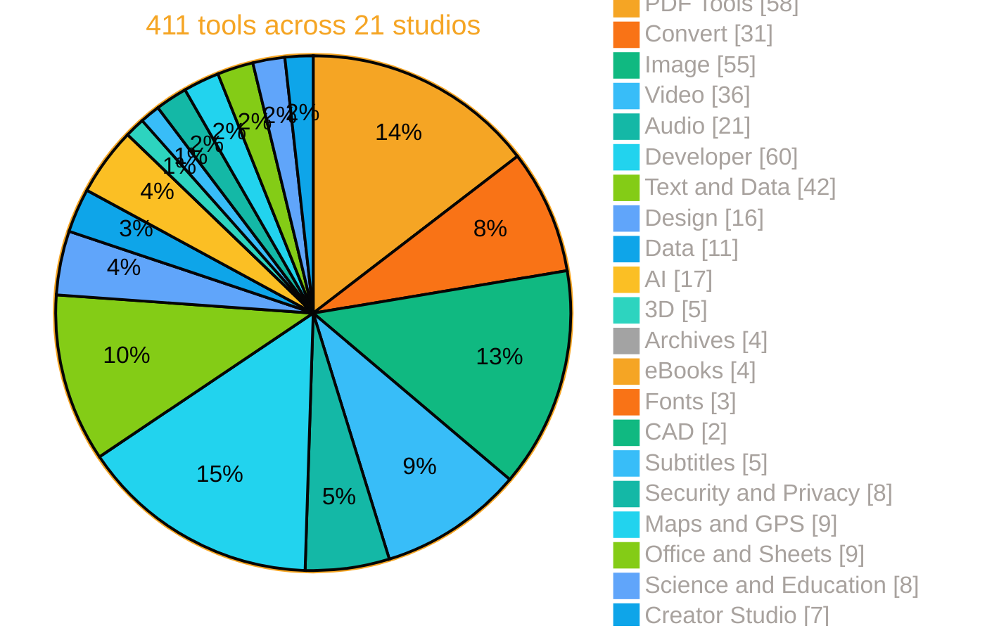

### 🧭 Category map

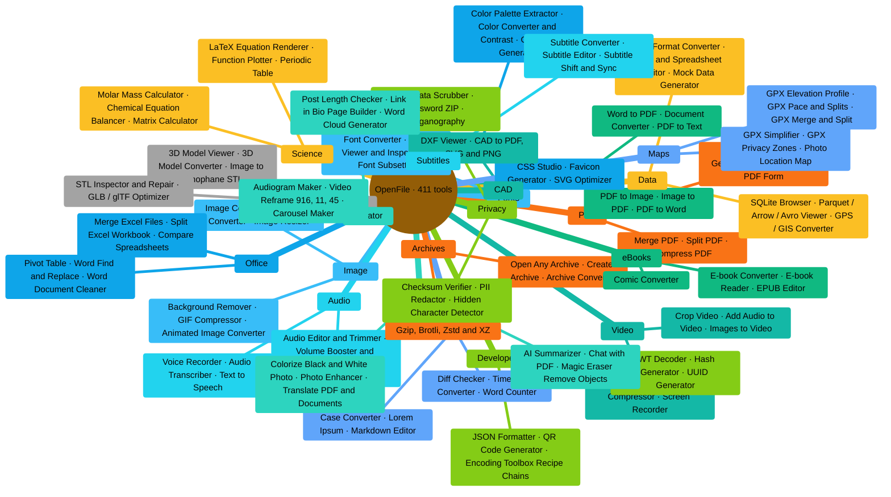
<!-- charts:end -->

<p align="center"></p>

## 🔁 Workspace, batch pipelines

The **[Workspace](https://openfile-studio.vercel.app/workspace)** turns single tools into automations: pick a mode, stack steps, drop a folder of files, download one ZIP.

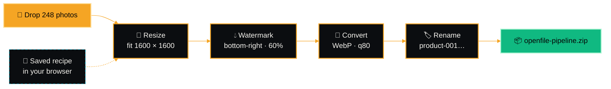

<table>
<tr>
<td width="50%" valign="top">

**🖼️ Image steps**
Resize · Convert format (JPG / PNG / WEBP / AVIF) · Compress · Rotate / flip · Filter · Watermark · Rounded corners · Rename (`{name}` `{n}` `{date}`)

</td>
<td width="50%" valign="top">

**📄 PDF steps**
Merge all · Rotate pages · Page numbers · Watermark · Clean metadata · Compress (rasterize) · Grayscale

</td>
</tr>
<tr>
<td colspan="2">

**Built-in presets:** *Web-ready photos* · *Product catalog* · *Social avatars* · *Share-safe PDF pack* · *Confidential drafts* · *Shrink scans*, plus your own **saved recipes**, stored locally.

</td>
</tr>
</table>

<p align="center"></p>

## 🏗️ Architecture

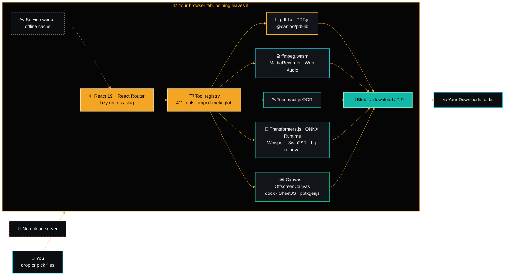

### 🔄 Lifecycle of a file

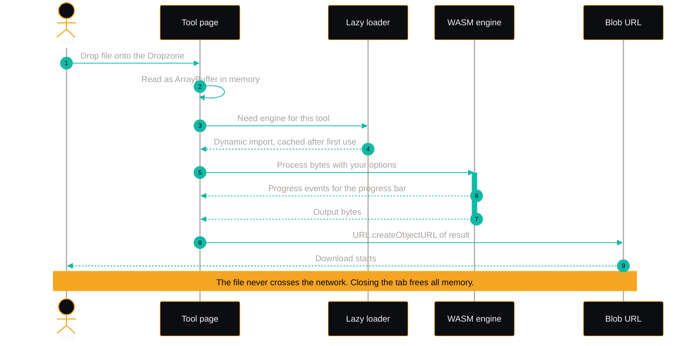

- **One component per tool** at `src/tools/<category>/<slug>.tsx`, discovered with `import.meta.glob` and code-split automatically, the homepage stays light even with 411 tools.
- **Heavy engines load on demand** (ffmpeg core, OCR language data, AI weights) and are cached by the browser and the service worker.
- **Zero-upload guarantee:** the optional Vercel functions (`/api/health`, `/api/fetch-page`, `/api/meta`) only ever receive a **URL you type**, never a file.

➡️ Deeper dive: **[docs/ARCHITECTURE.md](docs/ARCHITECTURE.md)** · Writing a tool: **[docs/TOOL_GUIDE.md](docs/TOOL_GUIDE.md)**

### 🛠️ Tech stack

| Layer | Built with |
|---|---|
| **UI** |       |
| **PDF** |     |
| **Media** |     |
| **AI** |     |
| **Office & data** |       |
| **Tooling** |      |

<p align="center"></p>

## 📚 Docs

Full documentation lives inside the app at **[/docs](https://openfile-studio.vercel.app/docs)** (also on [GitHub Pages](https://aniruddhaadak80.github.io/OpenFile/docs)), with search, a live device check, an interactive Workspace demo and references generated from the code on every build.

| Start here | Reference | Repo docs |
| --- | --- | --- |
| [Getting started](https://openfile-studio.vercel.app/docs) | [Full tools reference](https://openfile-studio.vercel.app/docs/tools) | [Architecture](docs/ARCHITECTURE.md) |
| [Install on every device](https://openfile-studio.vercel.app/docs/install) | [Formats supported](https://openfile-studio.vercel.app/docs/formats) | [Writing a tool](docs/TOOL_GUIDE.md) |
| [Using tools](https://openfile-studio.vercel.app/docs/using-tools) | [Command palette and shortcuts](https://openfile-studio.vercel.app/docs/keyboard-shortcuts) | [Keyboard shortcuts](docs/SHORTCUTS.md) |
| [Workspace pipelines](https://openfile-studio.vercel.app/docs/workspace) | [Local AI](https://openfile-studio.vercel.app/docs/local-ai) | [On-device AI](docs/AI.md) |
| [Offline and PWA](https://openfile-studio.vercel.app/docs/offline) | [Privacy and security](https://openfile-studio.vercel.app/docs/privacy-security) | [Privacy](docs/PRIVACY.md) |
| [Troubleshooting](https://openfile-studio.vercel.app/docs/troubleshooting) | [Developer guide](https://openfile-studio.vercel.app/docs/developer) | [Troubleshooting](docs/TROUBLESHOOTING.md) · [Install](docs/INSTALL.md) |

<p align="center"></p>

## 🚀 Quick start

<p align="center">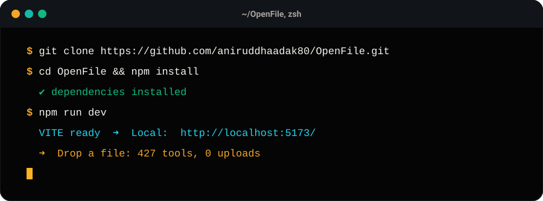</p>

```bash
git clone https://github.com/aniruddhaadak80/OpenFile.git
cd OpenFile
npm install
npm run dev          # → http://localhost:5173
```

| Script | What it does |
|---|---|
| `npm run dev` | Start the Vite dev server |
| `npm run build` | Production build for root hosting (Vercel, Netlify, Cloudflare Pages…) |
| `npm run build:pages` | Build with base `/OpenFile/` for GitHub Pages |
| `npm run typecheck` | Strict TypeScript check |
| `npm run preview` | Preview the production build locally |

> Requires **Node.js 20+** (CI uses Node 22).

### ⌨️ Keyboard shortcuts

| Where | Shortcut | Action |
|---|---|---|
| Everywhere | <kbd>Ctrl</kbd>/<kbd>⌘</kbd> + <kbd>K</kbd> | Open / close the command palette |
| Command palette | <kbd>↑</kbd> <kbd>↓</kbd> · <kbd>Enter</kbd> · <kbd>Esc</kbd> | Move · open tool · close |
| Homepage search | <kbd>Enter</kbd> | Jump to the best-matching tool |
| [PDF Reader](https://openfile-studio.vercel.app/pdf-reader) | <kbd>←</kbd> <kbd>→</kbd> (or <kbd>P</kbd> <kbd>N</kbd>) · <kbd>Home</kbd> <kbd>End</kbd> | Previous / next page · first / last page |
| [PDF Reader](https://openfile-studio.vercel.app/pdf-reader) | <kbd>Ctrl</kbd> + <kbd>F</kbd> · <kbd>Ctrl</kbd> + <kbd>+</kbd> / <kbd>-</kbd> / <kbd>0</kbd> | Search · zoom in / out / fit width |
| [Video Trimmer](https://openfile-studio.vercel.app/video-trimmer) | <kbd>I</kbd> · <kbd>O</kbd> · <kbd>Space</kbd> | Set in-point · set out-point · play selection |
| [Audio Editor](https://openfile-studio.vercel.app/audio-editor) | <kbd>Space</kbd> · <kbd>Ctrl</kbd> + <kbd>Z</kbd> / <kbd>Y</kbd> · <kbd>Del</kbd> | Play / pause · undo / redo · delete selection |
| [Sketch Whiteboard](https://openfile-studio.vercel.app/sketch-board) | <kbd>Ctrl</kbd> + <kbd>Z</kbd> / <kbd>D</kbd> / <kbd>G</kbd> / <kbd>S</kbd> | Undo · duplicate · group · save |
| [Sketch Whiteboard](https://openfile-studio.vercel.app/sketch-board) | <kbd>Alt</kbd> + <kbd>P</kbd> · <kbd>Shift</kbd> + <kbd>1</kbd> · <kbd>?</kbd> | Present · zoom to fit · all shortcuts |

<p align="center"></p>

## 📦 Packages

OpenFile is published on [GitHub Packages](https://github.com/aniruddhaadak80/OpenFile/packages) in two forms. Both are built and tested by [`.github/workflows/publish-packages.yml`](.github/workflows/publish-packages.yml) for every release.

| Package | What it is | Get it |
| --- | --- | --- |
| [`ghcr.io/aniruddhaadak80/openfile`](https://github.com/aniruddhaadak80/OpenFile/pkgs/container/openfile) | Container image, `linux/amd64` and `linux/arm64`, non-root, signed with cosign, with SBOM and build provenance | `docker pull ghcr.io/aniruddhaadak80/openfile` |
| [`@aniruddhaadak80/openfile`](https://github.com/aniruddhaadak80/OpenFile/pkgs/npm/openfile) | npm CLI that serves the full app from your machine, offline | `npx @aniruddhaadak80/openfile` |

**Docker**

```bash
docker run -d --name openfile -p 8080:8080 ghcr.io/aniruddhaadak80/openfile:latest
# open http://localhost:8080
```

Image tags: `latest`, the full version (`1.2.0`), the minor line (`1.2`), the major line (`1`) and the commit (`sha-<7 chars>`). Pin a version or a digest in production.

**Docker Compose**

```bash
curl -O https://raw.githubusercontent.com/aniruddhaadak80/OpenFile/main/docker-compose.yml
docker compose up -d
```

**npx**

GitHub's npm registry needs a token even for public packages. Create a [personal access token (classic)](https://github.com/settings/tokens/new?scopes=read:packages&description=OpenFile%20npm) with only the `read:packages` scope, then add two lines to `~/.npmrc`:

```ini
@aniruddhaadak80:registry=https://npm.pkg.github.com
//npm.pkg.github.com/:_authToken=YOUR_TOKEN
```

```bash
npx @aniruddhaadak80/openfile                 # serves http://localhost:5173 and opens your browser
npx @aniruddhaadak80/openfile --port 8080 --no-open
npx @aniruddhaadak80/openfile --host 0.0.0.0  # share on your local network
```

Verify the image signature:

```bash
cosign verify ghcr.io/aniruddhaadak80/openfile:latest \
  --certificate-identity-regexp '^https://github.com/aniruddhaadak80/OpenFile/' \
  --certificate-oidc-issuer https://token.actions.githubusercontent.com
```

Settings, headers, reverse proxies and Kubernetes: [docs/SELF_HOSTING.md](docs/SELF_HOSTING.md).

<p align="center"></p>

## ☁️ Self-hosting

OpenFile is a **static site**. Host it anywhere that serves files and rewrites unknown routes to `index.html`.

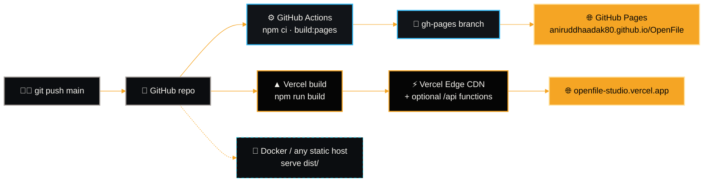

<details open>
<summary><b>▲ Vercel</b> (recommended, includes the optional API routes)</summary>
<br/>

[](https://vercel.com/new/clone?repository-url=https%3A%2F%2Fgithub.com%2Faniruddhaadak80%2FOpenFile)

1. Import the repo on Vercel, framework (**Vite**), build command and output dir are read from `vercel.json`.
2. Deploy. SPA rewrites, `/api/*` functions, immutable asset caching and security headers work out of the box.

</details>

<details>
<summary><b>🐙 GitHub Pages</b> (static mirror)</summary>
<br/>

1. Fork the repo and push to `main`, `.github/workflows/deploy-pages.yml` runs `npm run build:pages` and publishes `dist/` to the `gh-pages` branch.
2. **Settings → Pages → Deploy from a branch → `gh-pages` / root** (one-time).
3. Live at `https://<you>.github.io/OpenFile/`. Every tool works; only the URL mode of HTML → PDF needs the Vercel API.

> Renamed the repo? Change `VITE_BASE=/OpenFile/` in the `build:pages` script to match.

</details>

<details>
<summary><b>🐳 Docker</b> (nginx, any server)</summary>
<br/>

Save this as `Dockerfile` in the repo root:

```dockerfile
# ---- build ----
FROM node:22-alpine AS build
WORKDIR /app
COPY package*.json ./
RUN npm ci
COPY . .
RUN npm run build

# ---- serve ----
FROM nginx:alpine
COPY --from=build /app/dist /usr/share/nginx/html
RUN printf 'server {\n  listen 80;\n  root /usr/share/nginx/html;\n  location / { try_files $uri $uri/ /index.html; }\n}\n' > /etc/nginx/conf.d/default.conf
EXPOSE 80
```

```bash
docker build -t openfile .
docker run -p 8080:80 openfile   # → http://localhost:8080
```

</details>

<details>
<summary><b>📦 Any static host</b> (Netlify, Cloudflare Pages, S3, your own server)</summary>
<br/>

```bash
npm run build      # outputs dist/
npx serve -s dist  # quick local check with SPA fallback
```

Upload `dist/` and make unknown routes serve `index.html`. For a sub-path, build with `VITE_BASE=/your-path/ npx vite build`.

</details>

<p align="center"></p>

## 🗂️ Project structure

<!-- tree:start -->
```text
OpenFile/
├─ api/                      # optional Vercel functions (receive URLs, never files)
│  ├─ health.ts              #   GET /api/health
│  ├─ fetch-page.ts          #   GET /api/fetch-page?url=   (HTML → PDF)
│  └─ meta.ts                #   GET /api/meta?url=         (link previews)
├─ docs/
│  ├─ assets/                # animated SVG artwork for this README
│  ├─ ARCHITECTURE.md        # deep dive: engines, routing, pipelines
│  └─ TOOL_GUIDE.md          # how to write a new tool
├─ public/
│  ├─ media/                 # launch.mp4, poster.jpg, tools/ preview videos + index.json
│  ├─ og.png · icons         # social card, favicons, PWA icons
│  ├─ manifest.webmanifest   # installable PWA + share target
│  └─ sw.js                  # offline service worker
├─ scripts/                  # postbuild, icons, launch film and preview video tooling
│  └─ gen-readme-catalog.mjs # regenerates the catalog parts of README and docs
├─ src/
│  ├─ blog/                  # blog posts with live demos
│  ├─ components/            # UI kit, layout, command palette, drop anything, compare, previews
│  ├─ docs/                  # in-app docs pages (Markdown) and nav
│  ├─ lib/                   # files · pdf · ffmpeg · detect · handoff · store (IndexedDB) · prefs
│  ├─ pages/                 # Home, Tools, ToolPage, Workspace, Docs, Blog, History, Settings
│  │  └─ workspace/steps.ts  # pipeline steps + presets
│  └─ tools/
│     ├─ registry.ts         # the catalog, 411 tools, 21 categories
│     ├─ batches/            # more catalog entries: b-cat1, b-cat2, b-cat3, b1, b10, b11, b12, b2, b3, b4, b5
│     ├─ engines.ts · guides.ts  # "How it works" content for every tool page
│     └─ pdf/ convert/ image/ video/ audio/ dev/ text/ design/ data/ ai/ 3d/
│        archive/ ebook/ font/ cad/ subtitle/ privacy/ geo/ office/ science/ creator/
├─ .github/workflows/        # GitHub Pages deploy
├─ CHANGELOG.md              # release notes
└─ vercel.json               # SPA rewrites + security headers
```
<!-- tree:end -->

<p align="center"></p>

## 🤝 Contributing

New tools, fixes and ideas are very welcome. Every tool is **one React component**:

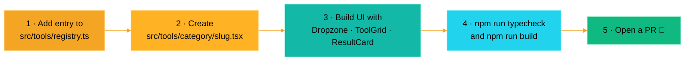

- The one hard rule: **keep everything client-side**, PRs that upload user files will not be merged.
- Heavy libraries must be **dynamically imported** inside handlers so each tool chunk stays small.
- Add a screenshot or GIF for UI changes. Full conventions: **[docs/TOOL_GUIDE.md](docs/TOOL_GUIDE.md)** · **[CONTRIBUTING.md](CONTRIBUTING.md)**.
- Found a bug or want a tool? **[Open an issue](https://github.com/aniruddhaadak80/OpenFile/issues/new)**.

<p align="center"></p>

## 🗺️ Roadmap

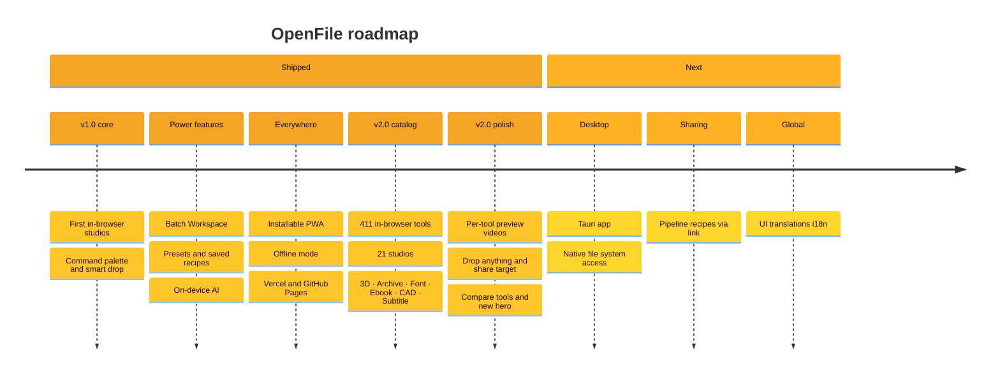

- [x] 411 in-browser tools across 21 studios
- [x] Batch Workspace with presets and saved recipes
- [x] On-device AI, background removal, OCR, upscaling, transcription
- [x] Installable PWA + offline mode
- [x] New studios: 3D, archives, fonts, eBooks, CAD and subtitles
- [x] More on-device AI: chat with PDF, colorize, object remover, photo enhancer, summarizer
- [x] Drop anything, share target, compare tools and per-tool preview videos
- [ ] Desktop app (Tauri) with native file-system access
- [ ] Shareable pipeline recipes via link
- [ ] UI translations (i18n)

### 🔭 Coming soon

- 🎞️ **Per-tool preview videos**, a short preview video for every tool. *Now live on tool pages and cards, more on the way.*
- 🌗 **Black, light and system themes** with selectable **accent colours**. *Now in the theme menu in the header.*
- 🧩 **New studios**, 3D models, archives, fonts, ebooks, CAD and subtitles. *Shipped in v2.0, see [What's new](#-whats-new).*
- 📰 **Interactive blog**, guides and project updates with live, interactive examples. *Live at [/blog](https://openfile-studio.vercel.app/blog).*

<p align="center"></p>

## ❓ FAQ

<details>
<summary><b>Are my files really never uploaded?</b></summary>
<br/>
Yes. Files are read into memory by your browser and processed with WebAssembly, Canvas and Web Audio inside the tab. There is no upload endpoint in the code. Open DevTools → Network while using any tool to see for yourself. The only server routes are optional and accept a URL you type (for HTML → PDF and link previews), never a file.
</details>

<details>
<summary><b>Is it actually free? What's the catch?</b></summary>
<br/>
No catch. Because your device does the work, there are no server costs to recover, so no paywall, no watermark, no quota and no account. The code is MIT-licensed.
</details>

<details>
<summary><b>Does it work offline?</b></summary>
<br/>
Yes. OpenFile is an installable PWA. After the first visit the app shell is cached; engines such as ffmpeg, OCR language packs and AI models are cached the first time you use the tool that needs them.
</details>

<details>
<summary><b>How big can my files be?</b></summary>
<br/>
There is no artificial cap, the limit is your device's memory. Very large videos or PDFs with hundreds of pages work best on a desktop browser.
</details>

<details>
<summary><b>Why is the first run of an AI or video tool slower?</b></summary>
<br/>
The engine (for example ffmpeg core or model weights) is downloaded once and then cached. Later runs start instantly. WebGPU-capable browsers run the AI tools faster.
</details>

<details>
<summary><b>Which browsers are supported?</b></summary>
<br/>

| Capability | Chrome / Edge | Firefox | Safari |
|---|:-:|:-:|:-:|
| PDF, image, dev &amp; text tools | ✅ | ✅ | ✅ |
| Video / audio (ffmpeg.wasm) | ✅ | ✅ | ✅ |
| AI tools (WebGPU fast path) | ✅ | ⚠️ WASM | ⚠️ WASM |
| Screen recorder | ✅ | ✅ | ✅ 16+ |
| QR scanning (BarcodeDetector) | ✅ | ⚠️ | ⚠️ |

Check your own browser on the in-app **[/status](https://openfile-studio.vercel.app/status)** page.
</details>

<details>
<summary><b>Can I link straight to a tool?</b></summary>
<br/>
Yes, every tool has its own URL: <code>https://openfile-studio.vercel.app/&lt;slug&gt;</code>, for example <a href="https://openfile-studio.vercel.app/merge-pdf">/merge-pdf</a> or <a href="https://openfile-studio.vercel.app/background-remover">/background-remover</a>. Categories live at <code>/category/&lt;id&gt;</code>.
</details>

<details>
<summary><b>Can I self-host it for my team?</b></summary>
<br/>
Absolutely, see <a href="#%EF%B8%8F-self-hosting">Self-hosting</a>. It is a static build, so any static host, an internal nginx, or the Docker recipe above works.
</details>

<p align="center"></p>

## 👤 Built by

<p align="center">
  <a href="public/author/aniruddha-adak.webp"></a>
</p>

<p align="center"></p>

<p align="center">
  <a href="https://github.com/aniruddhaadak80"></a>
  <a href="https://dev.to/aniruddhaadak"></a>
  <a href="https://www.linkedin.com/in/aniruddha-adak"></a>
  <br/>
  <a href="https://x.com/asi369_"></a>
  <a href="https://www.youtube.com/channel/UCPG2FWjVxnz9pKSzK2Bzxlw"></a>
  <a href="https://devpost.com/aniruddhaadak"></a>
</p>

<table>
<tr>
<td width="50%" valign="top">

### 🌏 About
**Aniruddha Adak** is an open-source developer from West Bengal, India (Kolkata area), with a **B.Tech in Computer Science &amp; Engineering (2026)**, who builds **agentic harnesses** and **production-grade agent skills**, and OpenFile, a fully in-browser file toolkit.

</td>
<td width="50%" valign="top">

### ⚡ Highlights
- 🛠️ Active **open-source contributor**
- 🏆 Frequent **hackathon builder**, MLH Global Hack Week, Hacktoberfest, DEV challenges
- ✍️ Writes **daily AI news on [DEV](https://dev.to/aniruddhaadak)**

</td>
</tr>
</table>

<p align="center"><sub>Like OpenFile? <a href="https://github.com/aniruddhaadak80">Follow on GitHub</a> for more open-source tools.</sub></p>

<p align="center"></p>

## ⭐ Star history

<p align="center">
  <a href="https://star-history.com/#aniruddhaadak80/OpenFile&Date">
    <picture>
      <source media="(prefers-color-scheme: dark)" srcset="https://api.star-history.com/svg?repos=aniruddhaadak80/OpenFile&type=Date&theme=dark"/>
      <source media="(prefers-color-scheme: light)" srcset="https://api.star-history.com/svg?repos=aniruddhaadak80/OpenFile&type=Date"/>
      
    </picture>
  </a>
</p>

## 🙏 Credits

Built on the shoulders of giants: [pdf-lib](https://pdf-lib.js.org) · [PDF.js](https://mozilla.github.io/pdf.js/) · [ffmpeg.wasm](https://ffmpegwasm.netlify.app) · [Tesseract.js](https://tesseract.projectnaptha.com) · [Transformers.js](https://huggingface.co/docs/transformers.js) · [IMG.LY background-removal](https://github.com/imgly/background-removal-js) · [SheetJS](https://sheetjs.com) · [docx](https://docx.js.org) · [mammoth](https://github.com/mwilliamson/mammoth.js) · [pptxgenjs](https://gitbrent.github.io/PptxGenJS/) · [svgo](https://svgo.dev) · [Lucide](https://lucide.dev).

## 📄 License

[MIT](LICENSE) © 2026 [Aniruddha Adak](https://github.com/aniruddhaadak80)

<p align="center"></p>

<p align="center">
  <b>If OpenFile saved you an upload, please <a href="https://github.com/aniruddhaadak80/OpenFile">⭐ star the repo</a>.</b><br/>
  <sub>Made with ♥ by <a href="https://github.com/aniruddhaadak80">@aniruddhaadak80</a> · <a href="https://openfile-studio.vercel.app">openfile-studio.vercel.app</a> · <a href="https://aniruddhaadak80.github.io/OpenFile/">GitHub Pages mirror</a></sub>
</p>
