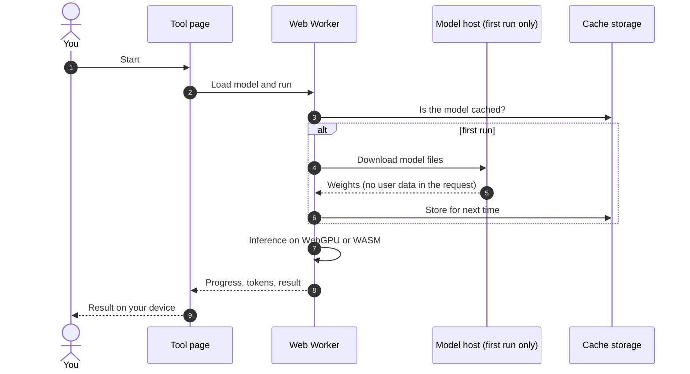

# On-device AI in OpenFile

OpenFile's AI tools run the model on your device. The model downloads once from a public model host, is cached by the browser and the service worker, and from then on your files, prompts and answers never leave the tab. There is no API key, no account and no inference server.

In the app: [/docs/local-ai](https://openfile-studio.vercel.app/docs/local-ai), with a live check of what your browser supports.

## Models

The table below is generated by `scripts/gen-docs.mjs`, which scans the tool code for model ids, so it always matches what ships.

<!-- gen:ai-models:start -->
| Model | Download | Used by |
| --- | --- | --- |
| `Carve/LaMa-ONNX (lama_fp32.onnx)` | shown in the tool before it downloads | [Magic Eraser (Remove Objects)](https://openfile-studio.vercel.app/object-remover) |
| `HuggingFaceTB/SmolLM2-135M-Instruct` | about 130 MB | [AI Writing Helper](https://openfile-studio.vercel.app/ai-writer), [Chat with PDF](https://openfile-studio.vercel.app/chat-pdf), [AI Summarizer](https://openfile-studio.vercel.app/pdf-summarizer), [Quiz and Flashcard Generator](https://openfile-studio.vercel.app/question-generator) |
| `lensmera/lensmera-color-ddcolor (ddcolor_tiny_fp16.onnx)` | shown in the tool before it downloads | [Colorize Black and White Photo](https://openfile-studio.vercel.app/colorize-photo) |
| `onnx-community/depth-anything-v2-small` | about 27 MB | [AI Depth Map](https://openfile-studio.vercel.app/depth-map), [Name & Entity Extractor](https://openfile-studio.vercel.app/entity-extractor), [AI Hashtag Generator](https://openfile-studio.vercel.app/hashtag-generator), [AI Image Captioner](https://openfile-studio.vercel.app/image-captioner), [AI Image Segmenter](https://openfile-studio.vercel.app/image-segmenter), [AI Image Tagger](https://openfile-studio.vercel.app/image-tagger), [AI Meal Photo Logger](https://openfile-studio.vercel.app/meal-photo-logger), [AI Meta Description Writer](https://openfile-studio.vercel.app/meta-description-writer), [Near Duplicate Finder](https://openfile-studio.vercel.app/near-duplicate-text), [AI Notes to Flashcards](https://openfile-studio.vercel.app/notes-to-flashcards), [AI Object Detector](https://openfile-studio.vercel.app/object-detector), [Semantic File Search](https://openfile-studio.vercel.app/semantic-file-search), [Sentiment Analyzer](https://openfile-studio.vercel.app/sentiment-analyzer), [Similar Photo Finder](https://openfile-studio.vercel.app/similar-photo-finder), [Zero-shot Text Classifier](https://openfile-studio.vercel.app/text-classifier), [Toxic Comment Checker](https://openfile-studio.vercel.app/toxicity-checker), [AI Transaction Categorizer](https://openfile-studio.vercel.app/transaction-categorizer) |
| `onnx-community/Kokoro-82M-v1.0-ONNX` | about 90 MB | [PDF to Speech](https://openfile-studio.vercel.app/pdf-to-speech), [Text to Speech](https://openfile-studio.vercel.app/text-to-speech) |
| `onnx-community/Qwen2.5-0.5B-Instruct` | about 500 MB | [AI Writing Helper](https://openfile-studio.vercel.app/ai-writer), [Chat with PDF](https://openfile-studio.vercel.app/chat-pdf), [AI Summarizer](https://openfile-studio.vercel.app/pdf-summarizer), [Quiz and Flashcard Generator](https://openfile-studio.vercel.app/question-generator) |
| `onnx-community/Qwen2.5-1.5B-Instruct` | about 1.3 GB | [AI Writing Helper](https://openfile-studio.vercel.app/ai-writer), [Chat with PDF](https://openfile-studio.vercel.app/chat-pdf), [AI Depth Map](https://openfile-studio.vercel.app/depth-map), [Name & Entity Extractor](https://openfile-studio.vercel.app/entity-extractor), [AI Hashtag Generator](https://openfile-studio.vercel.app/hashtag-generator), [AI Image Captioner](https://openfile-studio.vercel.app/image-captioner), [AI Image Segmenter](https://openfile-studio.vercel.app/image-segmenter), [AI Image Tagger](https://openfile-studio.vercel.app/image-tagger), [AI Meal Photo Logger](https://openfile-studio.vercel.app/meal-photo-logger), [AI Meta Description Writer](https://openfile-studio.vercel.app/meta-description-writer), [Near Duplicate Finder](https://openfile-studio.vercel.app/near-duplicate-text), [AI Notes to Flashcards](https://openfile-studio.vercel.app/notes-to-flashcards), [AI Object Detector](https://openfile-studio.vercel.app/object-detector), [AI Summarizer](https://openfile-studio.vercel.app/pdf-summarizer), [PDF to Speech](https://openfile-studio.vercel.app/pdf-to-speech), [Quiz and Flashcard Generator](https://openfile-studio.vercel.app/question-generator), [Semantic File Search](https://openfile-studio.vercel.app/semantic-file-search), [Sentiment Analyzer](https://openfile-studio.vercel.app/sentiment-analyzer), [Similar Photo Finder](https://openfile-studio.vercel.app/similar-photo-finder), [Sound Identifier](https://openfile-studio.vercel.app/sound-classifier), [Subtitle Translator](https://openfile-studio.vercel.app/subtitle-translator), [Zero-shot Text Classifier](https://openfile-studio.vercel.app/text-classifier), [Toxic Comment Checker](https://openfile-studio.vercel.app/toxicity-checker), [AI Transaction Categorizer](https://openfile-studio.vercel.app/transaction-categorizer), [Translate PDF and Documents](https://openfile-studio.vercel.app/translate-pdf) |
| `Xenova/all-MiniLM-L6-v2` | about 25 MB | [Chat with PDF](https://openfile-studio.vercel.app/chat-pdf), [AI Depth Map](https://openfile-studio.vercel.app/depth-map), [Name & Entity Extractor](https://openfile-studio.vercel.app/entity-extractor), [AI Hashtag Generator](https://openfile-studio.vercel.app/hashtag-generator), [AI Image Captioner](https://openfile-studio.vercel.app/image-captioner), [AI Image Segmenter](https://openfile-studio.vercel.app/image-segmenter), [AI Image Tagger](https://openfile-studio.vercel.app/image-tagger), [AI Meal Photo Logger](https://openfile-studio.vercel.app/meal-photo-logger), [AI Meta Description Writer](https://openfile-studio.vercel.app/meta-description-writer), [Near Duplicate Finder](https://openfile-studio.vercel.app/near-duplicate-text), [AI Notes to Flashcards](https://openfile-studio.vercel.app/notes-to-flashcards), [AI Object Detector](https://openfile-studio.vercel.app/object-detector), [Semantic File Search](https://openfile-studio.vercel.app/semantic-file-search), [Sentiment Analyzer](https://openfile-studio.vercel.app/sentiment-analyzer), [Similar Photo Finder](https://openfile-studio.vercel.app/similar-photo-finder), [Zero-shot Text Classifier](https://openfile-studio.vercel.app/text-classifier), [Toxic Comment Checker](https://openfile-studio.vercel.app/toxicity-checker), [AI Transaction Categorizer](https://openfile-studio.vercel.app/transaction-categorizer) |
| `Xenova/ast-finetuned-audioset-10-10-0.4593` | about 90 MB | [AI Writing Helper](https://openfile-studio.vercel.app/ai-writer), [Near Duplicate Finder](https://openfile-studio.vercel.app/near-duplicate-text), [Sound Identifier](https://openfile-studio.vercel.app/sound-classifier), [Toxic Comment Checker](https://openfile-studio.vercel.app/toxicity-checker) |
| `Xenova/bert-base-NER` | about 105 MB | [AI Depth Map](https://openfile-studio.vercel.app/depth-map), [Name & Entity Extractor](https://openfile-studio.vercel.app/entity-extractor), [AI Hashtag Generator](https://openfile-studio.vercel.app/hashtag-generator), [AI Image Captioner](https://openfile-studio.vercel.app/image-captioner), [AI Image Segmenter](https://openfile-studio.vercel.app/image-segmenter), [AI Image Tagger](https://openfile-studio.vercel.app/image-tagger), [AI Meal Photo Logger](https://openfile-studio.vercel.app/meal-photo-logger), [AI Meta Description Writer](https://openfile-studio.vercel.app/meta-description-writer), [Near Duplicate Finder](https://openfile-studio.vercel.app/near-duplicate-text), [AI Notes to Flashcards](https://openfile-studio.vercel.app/notes-to-flashcards), [AI Object Detector](https://openfile-studio.vercel.app/object-detector), [Semantic File Search](https://openfile-studio.vercel.app/semantic-file-search), [Sentiment Analyzer](https://openfile-studio.vercel.app/sentiment-analyzer), [Similar Photo Finder](https://openfile-studio.vercel.app/similar-photo-finder), [Zero-shot Text Classifier](https://openfile-studio.vercel.app/text-classifier), [Toxic Comment Checker](https://openfile-studio.vercel.app/toxicity-checker), [AI Transaction Categorizer](https://openfile-studio.vercel.app/transaction-categorizer) |
| `Xenova/clip-vit-base-patch32` | about 150 MB | [AI Depth Map](https://openfile-studio.vercel.app/depth-map), [Name & Entity Extractor](https://openfile-studio.vercel.app/entity-extractor), [AI Hashtag Generator](https://openfile-studio.vercel.app/hashtag-generator), [AI Image Captioner](https://openfile-studio.vercel.app/image-captioner), [AI Image Segmenter](https://openfile-studio.vercel.app/image-segmenter), [AI Image Tagger](https://openfile-studio.vercel.app/image-tagger), [AI Meal Photo Logger](https://openfile-studio.vercel.app/meal-photo-logger), [AI Meta Description Writer](https://openfile-studio.vercel.app/meta-description-writer), [Near Duplicate Finder](https://openfile-studio.vercel.app/near-duplicate-text), [AI Notes to Flashcards](https://openfile-studio.vercel.app/notes-to-flashcards), [AI Object Detector](https://openfile-studio.vercel.app/object-detector), [Semantic File Search](https://openfile-studio.vercel.app/semantic-file-search), [Sentiment Analyzer](https://openfile-studio.vercel.app/sentiment-analyzer), [Similar Photo Finder](https://openfile-studio.vercel.app/similar-photo-finder), [Zero-shot Text Classifier](https://openfile-studio.vercel.app/text-classifier), [Toxic Comment Checker](https://openfile-studio.vercel.app/toxicity-checker), [AI Transaction Categorizer](https://openfile-studio.vercel.app/transaction-categorizer) |
| `Xenova/distilbart-cnn-6-6` | about 300 MB | [AI Summarizer](https://openfile-studio.vercel.app/pdf-summarizer) |
| `Xenova/distilbert-base-uncased-finetuned-sst-2-english` | about 66 MB | [AI Depth Map](https://openfile-studio.vercel.app/depth-map), [Name & Entity Extractor](https://openfile-studio.vercel.app/entity-extractor), [AI Hashtag Generator](https://openfile-studio.vercel.app/hashtag-generator), [AI Image Captioner](https://openfile-studio.vercel.app/image-captioner), [AI Image Segmenter](https://openfile-studio.vercel.app/image-segmenter), [AI Image Tagger](https://openfile-studio.vercel.app/image-tagger), [AI Meal Photo Logger](https://openfile-studio.vercel.app/meal-photo-logger), [AI Meta Description Writer](https://openfile-studio.vercel.app/meta-description-writer), [Near Duplicate Finder](https://openfile-studio.vercel.app/near-duplicate-text), [AI Notes to Flashcards](https://openfile-studio.vercel.app/notes-to-flashcards), [AI Object Detector](https://openfile-studio.vercel.app/object-detector), [Semantic File Search](https://openfile-studio.vercel.app/semantic-file-search), [Sentiment Analyzer](https://openfile-studio.vercel.app/sentiment-analyzer), [Similar Photo Finder](https://openfile-studio.vercel.app/similar-photo-finder), [Zero-shot Text Classifier](https://openfile-studio.vercel.app/text-classifier), [Toxic Comment Checker](https://openfile-studio.vercel.app/toxicity-checker), [AI Transaction Categorizer](https://openfile-studio.vercel.app/transaction-categorizer) |
| `Xenova/mobilebert-uncased-mnli` | about 27 MB | [AI Depth Map](https://openfile-studio.vercel.app/depth-map), [Name & Entity Extractor](https://openfile-studio.vercel.app/entity-extractor), [AI Hashtag Generator](https://openfile-studio.vercel.app/hashtag-generator), [AI Image Captioner](https://openfile-studio.vercel.app/image-captioner), [AI Image Segmenter](https://openfile-studio.vercel.app/image-segmenter), [AI Image Tagger](https://openfile-studio.vercel.app/image-tagger), [AI Meal Photo Logger](https://openfile-studio.vercel.app/meal-photo-logger), [AI Meta Description Writer](https://openfile-studio.vercel.app/meta-description-writer), [Near Duplicate Finder](https://openfile-studio.vercel.app/near-duplicate-text), [AI Notes to Flashcards](https://openfile-studio.vercel.app/notes-to-flashcards), [AI Object Detector](https://openfile-studio.vercel.app/object-detector), [Semantic File Search](https://openfile-studio.vercel.app/semantic-file-search), [Sentiment Analyzer](https://openfile-studio.vercel.app/sentiment-analyzer), [Similar Photo Finder](https://openfile-studio.vercel.app/similar-photo-finder), [Zero-shot Text Classifier](https://openfile-studio.vercel.app/text-classifier), [Toxic Comment Checker](https://openfile-studio.vercel.app/toxicity-checker), [AI Transaction Categorizer](https://openfile-studio.vercel.app/transaction-categorizer) |
| `Xenova/nllb-200-distilled-600M` | about 900 MB | [Subtitle Translator](https://openfile-studio.vercel.app/subtitle-translator), [Translate PDF and Documents](https://openfile-studio.vercel.app/translate-pdf) |
| `Xenova/segformer-b0-finetuned-ade-512-512` | about 4 MB | [AI Depth Map](https://openfile-studio.vercel.app/depth-map), [Name & Entity Extractor](https://openfile-studio.vercel.app/entity-extractor), [AI Hashtag Generator](https://openfile-studio.vercel.app/hashtag-generator), [AI Image Captioner](https://openfile-studio.vercel.app/image-captioner), [AI Image Segmenter](https://openfile-studio.vercel.app/image-segmenter), [AI Image Tagger](https://openfile-studio.vercel.app/image-tagger), [AI Meal Photo Logger](https://openfile-studio.vercel.app/meal-photo-logger), [AI Meta Description Writer](https://openfile-studio.vercel.app/meta-description-writer), [Near Duplicate Finder](https://openfile-studio.vercel.app/near-duplicate-text), [AI Notes to Flashcards](https://openfile-studio.vercel.app/notes-to-flashcards), [AI Object Detector](https://openfile-studio.vercel.app/object-detector), [Semantic File Search](https://openfile-studio.vercel.app/semantic-file-search), [Sentiment Analyzer](https://openfile-studio.vercel.app/sentiment-analyzer), [Similar Photo Finder](https://openfile-studio.vercel.app/similar-photo-finder), [Zero-shot Text Classifier](https://openfile-studio.vercel.app/text-classifier), [Toxic Comment Checker](https://openfile-studio.vercel.app/toxicity-checker), [AI Transaction Categorizer](https://openfile-studio.vercel.app/transaction-categorizer) |
| `Xenova/swin2SR-classical-sr-x2-64` | shown in the tool before it downloads | [Image Upscaler](https://openfile-studio.vercel.app/image-upscaler), [Photo Enhancer](https://openfile-studio.vercel.app/photo-enhancer) |
| `Xenova/toxic-bert` | about 110 MB | [Toxic Comment Checker](https://openfile-studio.vercel.app/toxicity-checker) |
| `Xenova/vit-gpt2-image-captioning` | about 240 MB | [AI Depth Map](https://openfile-studio.vercel.app/depth-map), [Name & Entity Extractor](https://openfile-studio.vercel.app/entity-extractor), [AI Hashtag Generator](https://openfile-studio.vercel.app/hashtag-generator), [AI Image Captioner](https://openfile-studio.vercel.app/image-captioner), [AI Image Segmenter](https://openfile-studio.vercel.app/image-segmenter), [AI Image Tagger](https://openfile-studio.vercel.app/image-tagger), [AI Meal Photo Logger](https://openfile-studio.vercel.app/meal-photo-logger), [AI Meta Description Writer](https://openfile-studio.vercel.app/meta-description-writer), [Near Duplicate Finder](https://openfile-studio.vercel.app/near-duplicate-text), [AI Notes to Flashcards](https://openfile-studio.vercel.app/notes-to-flashcards), [AI Object Detector](https://openfile-studio.vercel.app/object-detector), [Semantic File Search](https://openfile-studio.vercel.app/semantic-file-search), [Sentiment Analyzer](https://openfile-studio.vercel.app/sentiment-analyzer), [Similar Photo Finder](https://openfile-studio.vercel.app/similar-photo-finder), [Zero-shot Text Classifier](https://openfile-studio.vercel.app/text-classifier), [Toxic Comment Checker](https://openfile-studio.vercel.app/toxicity-checker), [AI Transaction Categorizer](https://openfile-studio.vercel.app/transaction-categorizer) |
| `Xenova/whisper-base` | shown in the tool before it downloads | [Audio Transcriber](https://openfile-studio.vercel.app/audio-transcriber) |
| `Xenova/whisper-tiny` | shown in the tool before it downloads | [Audio Transcriber](https://openfile-studio.vercel.app/audio-transcriber) |
| `Xenova/yolos-tiny` | about 10 MB | [AI Depth Map](https://openfile-studio.vercel.app/depth-map), [Name & Entity Extractor](https://openfile-studio.vercel.app/entity-extractor), [AI Hashtag Generator](https://openfile-studio.vercel.app/hashtag-generator), [AI Image Captioner](https://openfile-studio.vercel.app/image-captioner), [AI Image Segmenter](https://openfile-studio.vercel.app/image-segmenter), [AI Image Tagger](https://openfile-studio.vercel.app/image-tagger), [AI Meal Photo Logger](https://openfile-studio.vercel.app/meal-photo-logger), [AI Meta Description Writer](https://openfile-studio.vercel.app/meta-description-writer), [Near Duplicate Finder](https://openfile-studio.vercel.app/near-duplicate-text), [AI Notes to Flashcards](https://openfile-studio.vercel.app/notes-to-flashcards), [AI Object Detector](https://openfile-studio.vercel.app/object-detector), [Semantic File Search](https://openfile-studio.vercel.app/semantic-file-search), [Sentiment Analyzer](https://openfile-studio.vercel.app/sentiment-analyzer), [Similar Photo Finder](https://openfile-studio.vercel.app/similar-photo-finder), [Zero-shot Text Classifier](https://openfile-studio.vercel.app/text-classifier), [Toxic Comment Checker](https://openfile-studio.vercel.app/toxicity-checker), [AI Transaction Categorizer](https://openfile-studio.vercel.app/transaction-categorizer) |

35 tools use on-device AI or OCR: [OCR PDF](https://openfile-studio.vercel.app/ocr-pdf), [Background Remover](https://openfile-studio.vercel.app/background-remover), [Image Upscaler](https://openfile-studio.vercel.app/image-upscaler), [Blur & Redact Image](https://openfile-studio.vercel.app/blur-faces), [Audio Transcriber](https://openfile-studio.vercel.app/audio-transcriber), [Text to Speech](https://openfile-studio.vercel.app/text-to-speech), [Magic Eraser (Remove Objects)](https://openfile-studio.vercel.app/object-remover), [Colorize Black and White Photo](https://openfile-studio.vercel.app/colorize-photo), [Photo Enhancer](https://openfile-studio.vercel.app/photo-enhancer), [Subtitle Translator](https://openfile-studio.vercel.app/subtitle-translator), [PDF to Speech](https://openfile-studio.vercel.app/pdf-to-speech), [AI Summarizer](https://openfile-studio.vercel.app/pdf-summarizer), [Translate PDF and Documents](https://openfile-studio.vercel.app/translate-pdf), [Quiz and Flashcard Generator](https://openfile-studio.vercel.app/question-generator), [Chat with PDF](https://openfile-studio.vercel.app/chat-pdf), [AI Image Captioner](https://openfile-studio.vercel.app/image-captioner), [AI Object Detector](https://openfile-studio.vercel.app/object-detector), [AI Depth Map](https://openfile-studio.vercel.app/depth-map), [AI Image Segmenter](https://openfile-studio.vercel.app/image-segmenter), [AI Image Tagger](https://openfile-studio.vercel.app/image-tagger), [Similar Photo Finder](https://openfile-studio.vercel.app/similar-photo-finder), [Sentiment Analyzer](https://openfile-studio.vercel.app/sentiment-analyzer), [Zero-shot Text Classifier](https://openfile-studio.vercel.app/text-classifier), [Name & Entity Extractor](https://openfile-studio.vercel.app/entity-extractor), [Semantic File Search](https://openfile-studio.vercel.app/semantic-file-search), [AI Transaction Categorizer](https://openfile-studio.vercel.app/transaction-categorizer), [AI Receipt Scanner](https://openfile-studio.vercel.app/receipt-scanner), [AI Meal Photo Logger](https://openfile-studio.vercel.app/meal-photo-logger), [AI Hashtag Generator](https://openfile-studio.vercel.app/hashtag-generator), [AI Notes to Flashcards](https://openfile-studio.vercel.app/notes-to-flashcards), [AI Meta Description Writer](https://openfile-studio.vercel.app/meta-description-writer), [AI Writing Helper](https://openfile-studio.vercel.app/ai-writer), [Sound Identifier](https://openfile-studio.vercel.app/sound-classifier), [Near Duplicate Finder](https://openfile-studio.vercel.app/near-duplicate-text), [Toxic Comment Checker](https://openfile-studio.vercel.app/toxicity-checker).
<!-- gen:ai-models:end -->

Sizes come from the text the tools show before a download. Where a tool shows the size only inside its own UI, the table says so.

## How a run works

## WebGPU or CPU

- `hasWebGPU()` in `src/lib/b4/ai.ts` asks the browser for a GPU adapter. When there is one, AI tools turn on **Use GPU** by default.
- Without WebGPU the same model runs on the CPU through WebAssembly (ONNX Runtime Web). It is slower but gives the same kind of result.
- Each model in the text catalog (`MODELS` in `src/lib/b4/ai.ts`) can pick different weights per device, for example `q4` on WASM and `q4f16` on WebGPU.
- If the GPU fails, the error tells the user to turn the GPU switch off and run again.

## Cancel, memory and errors

- Inference runs in a Web Worker so the page stays responsive. **Cancel** terminates the worker, which frees its memory at once.
- `friendlyAiError()` turns raw errors into plain advice: out of memory (close tabs or pick the smaller model), download failed (check the connection), WebGPU failed (turn off GPU).

## Privacy

- Inference happens in the user's tab. Files, text and audio never leave the device.
- The only network traffic is the model download, a plain GET for a public file that is the same for every user.
- After the first run the model is cached, so you can verify there is no traffic at all in the DevTools network tab, or run the tool offline.

## Adding a model

1. Load it in a worker with Transformers.js or ONNX Runtime Web, following `src/lib/b4/ai.worker.ts` or `src/tools/image/upscaler.worker.ts`.
2. Show the size next to the model id in the UI text ("about 90 MB"), so the docs pick it up.
3. Offer the GPU switch and a Cancel button (the shared UI in `src/lib/b4/aiui.tsx` does both).
4. Run `node scripts/gen-docs.mjs`. The model appears in this file and in the app docs.
