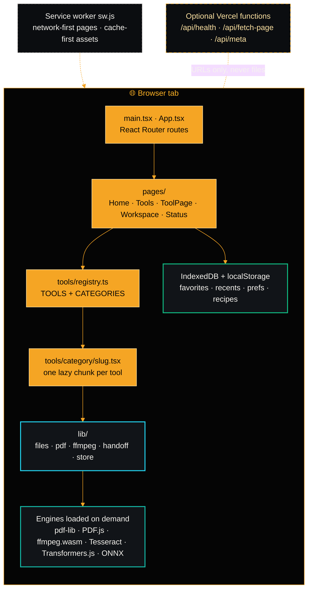
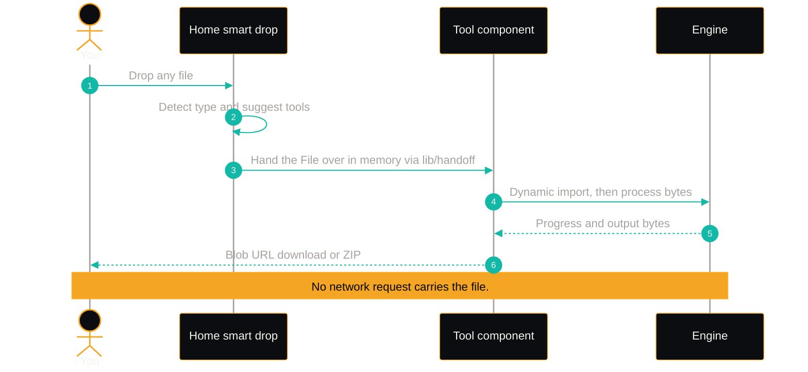
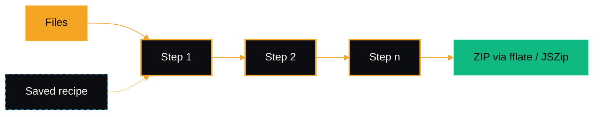
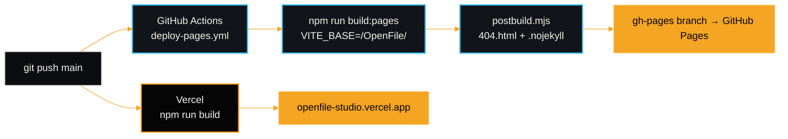
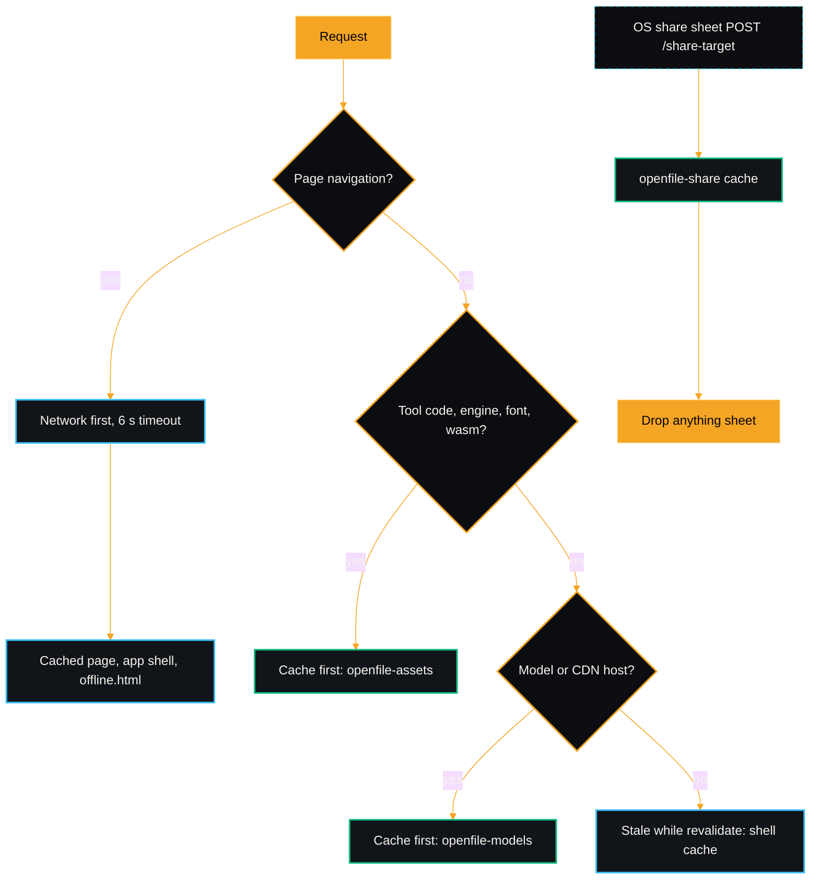
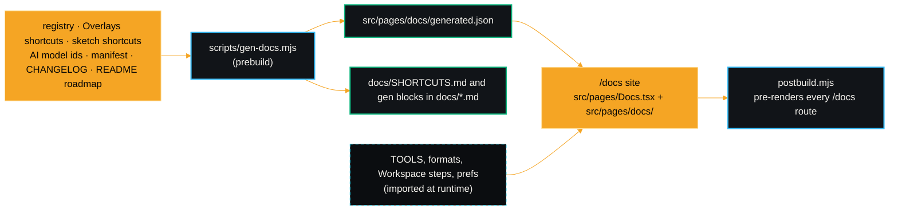

# OpenFile architecture

OpenFile is a static single-page app. Every one of its 360 tools runs inside the user's browser tab; the build output (`dist/`) is plain HTML, JS, CSS and WASM loaders that any static host can serve.

## 1. The big picture

## 2. Routing and the tool registry

- `src/App.tsx` declares the routes: `/`, `/tools`, `/category/:id`, `/workspace`, `/about`, `/privacy`, `/status`, `/docs` and `/docs/*`, `/changelog`, `/history`, `/settings`, `/blog` and `/blog/:slug`, `/install` (and `/download`), `/open`, and the catch-all `/:slug` that renders `ToolPage`.
- `src/tools/registry.ts` is the single source of truth. It holds the core tools and spreads in the entries from `src/tools/batches/b1.ts` to `b5.ts`, so parallel work on new tools never touches the same file. Each `ToolMeta` has a `slug`, `name`, `desc`, `category`, Lucide `icon`, optional `badge` (`NEW` / `AI` / `HOT` / `PRO`), `popular` flag and optional `pipeline` mode (`image` / `pdf`) for the Workspace.
- `loadTool(slug)` resolves `./<category>/<slug>.tsx` through `import.meta.glob`, so Vite emits **one chunk per tool**. Adding a tool never makes the homepage heavier.

<!-- arch-counts:start -->
| Category | Tools |
|---|:-:|
| 📄 PDF Tools | 58 |
| 🔄 Convert | 31 |
| 🖼️ Image | 55 |
| 🎬 Video | 36 |
| 🎧 Audio | 21 |
| 🧑‍💻 Developer | 60 |
| 📝 Text & Data | 42 |
| 🖌️ Design | 16 |
| 📊 Data | 11 |
| 🤖 AI | 7 |
| 🧊 3D | 5 |
| 🗜️ Archives | 4 |
| 📚 eBooks | 4 |
| 🔤 Fonts | 3 |
| 📐 CAD | 2 |
| 💬 Subtitles | 5 |
| **Total** | **360** |
<!-- arch-counts:end -->

## 3. Engines

| Engine | Used for | How it loads |
|---|---|---|
| **pdf-lib**, **@cantoo/pdf-lib** | Create / modify PDFs, encryption | Dynamic import in the tool |
| **PDF.js** (`pdfjs-dist`) | Rendering, thumbnails, text extraction, rasterising | Dynamic import, worker |
| **ffmpeg.wasm** | Video and audio transcode, trim, merge, GIF | Single-threaded core served by OpenFile itself from `public/ffmpeg` (public CDNs as a fallback), then cached |
| **Tesseract.js** | OCR | Language data fetched per language, cached |
| **Transformers.js / ONNX Runtime** | Whisper transcription, super-resolution, chat, summaries, translation, neural voices | Model weights fetched on first use in a Web Worker, WebGPU when available, WASM otherwise. See [AI.md](AI.md) |
| **@imgly/background-removal** | Background removal | Model fetched on first use |
| **Canvas / OffscreenCanvas** | All image tools and PDF rasterising | Built into the browser |
| **docx, mammoth, SheetJS, pptxgenjs, jsPDF** | Office conversions | Dynamic import |
| **MediaRecorder, Web Audio, Speech Synthesis** | Recorders, audio editor, text-to-speech | Built into the browser |

## 4. Lifecycle of a file

## 5. Workspace pipelines

`src/pages/workspace/steps.ts` defines pipeline **steps** (each a pure `run(items, params, onProgress)` over `{ name, blob }` items) and **presets**.

- **Image steps:** resize, convert, compress, rotate / flip, filter, watermark, rounded corners, rename.
- **PDF steps:** merge all, rotate, page numbers, watermark, clean metadata, compress (rasterise), grayscale.
- **Presets:** Web-ready photos, Product catalog, Social avatars, Share-safe PDF pack, Confidential drafts, Shrink scans.

## 6. Build and deploy

- **GitHub Pages** has no server-side rewrites, so `scripts/postbuild.mjs` copies `index.html` to `404.html`, making deep links like `/OpenFile/merge-pdf` work.
- **Vercel** uses `vercel.json` for SPA rewrites (excluding `/api/`, `/assets/`, `/media/`), immutable caching of hashed assets, and security headers (`nosniff`, strict referrer policy, camera / mic / display-capture limited to self).

## 7. Privacy guarantees

1. No code path sends user file bytes over the network.
2. The three optional API routes accept a URL string only.
3. Preferences, favorites, recents and saved recipes live in the browser's own storage and can be cleared from the browser at any time.
4. Contributions that upload user files are not accepted (see [CONTRIBUTING.md](../CONTRIBUTING.md)).

## 8. Offline, install and file handling

- `public/sw.js` precaches the app shell at install (`scripts/postbuild.mjs` writes the build id and the precache list), and waits for the page to say "reload" before a new version takes over.
- `public/manifest.webmanifest` declares `file_handlers` (Open with OpenFile, handled at `/open`), a `share_target` (`/share-target`, received by the service worker) and app shortcuts.
- `desktop/` (Tauri v2) and `mobile/` (Capacitor) wrap the same `dist/` build. `.github/workflows/release-apps.yml` builds every platform on a `v*` tag. See [INSTALL.md](INSTALL.md).

## 9. Docs site and generated facts

Nothing that counts or lists things in the docs is typed by hand. The docs site reads the registry, `src/lib/formats.ts`, the Workspace steps and the preferences at runtime, and reads everything else from `generated.json`, which `scripts/gen-docs.mjs` rebuilds before every build.

<!-- gen:counts:start -->
OpenFile has **360 tools in 16 categories**. PDF Tools 58, Convert 31, Image 55, Video 36, Audio 21, Developer 60, Text & Data 42, Design 16, Data 11, AI 7, 3D 5, Archives 4, eBooks 4, Fonts 3, CAD 2, Subtitles 5.
<!-- gen:counts:end -->

Back to the [README](../README.md) · Writing a tool: [TOOL_GUIDE.md](TOOL_GUIDE.md) · [AI.md](AI.md) · [PRIVACY.md](PRIVACY.md) · [TROUBLESHOOTING.md](TROUBLESHOOTING.md) · [SHORTCUTS.md](SHORTCUTS.md)
