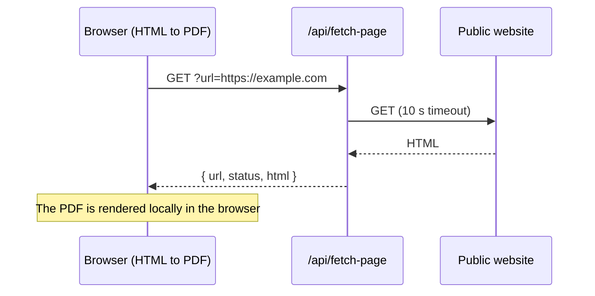

# API reference

OpenFile works without any server. When deployed on **Vercel**, three small serverless functions in `api/` add optional conveniences. They **only ever receive a URL you type, never a file**. On static hosts (GitHub Pages, Docker/nginx, etc.) these routes do not exist and the app degrades gracefully.

| Route | Method | Purpose | Cache |
| --- | --- | --- | --- |
| [`/api/health`](#get-api-health) | GET | Liveness probe used by the Status page | `no-store` |
| [`/api/fetch-page`](#get-api-fetch-page) | GET | Fetch a public web page's HTML for HTML to PDF | `s-maxage=300` |
| [`/api/meta`](#get-api-meta) | GET | Read title, description and `og:image` for link previews | `s-maxage=3600` |

All responses are JSON. Errors use the shape `{ "error": "message" }` with an appropriate status code.

## GET /api/health

Returns basic information about the deployment. The [Status](/status) page calls it to decide between *online* and *static mode*.

```bash
curl https://openfile-studio.vercel.app/api/health
```

Example response:

```json
{
  "ok": true,
  "name": "OpenFile",
  "version": "1.0.0",
  "region": "iad1",
  "time": "2026-10-28T12:00:00.000Z"
}
```

| Field | Type | Description |
| --- | --- | --- |
| `ok` | boolean | Always `true` when the function responds |
| `name` | string | `OpenFile` |
| `version` | string | API version string |
| `region` | string | `VERCEL_REGION` of the function, or `local` |
| `time` | string | Server time (ISO 8601) |

Response header: `Cache-Control: no-store`.

## GET /api/fetch-page

Fetches a public web page and returns its HTML so the HTML to PDF tool can render it in your browser.

| Query parameter | Required | Description |
| --- | --- | --- |
| `url` | yes | Absolute `http://` or `https://` URL |

```bash
curl "https://openfile-studio.vercel.app/api/fetch-page?url=https://example.com"
```

```json
{
  "url": "https://example.com/",
  "status": 200,
  "html": "<!doctype html><html><head><base href=\"https://example.com/\">…"
}
```

**Behavior**

- Only `http:` and `https:` URLs are accepted.
- Requests to private or internal hosts are refused: `localhost`, `127.*`, `10.*`, `192.168.*`, `169.254.*`, `0.*` and `*.internal`.
- The upstream request times out after **10 seconds** and is sent with the user agent `OpenFile/1.0 (+https://github.com/aniruddhaadak80/OpenFile)`.
- Only responses whose `Content-Type` contains `html` or `text` are returned.
- HTML longer than 3,000,000 characters is truncated.
- A `<base href>` pointing at the page's origin and path is injected into `<head>` so relative links, images and styles resolve.
- Successful responses are cached at the edge for 5 minutes (`s-maxage=300`).

**Errors**

| Status | When |
| --- | --- |
| `400` | Missing or invalid URL, non-http(s) protocol, or a private address |
| `415` | The URL did not return HTML or text |
| `502` | The page could not be fetched (network error or timeout) |

## GET /api/meta

Returns link-preview metadata for a URL.

| Query parameter | Required | Description |
| --- | --- | --- |
| `url` | yes | Absolute `http://` or `https://` URL |

```bash
curl "https://openfile-studio.vercel.app/api/meta?url=https://example.com"
```

Example response (fields are `null` when the page does not declare them):

```json
{
  "url": "https://example.com/",
  "title": "Example Domain",
  "description": null,
  "image": null
}
```

| Field | Type | Description |
| --- | --- | --- |
| `url` | string | Normalized URL |
| `title` | string \| null | `og:title`, falling back to `<title>` |
| `description` | string \| null | `description` or `og:description` |
| `image` | string \| null | `og:image` |

Responses are cached for an hour (`s-maxage=3600`). An invalid URL, a non-http(s) protocol or a fetch failure returns `400` with `{ "error": "…" }`.

## Using the API from your own deployment

The app calls these routes relative to its base path (`${import.meta.env.BASE_URL}api/…`). When you self-host on a platform other than Vercel, you can port the three handlers (each is a single function of the form `handler(req, res)`) or simply leave them out.


