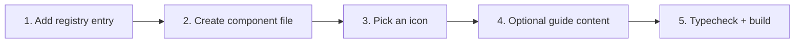

# Contributing & adding a tool

Thanks for helping make private file tools better for everyone. OpenFile is a React 19 + TypeScript + Vite + Tailwind CSS 4 app. Contributions of every size are welcome: bug fixes, new tools, docs and translations of tips.

## Set up

```bash
git clone https://github.com/<you>/OpenFile.git
cd OpenFile
npm install
npm run dev                         # http://localhost:5173
npx tsc -p tsconfig.app.json --noEmit   # typecheck
npm run build                       # production build + postbuild
```

## Project structure

```text
api/                      optional Vercel functions (health, fetch-page, meta)
public/                   static files, service worker, icons, launch film
scripts/postbuild.mjs     pre-renders every route, sitemap.xml, robots.txt, 404.html
src/
  App.tsx                 routes
  components/             UI kit (ui.tsx), Layout, CommandPalette, ToolCard, Markdown
  docs/                   docs navigation, markdown pages and generated tool guides
  lib/                    files, pdf, ffmpeg helpers, IndexedDB (db.ts), hooks (store.ts), prefs
  pages/                  Home, Tools, ToolPage, Workspace, Docs, History, Settings, …
  tools/
    registry.ts           the catalog of every tool
    guides.ts             "How it works", steps, tips and FAQ for each tool
    engines.ts            engines each tool uses
    <category>/<slug>.tsx one component per tool
```

## Ground rules

1. **Everything stays client-side.** Pull requests that upload user files to a server will not be merged.
2. **Use the UI kit** in `src/components/ui.tsx` (`Button`, `Dropzone`, `ToolGrid`, `ResultCard`, `Progress`, `useJob`, …) so every tool looks and behaves the same, in light and dark mode.
3. **Load heavy libraries lazily** inside handlers with `await import('lib')`, so each tool chunk stays small.
4. **Make it polished:** real previews, sensible defaults, helpful empty states, keyboard support and clear error messages.
5. Run the typecheck and a build before opening a PR, and add a screenshot or GIF for UI changes.

## Adding a tool



### 1. Register it

Add an entry to `TOOLS` in `src/tools/registry.ts`:

```ts
{
  slug: 'pdf-to-markdown',            // URL: /pdf-to-markdown
  name: 'PDF to Markdown',
  desc: 'Extract headings, lists and paragraphs from a PDF as clean Markdown.',
  category: 'convert',
  icon: 'FileCode',                   // a lucide-react icon name
  tags: ['md', 'extract'],
  badge: 'NEW',                       // optional: NEW | AI | HOT | PRO
}
```

The new tool automatically appears on the home page, All tools, the command palette, its category guide in the docs, the sitemap and the pre-rendered routes.

### 2. Create the component

Create `src/tools/<category>/<slug>.tsx` with a **default export** and no props. The tool page already renders the title, breadcrumb, badges, favorites button and the guide sections; your component renders only the working UI.

```tsx
import { useState } from 'react'
import { Button, Dropzone, ResultCard, ToolGrid, Progress, ErrorNote, useJob } from '@/components/ui'

export default function PdfToMarkdown() {
  const [file, setFile] = useState<File | null>(null)
  const [out, setOut] = useState<Blob | null>(null)
  const { busy, progress, error, run } = useJob()

  if (!file) return <Dropzone accept="application/pdf" onFiles={([f]) => setFile(f)} />

  const convert = () => run(async (onProgress) => {
    const { openPdfJs, pageText } = await import('@/lib/pdf')   // lazy
    // …build markdown, call onProgress(ratio)…
    setOut(new Blob(['# Title'], { type: 'text/markdown' }))
  })

  return (
    <>
      <ToolGrid
        main={<div className="rounded-xl border border-border p-4">{file.name}</div>}
        side={<Button onClick={convert} loading={busy}>Convert</Button>}
      />
      {busy && <Progress value={progress} label="Converting…" />}
      <ErrorNote error={error} />
      {out && <ResultCard blob={out} filename="document.md" onReset={() => { setFile(null); setOut(null) }} />}
    </>
  )
}
```

> [!NOTE]
> `useJob().run` passes a progress setter that takes a ratio from 0 to 1, catches errors, shows a toast and exposes `error` for `<ErrorNote/>`. See `docs/TOOL_GUIDE.md` for the full list of UI kit components and helpers.

### 3. Pick an icon

Icons are imported explicitly in `src/components/icons.ts` to keep the bundle small. If your icon is not in the list yet, add it to both the import and the `ICONS` map.

### 4. Add guide content (optional)

Tool pages and the docs show *How it works*, steps, tips, FAQ and related tools. They are generated automatically from the category and the engines your tool uses, but hand-written content is better. Add any of these optional fields to the registry entry:

```ts
{
  // …
  how: 'Extracts text runs with PDF.js, groups them into blocks by font size and position, and writes Markdown.',
  steps: ['Drop a PDF.', 'Choose heading detection sensitivity.', 'Copy or download the Markdown.'],
  tips: ['Run OCR PDF first for scanned documents.'],
  faq: [{ q: 'Are tables supported?', a: 'Simple tables are converted to Markdown tables.' }],
  related: ['pdf-to-text', 'markdown-to-pdf'],
  inputs: ['PDF'],
  outputs: ['MD'],
}
```

If your tool uses a new engine, add it to `src/tools/engines.ts` (and describe it in `ENGINE_INFO` in `src/tools/guides.ts`).

### 5. Check it

```bash
npx tsc -p tsconfig.app.json --noEmit
npm run build
```

Open `/your-slug`, try light and dark mode, a narrow mobile width, and keyboard navigation.

## Docs

Docs pages are Markdown files in `src/docs/pages/`, listed in `src/docs/nav.ts`. They support GitHub-style tables, fenced code with syntax highlighting, `mermaid` diagrams (rendered client-side) and callouts:

```md
> [!TIP]
> Callouts support NOTE, TIP and WARNING.
```

`{{TOOL_COUNT}}` is replaced with the live number of tools. Category guides are generated from the registry, so they stay in sync automatically.

## Reporting bugs

Open an issue with the tool name, your browser and OS, what you expected and what happened. If the problem depends on a file, describe it (type, size, how it was created) rather than attaching anything private.
