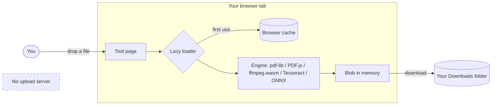
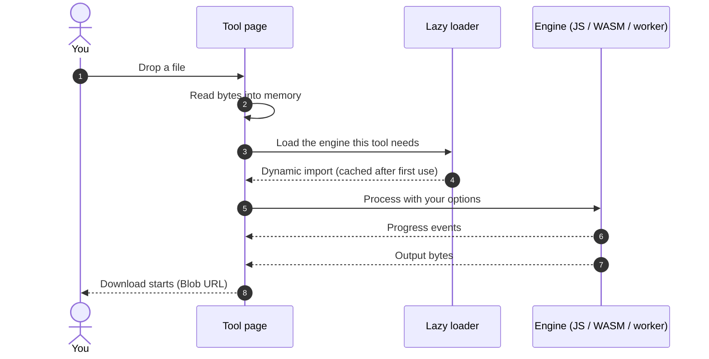

# How OpenFile works

OpenFile is a static single-page application. There is **no upload endpoint**: when you drop a file, the browser reads it into the memory of your tab, a JavaScript or WebAssembly engine processes it on your own CPU (or GPU), and the result is handed back to you as a download.

## The privacy architecture

- **Files stay local.** They are read with the File API into an `ArrayBuffer` or `Blob`. Nothing is posted to a server.
- **Results are Blob URLs.** Downloads are created with `URL.createObjectURL`, so the bytes go straight from memory to your disk.
- **Closing the tab frees everything.** Files only live in memory while the tab is open.
- **Optional server routes only take URLs.** When deployed on Vercel, three small [API routes](/docs/api) exist. They receive a URL you type (for example to fetch a public web page for HTML to PDF), never a file.

## The lifecycle of a file

## The engines

Each tool is a React component that loads only the libraries it needs, when it needs them. The main engines are:

| Engine | Used for | Runs on |
| --- | --- | --- |
| **pdf-lib** / **@cantoo/pdf-lib** | Creating and editing PDF structure, forms, encryption | JavaScript |
| **PDF.js** | Rendering pages, thumbnails and extracting text | JavaScript in a Web Worker |
| **ffmpeg.wasm** | Video and audio trimming, conversion and compression | WebAssembly in a worker |
| **Tesseract.js** | OCR in 10+ languages | WebAssembly in a worker |
| **Transformers.js** | Whisper speech-to-text, Swin2SR upscaling | ONNX Runtime Web (WebGPU or WASM) |
| **@imgly/background-removal** | Background segmentation | ONNX Runtime Web (WebGPU or WASM) |
| **Canvas 2D / OffscreenCanvas** | Image resizing, filters, watermarks, exports | GPU-accelerated browser API |
| **SheetJS, docx, mammoth, PptxGenJS, jsPDF** | Office and document conversion | JavaScript |

Every tool page lists the exact engines it uses under **How it works**.

## First-use downloads

Small engines ship with the app. Four large engines are downloaded **the first time you use a tool that needs them**, then cached so later runs start immediately. Engines served from jsDelivr are also kept by the service worker, and Transformers.js stores model weights in its own browser cache:

| Engine | Size (approx.) | Downloaded from | Tools |
| --- | --- | --- | --- |
| ffmpeg.wasm core | ~30 MB | OpenFile itself (jsDelivr or unpkg only as a fallback) | Video tools, most audio tools |
| Tesseract OCR | engine + a few MB per language | jsDelivr / tessdata CDN | OCR PDF |
| Background removal model | ~40 MB | IMG.LY CDN | Background Remover |
| Whisper (tiny / base) | ~40 MB / ~80 MB | Hugging Face Hub | Audio Transcriber |
| Swin2SR super-resolution | a small ONNX model | Hugging Face Hub | Image Upscaler |

> [!NOTE]
> Only the **engine** is downloaded. Your file is never sent anywhere, even while an engine downloads.

## Code splitting

The tool catalog lives in `src/tools/registry.ts`. Each tool component at `src/tools/<category>/<slug>.tsx` is discovered with `import.meta.glob` and becomes its own chunk, so the home page stays light even with {{TOOL_COUNT}} tools. Heavy libraries are imported dynamically inside the tool, the moment you press the button that needs them.

## Offline and caching

`public/sw.js` uses a cache-first strategy for hashed app assets and CDN engines (jsDelivr, unpkg, Google Fonts) and network-first for pages, falling back to the cached copy when you are offline. Once you have used a tool, it keeps working without a connection.

## Local data

Favorites, recent tools, activity history and settings are kept in an IndexedDB database named `openfile` in your browser. Nothing is synced or sent. See [Favorites, history & settings](/docs/local-data).
