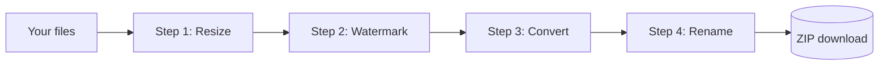

# Workspace pipelines

The [Workspace](/workspace) turns single tools into **automated pipelines**. You build a recipe of steps (for example *resize → watermark → convert to WebP → rename*) and run it on as many files as you like. Everything runs locally, one file and one step at a time, and the results download as a ZIP.

## Modes

The Workspace has two modes. Switching mode clears the file list and loads that mode's first preset.

- **Images**: accepts any image the browser can decode.
- **PDF**: accepts PDF documents.

## Building a pipeline

1. Drop files or folders, or press **Samples**.
2. Start from a recipe in the gallery, or add steps from the step library. A click adds the step after the selected one; dragging drops it on the canvas.
3. Select a step to change its settings and watch the live preview.
4. Press **Run** (Ctrl + Enter). Pause, resume or cancel at any time, and retry failed files when it ends.
5. Download single results, compare them with the before and after slider, or press **Download all as ZIP**.

## Image steps

| Step | What it does | Parameters |
| --- | --- | --- |
| Resize | Fits images inside a maximum box | Max width, max height, allow upscaling |
| Convert format | Re-encodes as JPG, PNG, WEBP or AVIF | Format, quality |
| Compress | Re-encodes with a quality level (PNG becomes WEBP) | Quality |
| Rotate / flip | Rotates in 90° steps and mirrors | Angle, flip horizontal |
| Filter | Grayscale, sepia, boost, brighten or invert | Filter |
| Watermark | Text in a corner, centered or tiled | Text, position, opacity, color |
| Rounded corners | Transparent rounded corners (PNG) | Radius % |
| Rename | Renames with a pattern | Pattern with `{name}` `{n}` `{date}`, start number |

> [!TIP]
> Quality parameters on newly added image steps start from your **default image quality** in [Settings](/settings).

## PDF steps

| Step | What it does | Parameters |
| --- | --- | --- |
| Merge all | Combines every PDF into one, in list order | Output name |
| Rotate pages | Rotates every page | Angle |
| Page numbers | Stamps page numbers at the bottom center | Format (`{n}`, `{n} / {total}`, `Page {n} of {total}`), font size |
| Watermark | Diagonal text watermark | Text, opacity |
| Clean metadata | Strips title, author, subject and keywords | None |
| Compress (rasterize) | Re-renders pages as JPEG images | DPI, JPEG quality |
| Grayscale | Converts pages to grayscale | None |

## Presets

| Preset | Mode | Steps |
| --- | --- | --- |
| Web-ready photos | Images | Resize to 1920px → WebP 80 |
| Product catalog | Images | Resize to 1200px → Watermark → JPG 85 → Rename `product-{n}` |
| Social avatars | Images | Resize to 512px → Round 50% (circle) |
| Share-safe PDF pack | PDF | Merge → Page numbers → Clean metadata |
| Confidential drafts | PDF | Watermark → Clean metadata |
| Shrink scans | PDF | Grayscale → Compress |

## Saving recipes

Type a name under **My recipes** and press save. Recipes are stored in this browser (localStorage key `of:ws-recipes`; older `of:recipes` entries are carried over) and show up in every open tab. Click a recipe to load it, or delete it with the bin icon. Recipes are included when you [export your settings](/settings).

## Tips

- Put **Resize** first: every later step then works on smaller images and runs faster.
- Put **Rename** last so it names the final files.
- **Compress (rasterize)** turns text into images. Use it for scans, not for documents whose text you need to select.
- Very large batches are limited only by your device's memory. If a run fails, split the batch.
