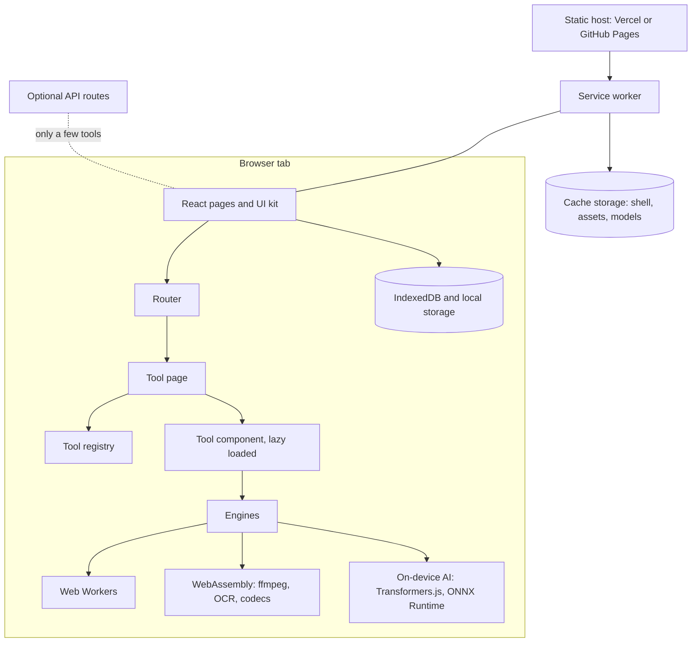

# Developer guide

OpenFile is a React 19, TypeScript and Vite app styled with Tailwind CSS 4. It is a static site: there is no backend doing file work, so you can host it anywhere that serves files. This guide is for anyone who wants to build it, change it or add a tool.

## Architecture



- **Registry** (`src/tools/registry.ts` plus `src/tools/batches/*.ts`) lists every tool: slug, name, description, category, icon and optional guide fields. Routes, search, the sitemap, these docs and the format matrix all read it.
- **Tool components** live at `src/tools/<category>/<slug>.tsx` and are code split, so a tool's code loads only when you open it.
- **Engines** are libraries the tools call: pdf-lib and PDF.js for PDFs, ffmpeg.wasm for media, Tesseract for OCR, Transformers.js and ONNX Runtime for AI, plus Canvas, Web Audio and Web Crypto.
- **Guides** (`src/tools/guides.ts`, `src/tools/engines.ts`) generate the how it works, steps, tips and FAQ for every tool page.

## Project layout

```text
api/                     optional Vercel functions (health, fetch-page, meta)
desktop/                 Tauri v2 desktop app around the web build
mobile/                  Capacitor app for Android and iOS
public/                  service worker, manifest, icons, self-hosted ffmpeg, media
scripts/
  gen-docs.mjs           generates docs facts (shortcuts, AI models, dates) before each build
  gen-icons.mjs          icon set, runs before each build
  postbuild.mjs          pre-renders every route, sitemap, robots, llms.txt, OG images
  tests/                 unit tests per batch
src/
  App.tsx                routes
  components/            UI kit, layout, command palette, markdown renderer
  docs/                  original docs pages and tool guide generator
  lib/                   shared helpers, IndexedDB, preferences, engine loaders
  pages/                 Home, Tools, ToolPage, Workspace, Docs, Settings and more
  pages/docs/            this documentation site: navigation, pages, search, components
  tools/                 registry, guides, batches and one folder per category
```

## Adding a tool

The short version: add a registry entry, create the component, run the checks. The full walkthrough with code is in [Contributing](/docs/contributing#adding-a-tool).

1. Add an entry to a batch file in `src/tools/batches/` (or to `CORE_TOOLS` in the registry) with a unique `slug`, a `category` id and a Lucide `icon` name.
2. Create `src/tools/<category>/<slug>.tsx` with a default export and no props. Use the UI kit in `src/components/ui.tsx`.
3. Optionally set `inputs`, `outputs`, `steps`, `tips`, `how`, `faq` and `related`. `inputs` and `outputs` feed the [format matrix](/docs/formats) directly.
4. Run the typecheck and build. The new tool appears in search, the sitemap, the [tools reference](/docs/tools) and these docs automatically.

## Batch files

New tools usually ship in groups. Each group is a file `src/tools/batches/bN.ts` exporting `BATCH_N: ToolMeta[]`, spread into `TOOLS` in the registry. Shared logic for a batch goes in `src/lib/bN/`, kept free of React where possible so it can be unit tested, and tests go in `scripts/tests/bN/`.

## Tests

::tests

Tests are plain Node scripts using `node:assert`. Node 22 runs them directly, including TypeScript imports:

```bash
node scripts/tests/b12/b12.test.mjs
for f in scripts/tests/*/*.test.mjs; do node "$f" || exit 1; done
```

## Build

| Command | What it does |
| --- | --- |
| `npm run dev` | Vite dev server at http://localhost:5173 |
| `npx tsc -p tsconfig.app.json --noEmit` | Strict typecheck |
| `npm run build` | Production build for root hosting, then postbuild |
| `npm run build:pages` | Same, with the base path `/OpenFile/` for GitHub Pages |
| `node scripts/gen-docs.mjs` | Regenerate docs facts by hand (also runs before every build) |

`prebuild` runs the icon generator and `gen-docs.mjs`, then Vite builds, then `postbuild.mjs` pre-renders a real HTML file for every route with its own title, description and structured data.

## Pages and Vercel base paths

:::tabs host
@tab Vercel
Served from the domain root, so the base path is `/`. `vercel.json` rewrites unknown paths to the app and sets cache and security headers. Build command: `npm run build`.
@tab GitHub Pages
Served from `/OpenFile/`. The workflow `.github/workflows/deploy-pages.yml` runs `npm run build:pages`, which sets `VITE_BASE=/OpenFile/`. Pages has no rewrites, so postbuild writes `dist/<route>/index.html` for every route and a `404.html` fallback, which is why deep links work after a reload.
@tab Your own host
Build with `VITE_BASE=/your-path/ npm run build` for a sub-path, or plain `npm run build` for a root. Serve `dist/` and send unknown paths to `index.html`. See [Self-hosting](/docs/self-hosting).
:::

Inside the code, never hard-code `/`. Use `import.meta.env.BASE_URL` for files in `public/`, and router links for pages.

## Release the apps

::workflows

1. Bump `version` in `desktop/src-tauri/tauri.conf.json` and `desktop/src-tauri/Cargo.toml`, and `versionName` and `versionCode` in `mobile/android/app/build.gradle`. The current app version is **{{APP_VERSION}}**.
2. Push a tag such as `v1.2.0`, or run the release workflow by hand with a tag.
3. The workflow builds the web app once, then Windows, macOS, Linux, Android and iOS simulator builds, and attaches them to the GitHub Release with fixed names, so `releases/latest/download/<name>` links on the Install page never go stale.

## Keeping the docs current

Anything that counts or lists things in these docs is generated, never typed: tool and category counts, the tools reference, the format matrix, shortcuts, the AI model list, the changelog and the roadmap. `scripts/gen-docs.mjs` runs before every build and also refreshes `docs/SHORTCUTS.md` and the generated blocks in the repo docs. After adding tools, run it and check the docs pages for anything new worth explaining.
