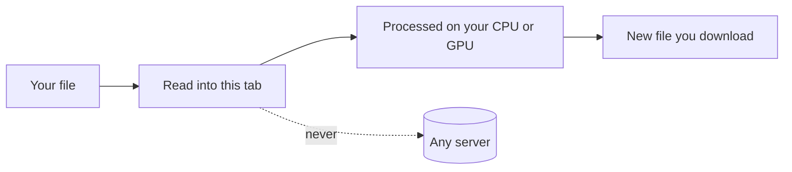

# Getting started

OpenFile is a free, open-source workbench of **{{TOOL_COUNT}} file tools in {{CATEGORY_COUNT}} categories** for PDFs, images, video, audio, data, code and more. Every tool runs inside your browser tab. Your files are never uploaded, there is no account, and there are no limits or watermarks.

::component stats

## Your first file in 30 seconds

1. **Pick a tool.** Press <kbd>Ctrl</kbd> + <kbd>K</kbd> (or <kbd>Cmd</kbd> + <kbd>K</kbd> on a Mac), type what you want to do, for example `merge pdf` or `compress image`, and press <kbd>Enter</kbd>.
2. **Drop your file** on the drop area, or click it to choose one. Most tools take several files at once.
3. **Adjust the options.** Most tools show a live preview while you change things.
4. **Download.** Press the main button. You always get a new copy, your original is never touched. Batches come as a ZIP.

> [!TIP]
> Not sure which tool you need? Drag the file onto any page. OpenFile reads the first bytes of the file to work out what it really is, then suggests the tools that fit.

## Try one of these

::component popular-tools

## What happens to my file

Your file is read from your disk into the memory of this tab, processed by code that already sits on your device (JavaScript, WebAssembly, and for AI tools a model that downloads once), and handed back as a download. Nothing is sent to a server. You can check this yourself in a minute, see [Privacy and security](/docs/privacy-security#verify-it-yourself).

## Keep going

- [Install on every device](/docs/install): put OpenFile on your desktop, phone or tablet. It works offline.
- [Using tools](/docs/using-tools): batches, page ranges, presets, history and undo.
- [Workspace pipelines](/docs/workspace): run the same steps on hundreds of files.
- [Command palette and shortcuts](/docs/keyboard-shortcuts): drive everything from the keyboard.
- [Full tools reference](/docs/tools): all {{TOOL_COUNT}} tools, searchable.
