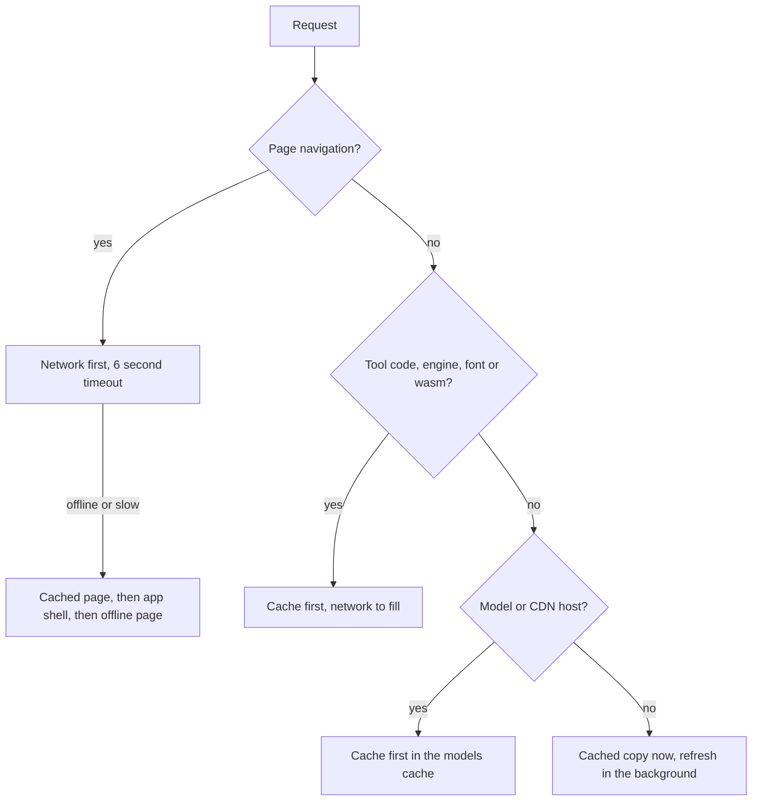

# Offline and PWA

OpenFile is a Progressive Web App. After your first visit it keeps working without a connection, and you can install it like any other app. This page explains exactly what is cached, when, and how to clear it.

## Check your device

::component device-check

## What gets cached

A service worker (`sw.js`) sits between the app and the network. It keeps four caches:

| Cache | What is in it | When it fills |
| --- | --- | --- |
| App shell | The start page, entry scripts and styles, icons, the manifest and an offline page | When the service worker installs, on your first visit |
| Assets | Tool code, fonts, WebAssembly engines and the self-hosted ffmpeg core | The first time you open each tool |
| Models | On-device AI models and OCR data fetched from model hosts and CDNs | The first time you run each AI or OCR tool |
| Share | Files another app shared to OpenFile, until the app reads them | When you use the share sheet |

So a tool works offline once you have opened it while online. Tools you have never opened still need a connection the first time.

::ffmpeg

## How requests are served

- Pages try the network first, so you see the newest version when you are online, and fall back to the cache after six seconds or when offline.
- Hashed assets, engines and models never change under the same URL, so they are served from the cache straight away.
- Video and audio seeking (range requests), the optional API routes and large demo videos always go to the network.

## Updates

When a new version is deployed, the new service worker downloads in the background and waits. A bar says **New version ready, reload**. Click it and the new version takes over in one step. Nothing changes under your feet while you work.

## How much space it uses

The app shell is a few MB. Everything else grows only with what you use: the ffmpeg core, OCR data and AI models are the large items. The live panel above shows your current usage, and [Settings](/settings) shows the size of the offline cache.

## Clearing data

:::tabs clear
@tab Inside OpenFile
Open [Settings](/settings), **Privacy & data**:

- **Clear offline cache** removes the cached app, engines and models. They download again when needed.
- Clear **favorites**, **recent tools** or **history** one by one, each with an undo.
@tab Chrome and Edge
1. Click the icon left of the address bar, then **Site settings** (Chrome) or **Cookies and site permissions** (Edge).
2. Click **Delete data** or **Clear data**.

This removes the caches, IndexedDB and local storage for OpenFile only.
@tab Firefox
1. Click the lock icon in the address bar.
2. Choose **Clear cookies and site data**.
@tab Safari
1. Safari, **Settings**, **Privacy**, **Manage Website Data**.
2. Search for the OpenFile site and click **Remove**.

On iPhone: Settings, Safari, Advanced, Website Data.
:::

> [!WARNING]
> Clearing site data also removes your favorites, history, saved Workspace recipes and settings. Export them first from Settings if you want to keep them.

## Private windows

Private and incognito windows can limit storage, so the offline cache, favorites and history may be gone when the window closes. The tools themselves work the same.
