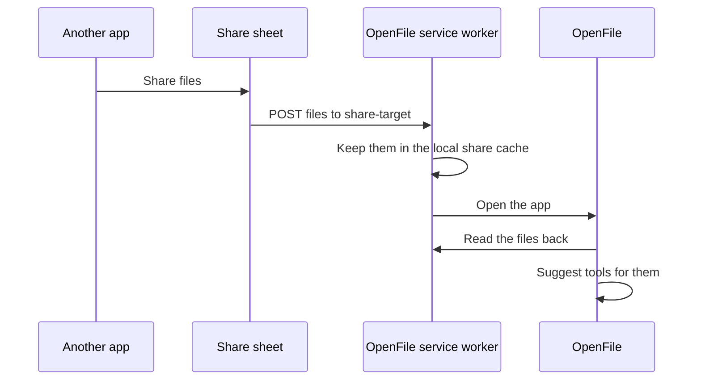

# Open with and share target

Once OpenFile is installed, your operating system treats it like a real app: you can open files with it from your file manager, and send files to it from other apps through the share sheet.

## Open with OpenFile

On Chrome and Edge for desktop, the installed web app registers as a handler for common file types. Right-click a file, choose **Open with**, then **OpenFile**, or set it as the default app for that type.

When a file arrives, OpenFile works out its real type and opens the best tool with the file already loaded. If it is not sure, it shows the **Drop anything** sheet so you can pick.

::file-handlers

The [Open page](/open) does the same in any browser: choose a file and OpenFile picks the tool.

## Share to OpenFile

On Android (and other systems that support web share targets), installed OpenFile appears in the system share sheet. Share a photo, PDF or document from your gallery, files app or another app, pick OpenFile, and the files open in the **Drop anything** sheet.

The files go from the other app into the service worker on your device and then into the page. They are never sent anywhere else, and the share cache is cleared on the next share.

::share-accept

## Desktop and Android apps

The Tauri desktop apps and the Android app include the full web build. Use your file manager's **Open with** for the desktop app. In the Android app, files you save go to **Downloads/OpenFile**.

## App shortcuts

Long-press the installed icon (or right-click it on desktop) for quick shortcuts:

::app-shortcuts

> [!NOTE]
> File handling and share targets are platform features. Safari and Firefox do not support them yet, so on those browsers use drag and drop or the [Open page](/open).
