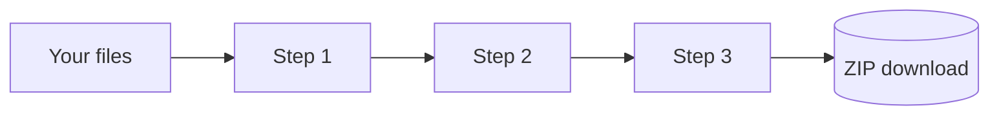

# Workspace pipelines and recipes

The [Workspace](/workspace) runs a chain of steps on as many files as you like: resize, watermark, convert and rename a few hundred photos, or merge, number and clean a pile of PDFs. It runs many files at once in Web Workers, entirely in your tab, and hands back a ZIP.

It has **{{STEP_COUNT}} steps** ({{IMAGE_STEP_COUNT}} for images, {{PDF_STEP_COUNT}} for PDFs, the rest for video, audio, data, archives and any file) and **{{PRESET_COUNT}} ready-made presets**. These numbers and the tables below come straight from the Workspace code, so they are always current.

## Try it here

This mini pipeline uses the real Workspace steps on a sample image drawn in your browser. Turn steps on or off, change a value, and run it.

::component pipeline-demo

## The studio at a glance

- **Canvas or list.** The canvas shows every step as a node. Drag the empty space to pan, use Ctrl and the mouse wheel or a pinch to zoom, and turn snap to grid on or off. Drag from the dot on the right of a step to another step to link them. Link one step to two others to branch, link two steps into one to merge. The list shows a straight pipeline you can reorder by dragging the handle or with Alt and the arrow keys.
- **Files a step does not understand pass straight through.** An image step leaves PDFs alone, so one pipeline can handle a mixed folder.
- **Live preview.** Select a step to open its settings. The preview runs the pipeline up to that step on one of your files and shows a before and after slider and the size change. Slow steps (video, OCR, AI) preview when you press Run.
- **Run engine.** Image steps run in a pool of Web Workers. Video, OCR and background removal share one engine, so they take one file at a time. You can pause, resume and cancel, see progress per file and overall with an estimate of the time left, and retry only the files that failed. A memory guard slows the run down before the tab runs out of memory. With **Keep the original when a result is bigger** on, a same-type result that did not get smaller is swapped for your original.
- **Inputs.** Drop files or whole folders, pick a folder, paste a screenshot or text with Ctrl and V, add a public file link (the other site must allow cross-site reads, CORS), or press Samples. ZIPs are unpacked when you add them, unless you switch that off. In Chrome and Edge, **Watch** keeps adding new files from a folder as they appear.
- **Recipes.** Save a pipeline by name, export it as JSON, import a JSON file, or copy a link that rebuilds it. The link holds only the steps and settings, never your files. Imported recipes and links are checked against the step list: unknown steps and settings are dropped, values are clamped, and loops are refused. Saved recipes show up in every open tab, and **Mirror this pipeline** keeps the current pipeline in step across your tabs.
- **Motion.** Animation starts from your system's reduced motion setting. The Off, Subtle and Full switch in the toolbar overrides it for the Workspace.

## Keyboard shortcuts

| Keys | Action |
| --- | --- |
| Ctrl + Enter | Run the pipeline |
| P | Pause or resume a run |
| Esc | Cancel a run, close panels |
| Ctrl + Z, Ctrl + Shift + Z | Undo, redo |
| Ctrl + S | Save the recipe |
| A | Search the step library |
| D, E, Delete | Duplicate, turn on or off, remove the selected step |
| Arrows | Move the selected step on the canvas |
| V, F | Switch canvas and list, fit the canvas |
| ? | Show all shortcuts |

## How a pipeline runs

Each step receives every file the previous step produced. Some steps change the number of files, for example **Merge all** turns many PDFs into one, so the order of steps matters.

::workspace-steps

::workspace-presets

::include legacy:workspace#Building a pipeline,Saving recipes,Tips

> [!NOTE]
> Saved recipes are kept in this browser's local storage and are included when you export your settings from [Settings](/settings), so you can move them to another device.
