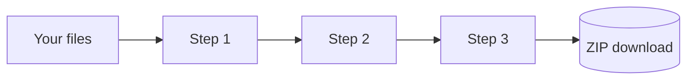

# Workspace pipelines and recipes

The [Workspace](/workspace) runs a chain of steps on as many files as you like: resize, watermark, convert and rename a few hundred photos, or merge, number and clean a pile of PDFs. It works one file and one step at a time, entirely in your tab, and hands back a ZIP.

It has **{{STEP_COUNT}} steps** ({{IMAGE_STEP_COUNT}} for images, {{PDF_STEP_COUNT}} for PDFs) and **{{PRESET_COUNT}} ready-made presets**. These numbers and the tables below come straight from the Workspace code, so they are always current.

## Try it here

This mini pipeline uses the real Workspace steps on a sample image drawn in your browser. Turn steps on or off, change a value, and run it.

::component pipeline-demo

## How a pipeline runs

Each step receives every file the previous step produced. Some steps change the number of files, for example **Merge all** turns many PDFs into one, so the order of steps matters.

::workspace-steps

::workspace-presets

::include legacy:workspace#Modes,Building a pipeline,Saving recipes,Tips

> [!NOTE]
> Saved recipes are kept in this browser's local storage and are included when you export your settings from [Settings](/settings), so you can move them to another device.
